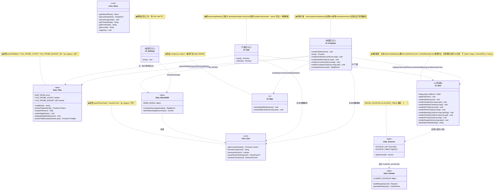
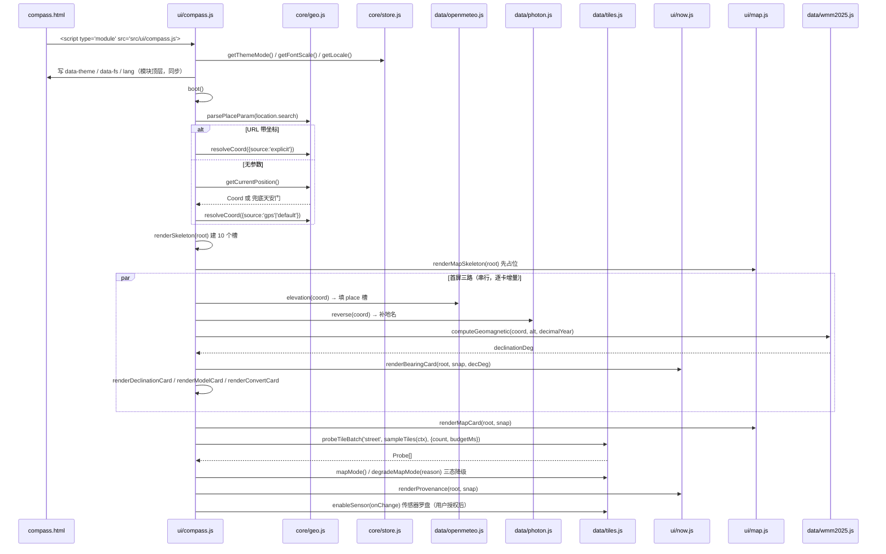
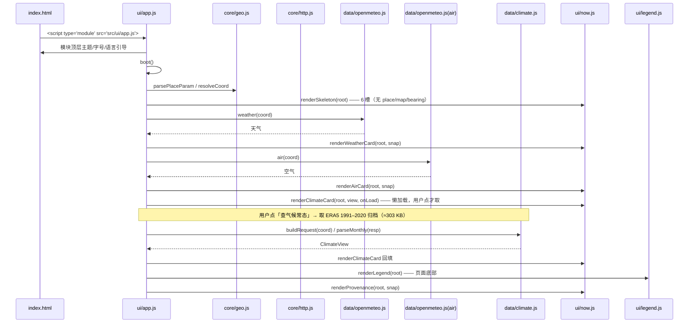
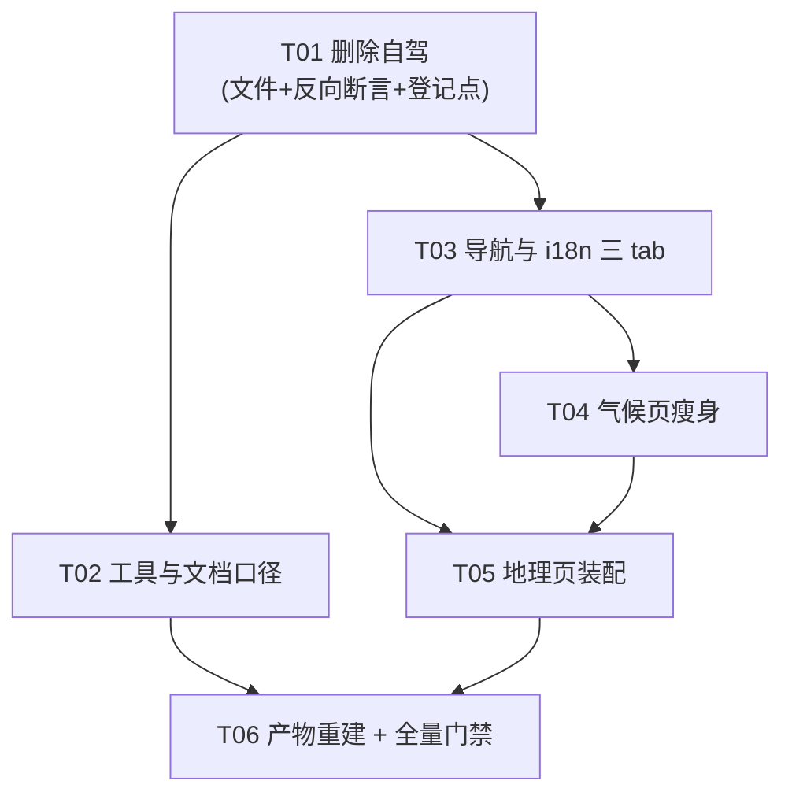

# 途候 WayScope —— 导航重构 + 自驾删除：增量架构设计与任务分解

> 作者：高见远（Gao）· 架构师
> 版本：v1（增量设计，建立在 `docs/stage1-architecture.md` 之上）
> 日期：2026-10-17
> 状态：**设计稿，待主理人拍板**。本文只描述「要怎么改」，不含已落地的代码。
>
> ★章节号是本文件的**跨组契约**：只追加、不重排。src 注释里若引用本文编号（形如
> `docs/nav-restructure-architecture.md §3.2`），改动前先打招呼。
>
> 已拍板的三个决定（来自主理人）：
> - **决定 A**：底部导航改成 3 个主 tab —— 地理 / 气候 / 我的。
> - **决定 B**：自驾代码彻底删干净（零死代码，git 可恢复）。
> - **决定 C**：本次发布带上气候常态（v44 内容）。
>
> **2026-10-26 修订（真机裁定，用户已拍板）**：地理页的「方位 · 磁偏角」概览卡
> （`ui/now.js` 的 `renderBearingCard`）**删除**，不是搬迁 —— 它与紧邻的磁偏角详情卡
> 在同一屏把同一个数（西偏 7.60°）说了两遍；其免责声明 `compass.calcNote` 详情卡里
> 本来就有，删它不丢内容；它那颗「看下方完整罗盘」按钮锚点指向 `#card-declination`
> （磁偏角详情卡，不是罗盘卡），标签与目标本身就不一致。
> 连带影响（本文档以下章节按本条为准）：
> - 地理页槽位契约由 9 槽变 8 槽：去掉 `bearing`
>   （`header→search→place→map→declination→model→convert→compass→prov`）；
> - `renderBearingCard` 的导出与 `geo.bearingBtn` / `now.bearingBtn` 两条文案一并删除；
> - **保留 `compass.title` 这个 i18n key**（即使已不上屏）：`tools/check.mjs` §16 拿它做
>   页头宽度的保守上界，删了会让该节静默退化成守一个英文字符串（详见该文件注释）。

---

## 0. 摘要（给主理人的三页纸）

### 0.1 页面归属方案（一句话）

**不新建任何 HTML。复用 `compass.html` 改造为「地理」页，复用 `index.html` 改造为「气候」页，`settings.html` 保持「我的」。** 最终手写页面从 6 个降到 5 个（删 `roadtrip.html`），三 tab 指向 `compass.html` / `index.html` / `settings.html`。

| tab | 指向 | 装什么 |
|---|---|---|
| 地理 | `compass.html`（改造） | 地点卡（海拔 / 坐标 / 地名）+ 底图（Esri）+ 方位·磁偏角卡 + **完整罗盘（真/磁换算 + 传感器罗盘 + 模型卡）** |
| 气候 | `index.html`（改造） | 搜索 + 此刻天气 + 此刻空气 + **气候常态（1991–2020 月/年平均）** + 来源说明 + 指标释义 |
| 我的 | `settings.html`（改造） | 设置（主题 / 字号 / 语言 / 备份导出导入）+ 自检入口 + 对比入口 |

**地理页是新页面还是复用现有页面？→ 复用/改造 `compass.html`，不新建 `geo.html`。**
两条路线的代价对比见 §2.1，结论一句话：`geo.html` 路线要白走一遍「新增页面的 7 处登记点」，还要把罗盘拆成「地理页 → 罗盘子页」两级跳；`compass.html` 路线零新增登记点，且三 tab 的 href 正好是 `compass|index|settings`——与 `build-standalone.mjs` 现有 nav 正则、`verify-standalone.mjs` 现有死链断言**完全吻合，两个工具几乎零改动**。

**`compare.html` 归属**：保留为**子页**（本来就无 tabbar），入口留在「我的」页现有的对比卡。理由：tabbar 4 个是安全上限、5 个必撑破（真机 320px 已出过断行），三主 tab 保持不变。

### 0.2 文件清单（三类）

- **删除 21 个文件**：自驾页面 1 + 自驾源码 9 + 自驾测试 8 + OSRM 夹具 3。另 `docs/roadtrip-architecture.md` 建议**保留并加归档声明**（见 §2.5，删除有连带风险）。
- **修改 17 个文件**：4 个 HTML 外壳 + 8 个 src 模块 + 2 张 i18n 表 + 3 个工具/测试登记点（详见 §5 的 T 任务）。
- **新增 0 个文件**。

### 0.3 数据结构与接口契约（重点回答）

- **`now.js` 自检闭包红线**：把「地理」渲染拆出去**不会**破坏红线。`now.js` 继续**只做纯渲染**、继续**不 import** `core/mag.js` / `data/wmm2025.js` / `ui/map.js`，因此 `selfcheck-standalone.html` 的依赖闭包**模块数与体积都不变**（基线仍是 27 模块 / 461.0 KB）。
- **`map.js`（20.3 KB）会不会被拖进单文件产物？** **不会。** 它从 `app.js`（气候入口）移除、改由 `compass.js`（地理入口）import；而 `compass.js` 不在 `src/ui/selfcheck.js` 的依赖闭包内，`build-standalone.mjs` 的 `ORDER` 也**继续不登记** `src/ui/map.js`。
- **`mag.js`（26.6 KB）/ `wmm2025.js`（9.5 KB）会不会？** **不会，而且比今天更干净**：今天 `app.js` 为了那张方位卡 import 了 `declinationDegAt`；改后气候页不再显示磁偏角，这条 import 一并删除，WMM 只剩 `compass.js`（地理入口）与 `settings.js` 两个消费者。
- 关键接口变更清单见 §4.3，槽位顺序变更见 §4.4。

### 0.4 任务列表（有序）

T01 删除自驾（先删后改，避免改到一半又删）→ T02 登记点与工具同步 → T03 导航与 i18n → T04 气候页瘦身 → T05 地理页装配 → T06 产物重建与全量门禁。详见 §6。

### 0.5 风险与待确认

4 条待确认（§7）：`SOURCE_TABLE` 口径是 7 路不是 6 路；`docs/roadtrip-architecture.md` 留不留；`probeTileBatch` 迁移位置；地理页是否保留「完整罗盘」同页展示（还是折叠）。4 条风险（§8）。

---

## 1. 实现思路

### 1.1 这次改动的三个难点

| # | 难点 | 处理办法 |
|---|---|---|
| 1 | **页面归属变化，但仓里没有 SPA 路由**：四个独立 HTML 靠 `<a href>` 跳，跨页传参走 URL query。砍掉一个页面 = 每个带 tabbar 的页面都得改一遍 href，漏一处就是死链 | 用「7 处页面登记点」清单（§3.1）逐项核对；`check.mjs` §15 做 tabbar 覆盖断言兜底 |
| 2 | **自驾散落在 10 个源码文件 + 8 个测试 + 3 个夹具 + 10 个工具/登记点里**，且 `check.mjs` 里有**两条反向断言**（§19 禁 `listTrips`、§20 钉 OSRM 体积数字 4 个数）钉着被删文件——删完文件这两条会自己变红 | 删除任务 T01 里把「删文件」与「删反向断言」绑成同一批，不允许分两次提交 |
| 3 | **地理页要装下「地点 + 底图 + 方位 + 完整罗盘」四块，而它们的渲染函数今天分散在 `now.js` / `map.js` / `compass.js`**。最省事的写法是让地理页 import `app.js`——但 `app.js` 是入口模块，顶层有主题/字号/语言三处 DOM 引导副作用，且会把整个气候页闭包拖进地理页 | 拆两条骨架（§4.4）：气候页用 `now.js` 的骨架（瘦身），地理页用 `compass.js` 的骨架（扩展）。共用卡片函数从 `now.js` 导出（纯渲染、无副作用），`map.js` 只被地理入口 import |
| 4 | **单文件产物 `selfcheck-standalone.html`** 有一个 nav 替换正则只 cover `index\|compass\|settings`，且残留一条 `roadtrip.html` 死链 | 本次三 tab 正好落在这三个名字上 → 正则**不用改**；死链靠 T06 重新 `build-standalone` 消失 |

### 1.2 架构模式（不变）

沿用既有的四层单向依赖与「零构建原生 PWA」：

```
src/core  ←  src/data  ←  src/ui  ←  html 外壳
```

硬规则（勿回退）：
1. `core/**` 严禁 import `data/**`；`core/**` 严禁 import `src/i18n/**`（core 不翻译，只回 `reasonKey`）。
2. UI 层负责翻译；模块级常量禁止 `label: t('...')`，一律 `labelKey` + 惰性 getter。
3. 无 npm / 无 CDN / 无后端 / 无打包器；外部请求只能是浏览器直连数据源，且宿主必须在 `tools/check.mjs` 的 `ALLOWED_HOSTS` 里。
4. 页面级引导（主题 / 字号 / 语言）必须在**模块顶层**执行，不能等 `boot()`。

### 1.3 为什么「地理页」选定 `compass.html` 而不是新建 `geo.html`

见 §2.1 的完整代价对比。核心三条：

1. **登记点成本**：新增一个 HTML 要过 7 处登记（HTML 骨架本身、`sw.js` 的 `SHELL_ASSETS`、`tests/static.test.mjs` 的 `runtimeFiles`、`check.mjs` 的 `ENTRY_OF_PAGE`、`check.mjs` 的 `PAGES`、`check.mjs` 的 `MAIN_TABS`、带 tabbar 页面里的 href）。改造 `compass.html` 只需做 `roadtrip.html` 的**反向清理**，零新增。
2. **工具成本**：`build-standalone.mjs` 的 nav 替换正则与 `verify-standalone.mjs` 的三条死链断言，今天正好覆盖 `compass|index|settings`。改造路线下这两个工具**一行都不用改**；新建 `geo.html` 则要同时改正则与补断言。
3. **产品成本**：`compass.html` 里已经是完整罗盘（磁偏角大号数字、模型卡、真/磁换算卡、传感器罗盘卡）。改造后「地理页 = 地点 + 底图 + 方位卡 + 完整罗盘」一页装完，「进完整罗盘的入口」这个二级跳**自然消失**；新建 `geo.html` 则会把罗盘推成子页，用户多点一次。

**唯一反悔条件**：产品坚持「地理页只放数字卡、罗盘必须独立成页」——那才走 Route 1。

---

## 2. 页面归属总表

### 2.1 两条路线代价对比

| 项 | Route 1：新建 `geo.html` | Route 2：改造 `compass.html`（**采用**） |
|---|---|---|
| 新增 HTML 文件 | +1（要复刻 head 里的无障碍字号预置脚本、banner、app、footer、tabbar 全套骨架） | 0 |
| 7 处登记点 | 新增侧全走一遍 | 0 新增，只做 `roadtrip` 的反向清理 |
| `compass.html` 处置 | 保留为独立罗盘子页 → 地理页还要再放一个「进完整罗盘」入口，形成两级跳 | 本身就是地理页，入口消失 |
| `build-standalone.mjs` nav 正则 | 需把 `geo` / `climate` 加进 `(?:index\|compass\|settings)` | **不用改**（三 tab 已被覆盖） |
| `verify-standalone.mjs` 死链断言 | 需新增 `geo.html` / `climate.html` 两条 | **不用改**（现有三条正好是三 tab） |
| 罗盘代码复用 | 0（罗盘留在 `compass.js`，地理页另写一套入口） | 100% |
| 净文件变动 | 约 +1 / −1 | 约 −1 |
| 综合风险 | 高 | **低** |

### 2.2 最终页面清单（5 个手写 + 1 个生成产物）

| 文件 | 角色 | 是否在主 tabbar | 入口 JS | tabbar 三 tab |
|---|---|---|---|---|
| `index.html` | **气候**页（此刻 + 气候常态） | ✅ 第 2 个 tab | `src/ui/app.js` | 地理 / **气候(active)** / 我的 |
| `compass.html` | **地理**页（地点 + 底图 + 方位·磁偏角 + 完整罗盘） | ✅ 第 1 个 tab | `src/ui/compass.js` | **地理(active)** / 气候 / 我的 |
| `settings.html` | **我的**页 | ✅ 第 3 个 tab | `src/ui/settings.js` | 地理 / 气候 / **我的(active)** |
| `selfcheck.html` | 数据源自检（子页） | ❌ 不在 tab，但自身带 tabbar 方便返回 | `src/ui/selfcheck.js` | 地理 / 气候 / 我的（**无 active**） |
| `compare.html` | 多地点对比（子页） | ❌ 无 tabbar，从「我的」页进 | `src/ui/compare.js` | — |
| `roadtrip.html` | — | — | — | **删除** |
| `selfcheck-standalone.html` | 生成产物（发给手机的单文件版） | 自带 tabbar | 内联 `src/ui/selfcheck.js` | 由 build 时替换 |

> **`selfcheck.html` / `compare.html` 的 tabbar 说明**：`selfcheck.html` 保留 tabbar 但不设 `tab--active`（它是子页，不属于三主 tab 之一）——今天它就是这样，保持不变。`compare.html` 今天**没有** tabbar，保持不变。

### 2.3 地理页（`compass.html`）装什么 —— 卡序

```
[页头]  地点名 + 坐标 + 更新时间
[search]  地点搜索（placesearch）
[place]   地点卡：海拔（m）+ 坐标（度分秒 / 小数）+ 地名（逆地理）
[map]     底图卡：Esri 瓦片，三态降级（live / grid / no-map）
[bearing] 方位·磁偏角卡：磁偏角一个数 + 进完整罗盘的同页锚点
[declination] 磁偏角大号数字（现有 renderDeclinationCard）
[model]      模型卡：WMM2025 版本 / 有效期 / 是否超期（现有 renderModelCard）
[convert]    真↔磁换算（现有 renderConvertCard）
[compass]    传感器罗盘（现有 renderCompassCard）
[prov]       来源说明
```

> ★槽位顺序由**首次 `appendChild` 的先后**决定，建错位置就再也挪不回去。`compass.js` 现有的 `renderSkeleton()`（line 693）已建 declination / model / convert / compass 四个槽，改造时只需在**最前面**插入 `search` / `place` / `map` / `bearing`，在最后补 `prov`。

### 2.4 气候页（`index.html`）装什么 —— 卡序（瘦身后的 `now.js` 骨架）

```
[页头]  地点名 + 时间
[search]   地点搜索
[weather]  此刻天气
[air]      此刻空气
[climate]  气候常态（1991–2020 月/年平均，ERA5）—— 决定 C 带上
[prov]     来源说明
[legend]   指标释义（页面底部）
```

**移走的三块**：`place`（地点卡）、`map`（底图卡）、`bearing`（方位卡）→ 全部归地理页。
> ⚠️ `place` 槽移除后，气候页的页头仍需显示地点名与坐标——`renderHeader()` 保留，不要一起删。

### 2.5 `docs/roadtrip-architecture.md` 留不留（待确认 Q2）

**建议：保留文件，在文件头加一段「已归档」声明**。理由：`tools/check.mjs` §18 把它的章节号定为**跨组契约**并逐条校验 `src/**` 注释里的 `§N` 引用；而下面 4 个**不会被删除**的存活文件里仍有 `§N` 引用挂在它身上：

| 文件:行 | 引用 |
|---|---|
| `src/core/geo.js:11` | 「架构 §2.2」 |
| `src/data/sources.js:8` | 「架构 §3.2」 |
| `src/ui/app.js:240` | 「架构 §4.1」 |
| `src/ui/map.js:58` | 「架构 §7 T05」 |

删掉文档会让 §18 直接读文件失败。若要坚持删除，必须一并做完 4 条连带改动（拆到 T02）：
1. `tools/check.mjs:2070` 的 `ARCH_DOC` 改指向新文档，且新文档的编号标题**不许有重号**（§18 会数重号）；
2. 上表 4 处注释改写为指向 `docs/stage1-architecture.md` 的对应小节（需人工确认那一侧真有对应编号，否则 §18 报「引用了不存在的编号」）；
3. `tests/fixtures/README.md:46` 对它的引用删除；
4. `tools/check.mjs:2051 / 2056 / 2187` 三处提到它的注释文字更新。

代价明显大于收益 → **采用「保留 + 归档声明」**。

---

## 3. 删除范围与登记点

### 3.1 「7 处页面登记点」清单（增删页面都要过一遍）

| # | 登记点 | 文件 | 本次动作 |
|---|---|---|---|
| 1 | HTML 外壳本身 | `*.html` | 删 `roadtrip.html`；其余 4 个改 tabbar |
| 2 | 离线壳预缓存 | `sw.js` `SHELL_ASSETS` | 删 10 项自驾资产 → 跑 `bump-shell.mjs` |
| 3 | 运行时资源双向一致 | `tests/static.test.mjs` `runtimeFiles` | 删 10 项 + 删「自驾模块（T01/T02）」注释 |
| 4 | 页面 → 入口模块 | `tools/check.mjs` `ENTRY_OF_PAGE` | 删 `roadtrip.html` 一行及其注释 |
| 5 | 需要离线可用的页面 | `tools/check.mjs` `PAGES` | 去 `roadtrip.html`（5 → 4） |
| 6 | 主导航三 tab | `tools/check.mjs` `MAIN_TABS` | 改为 `['compass.html', 'index.html', 'settings.html']` |
| 7 | 单文件产物依赖闭包 | `tools/build-standalone.mjs` `ORDER` | 删 4 项（apikeys / osrm / amap / roadsources）及注释 |

> 附带的第 8 处（非登记点但会红）：`tools/check.mjs` 的 `ALLOWED_HOSTS`（第 52–64 行）含 `router.project-osrm.org` 与 `restapi.amap.com` → 必须删，否则第 7 节「白名单外外链」与隐私红线报红。

### 3.2 删除清单（21 个文件）

**页面（1）**
```
roadtrip.html
```

**源码（9）**
```
src/ui/roadtrip.js        自驾页入口与装配
src/ui/poilist.js         候选列表
src/ui/roadmap.js         自驾路线图
src/core/roadtrip.js      路线切段 / 行程模型
src/core/tripstore.js     行程持久化（含废弃的 listTrips）
src/core/apikeys.js       高德 Key 的「孤儿存储」
src/data/osrm.js          OSRM 路线规划源
src/data/amap.js          高德 POI 源
src/data/roadsources.js   ROAD_SOURCES 源表
```

**测试（8）**
```
tests/roadtrip-model.test.mjs
tests/roadtrip-map.test.mjs
tests/roadtrip-coord-guard.test.mjs
tests/roadtrip-ui.test.mjs
tests/roadtrip-filter.test.mjs
tests/roadtrip-plan.test.mjs
tests/roadtrip-deviation.test.mjs
tests/roadtrip-sources.test.mjs
```

**夹具（3）**
```
tests/fixtures/osrm-cd-xian.json
tests/fixtures/osrm-cd-hanzhong-xian.json
tests/fixtures/osrm-xian-luoyang.json
```
> ⚠️ `tests/fixtures/README.md` 里「OSRM 路线夹具」整节（含 line 46 对 `docs/roadtrip-architecture.md` §4.4.1 的引用）一并删。`tests/fixtures/climate-bj-1991-2020.json` **保留**。

### 3.3 必须同时删掉的「反向断言」（否则删完文件反而变红）

| 位置 | 内容 | 为什么必须删 |
|---|---|---|
| `tools/check.mjs` §19（约 2139–2176 行） | 禁 `\blistTrips\b`（豁免 `src/core/tripstore.js`） | `tripstore.js` 被删，整块失去意义；且「豁免文件不存在」会让 `read(rel)` 直接抛 |
| `tools/check.mjs` §20（约 2178–2224 行） | 反向钉「`src/data/osrm.js` 仍持有 134 / 137 / 299 / 537 KB 四个数字」 | `osrm.js` 被删 → 这条**反向断言必然变红**；「不许在别处抄」那条也随之失去出处 |
| `tools/check.mjs` `ALLOWED_HOSTS`（52–64 行） | `router.project-osrm.org`、`restapi.amap.com` | 同上，白名单外/隐私红线 |
| `tests/sources.test.mjs` `allowed`（约 111 行） | 同上两个宿主 | 同上 |
| `tests/sources.test.mjs` `enumMap`（约 176–179 行） | `"rt.type.": ['stay','sight','food']` | 对应 i18n key 将被删 |
| `tests/theme-entry.test.mjs` `ENTRIES`（约 61 行） | `{ page: 'roadtrip.html', entry: '../src/ui/roadtrip.js' }` | 文件不存在 → 测试报错 |

### 3.4 必须改数字的断言

| 位置 | 现况 | 改成 |
|---|---|---|
| `tests/climate.test.mjs` ⑥（约 389–406 行） | `assert.equal(Object.keys(SOURCE_TABLE).length, 9)` | **`7`**（见 Q1） |
| 同上（404–405 行） | `assert.ok(SOURCE_TABLE.osrmRoute)` / `assert.ok(SOURCE_TABLE.amapPoi)` | 删除这两条 |
| `tools/verify-standalone.mjs` 第 107 行注释 | 提到「自驾两路进 SOURCE_TABLE」 | 顺手更新为「气候常态进 SOURCE_TABLE」 |

### 3.5 不需要动的地方（避免工程师做无用功）

| 文件 | 结论 | 依据 |
|---|---|---|
| `styles/app.css` | **无需删任何自驾样式** | 全仓 grep 无 `.rt-` / `.poi-` / `.route-` / `.trip-` / `.amap` / `.osrm` 真实类（唯一命中 `pointer` 是假阳性）。只需保证**不新增 `color:` 声明** |
| `src/core/store.js` | **无需改** | 只 import `./cache.js` / `./geo.js`，不引用 tripstore / roadtrip |
| `manifest.webmanifest` | **无需改** | `start_url` 仍是 `index.html`（气候页沿用原文件名） |
| `tools/smoke.mjs` | **无需改** | 第 335 行钉的是 `SOURCE_LIST` 六路顺序，不变；无 roadtrip 引用 |
| `tools/build-standalone.mjs` 的 nav 正则 | **无需改** | 三 tab 正好是 `compass\|index\|settings`，已被覆盖 |
| `tools/verify-standalone.mjs` 的死链断言 | **无需改** | 现有三条（compass / settings / index）正好是三 tab |
| `src/ui/map.js` | 保留，**继续不进 `ORDER`** | 它在产物闭包外，是地理页在用的真模块 |
| `tools/build-standalone.mjs` 第 84–89 行注释 | 需**改一句话**：「只被 `src/ui/app.js:52`（『此刻』页）import」→ 改成「只被 `src/ui/compass.js`（地理页）import」 | 注释失真，check 看不见但人会看错 |

---

## 4. 数据结构与接口契约

### 4.1 类图（本次改动涉及的模块与关系）



### 4.2 关键数据流：快照对象（`Snapshot`）

本次**不改** `Snapshot` 的字段集合，只改「谁消费哪些字段」：

| 字段 | 气候页（`app.js`） | 地理页（`compass.js`） |
|---|---|---|
| `coord` / `placeName` / `elevationM` | 页头显示（不再单独成卡） | **地点卡主体** |
| `weather` / `air` | 天气卡 / 空气卡 | 不消费 |
| `climate` | 气候常态卡 | 不消费 |
| `declinationDeg` | 不再消费 | 方位卡 + 磁偏角大号数字 |

### 4.3 接口变更清单（工程师照此施工）

| 符号 | 现位置 | 变更后 | 说明 |
|---|---|---|---|
| `renderSkeleton(root)` | `ui/now.js:169` | **改** | 槽位顺序 `search→weather→air→place→climate→map→bearing→prov→legend` 改为 **`search→weather→air→climate→prov→legend`** |
| `renderSnapshot(root, snap, opts)` | `ui/now.js:1076` | **改** | 不再调 `renderPlaceCard` / `renderBearingCard`；`opts.declinationDeg` 参数随之无意义，从 JSDoc 里移除 |
| `renderPlaceCard(root, snap)` | `ui/now.js:701` | **保留导出** | 气候页不再自调；由地理页 import |
| `renderBearingCard(root, snap, decDeg)` | `ui/now.js:945` | **删除**（2026-10-26 修订） | 磁偏角数值一屏重复两遍；见本文开头「2026-10-26 修订」 |
| `renderClimateCard(root, view, onLoad)` | `ui/now.js:741` | 不变 | 决定 C 带上 |
| `declinationText(decDeg)` | `ui/now.js:918` | 不变 | 三处共用（地理页 / 设置页 / 原此刻页） |
| `renderSkeleton(root)` | `ui/compass.js:693` | **改** | 前置 `search`/`place`/`map`/`bearing`，末尾补 `prov` |
| `boot()` | `ui/compass.js:820` | **改** | 新增：elevation / reverse 拉取 + `probeTileBatch` 瓦片探测 + `degradeMapMode` 三态降级编排 |
| `probeTileBatch(styleId, tiles, opts)` | `ui/app.js:329` | **迁** → `src/data/tiles.js` | 两页共用；data 层不违反依赖方向（见 Q3） |
| `TILE_PROBE_COUNT = 3` | `ui/app.js:89` | **迁** → `src/data/tiles.js` | 同上 |
| `TILE_PROBE_BUDGET_MS = 8000` | `ui/app.js:106` | **迁** → `src/data/tiles.js` | 同上 |
| `parsePlaceParam(search)` | `ui/app.js:606` | **迁** → `src/core/geo.js` | 两页共用；geo.js 已在全部登记点内，零新增登记 |
| `resolveCoord(coord)` | `ui/app.js:657` | **迁** → `src/core/geo.js` | 同上 |
| `renderMapCard` / `renderMapSkeleton` | `ui/map.js` | 不变 | import 方从 `app.js` 改为 `compass.js` |
| `declinationDegAt` 的 import | `ui/app.js:52` | **删** | 气候页不再显示磁偏角 |

> ★**零新增文件原则**：上面 5 个符号的迁移全部落进**已登记**的 `src/core/geo.js` 与 `src/data/tiles.js`，因此 7 处登记点一个都不用为新文件操心。

### 4.4 槽位顺序契约（最容易踩的坑）

```
气候页 now.js renderSkeleton：
  header → search → weather → air → climate → prov → legend

地理页 compass.js renderSkeleton：
  header → search → place → map → bearing → declination → model → convert → compass → prov
```

硬规则：**槽位顺序由首次 `appendChild` 决定，建错位置就再也挪不回去。** 工程师改这两处时必须在骨架函数里一口气按上表顺序建完，不要用「先建 climate 再插 place」的补建写法。

### 4.5 时序图：地理页首屏（T05 的验收对象）



### 4.6 时序图：气候页首屏（瘦身后的 T04）



### 4.7 单文件产物闭包边界（回答主理人的重点问题）

```
src/ui/selfcheck.js 的依赖闭包（build-standalone ORDER）：
  ✅ now.js          在闭包内（自检页要用它的渲染与 h()）
  ❌ compass.js      不在 → 地理页装的 map.js / wmm2025.js / mag.js 一律进不来
  ❌ map.js          不在（ORDER 故意不登记）
  ❌ wmm2025.js      不在（只被 compass.js / settings.js import）
  ❌ core/mag.js     不在（wmm2025.js 的底层依赖，跟着一起在闭包外）
  ❌ app.js          不在（气候页入口）
```

**结论**：本次改动后 `selfcheck-standalone.html` 的模块数与体积**预期与基线一致（27 模块 / 461.0 KB）**。T06 的验收标准就是它不许变大。

`now.js` 三条红线（继续保持，勿回退）：
1. 不 import `core/mag.js`；
2. 不 import `data/wmm2025.js`；
3. 不发起任何网络请求（纯渲染）。

新增的第 4 条（本次引入）：**不 import `ui/map.js`** —— 反方向依赖会成环（`map.js` 要用 `now.js` 的 `h()`）。

---

## 5. 文件清单（新增 / 修改 / 删除）

### 5.1 新增

**无。**

### 5.2 修改（17 个）

**HTML 外壳（4）**

| 文件 | 动作 |
|---|---|
| `index.html` | tabbar 三 tab：删 `roadtrip.html` 项；自身 label 由 `tab.now` 改 `tab.climate`；新增地理 tab 指向 `compass.html`（排在首位，非 active）；`<title>` / `desc` 同步；`body data-page="now"` 建议改为 `data-page="climate"` |
| `compass.html` | tabbar 三 tab：自身（地理，`tab.geo`，active）/ `index.html`（气候）/ `settings.html`（我的）；`<title>` 改「地理」；desc 由 `desc.compass` 改 `desc.geo`；`data-page="compass"` 建议改 `data-page="geo"` |
| `settings.html` | tabbar 同上（自身 active）；删自驾 tab |
| `selfcheck.html` | tabbar 同上（**无 active**） |

**src 模块（8）**

| 文件 | 动作 |
|---|---|
| `src/ui/app.js` | 删 `renderPlaceCard` / `renderBearingCard` / `renderMapSkeleton` / `renderMapCard` 的使用与 import；删 `declinationDegAt` import；迁出 `probeTileBatch` / `TILE_PROBE_COUNT` / `TILE_PROBE_BUDGET_MS` / `parsePlaceParam` / `resolveCoord`；更新文件头注释（`now.js` 红线那段要写清新边界） |
| `src/ui/now.js` | `renderSkeleton` 瘦身；`renderSnapshot` 去掉 place/bearing；保留 `renderPlaceCard` / `renderBearingCard` 导出并补注释说明「供地理页复用」 |
| `src/ui/compass.js` | 骨架扩展（4 个前置槽 + prov）；`boot()` 新增 elevation / reverse / 瓦片探测 / 三态降级编排；import `renderPlaceCard` / `renderBearingCard`（from `./now.js`）与 `renderMapCard` / `renderMapSkeleton`（from `./map.js`） |
| `src/ui/map.js` | 仅改文件头注释里「被 app.js import」的说法 → `compass.js` |
| `src/ui/settings.js` | 删自驾入口卡（约 622–634 行：`rt.entry` / `rt.entryHint` / `rt.entryBtn` 三处 `t()` 与那个 `<a href="roadtrip.html">`）；对比入口卡**保留** |
| `src/data/sources.js` | 删 line 57 `import { ROAD_SOURCES } from './roadsources.js';`；line 236 的 `SOURCE_TABLE` 去掉 `...ROAD_SOURCES`（保留 `...CLIMATE_SOURCES`） |
| `src/core/geo.js` | **承接** `parsePlaceParam` / `resolveCoord` |
| `src/data/tiles.js` | **承接** `probeTileBatch` / `TILE_PROBE_COUNT` / `TILE_PROBE_BUDGET_MS` |

> 附带清理（不改逻辑，只清陈旧注释）：
> - `src/data/climate.js:7` 与 `:359` 提到 `data/roadsources.js` → 改写（该文件将被删）
> - `src/i18n/zh.js:984` / `src/i18n/en.js:1013` 注释提到 `core/roadtrip.js` / `core/tripstore.js` → 删除该句

**i18n（2）**

| 文件 | 动作（**zh / en 必须成对增删**） |
|---|---|
| `src/i18n/zh.js` | **删**：全部 `rt.*` 前缀键（实测量 **164 条**，含 `rt.type.stay/sight/food`、`rt.amap.*`、`rt.err.*`、`rt.entry` / `rt.entryHint` / `rt.entryBtn` 等）、`tab.roadtrip`、`desc.roadtrip`、`attr.osrm`（784）、`attr.amap`（785）、`source.osrmRoute`（788）、`source.amapPoi`（789）。**增**：`tab.geo`（地理）、`tab.climate`（气候）、`desc.geo`。**保留**：`tab.now` / `tab.selfcheck` / `tab.compass` / `tab.settings`（它们仍被别处引用，不要误删） |
| `src/i18n/en.js` | 同上，逐条对拍 |

**工具 / 测试登记点（3 + 若干）**

| 文件 | 动作 |
|---|---|
| `sw.js` | `SHELL_ASSETS` 删 10 项自驾资产；随后跑 `node tools/bump-shell.mjs` 更新 `SHELL_CACHE` 与 `SHELL_FINGERPRINT` |
| `tools/check.mjs` | `ALLOWED_HOSTS` 删 2 个宿主；`ENTRY_OF_PAGE` 删 roadtrip 一行 + 注释；`PAGES` 去 roadtrip；`MAIN_TABS` 改 `['compass.html','index.html','settings.html']` + 重写那段「三个 tab」的说明注释；§15 循环的 `PAGES.length + 2` 随 PAGES 变短而变（`PAGES` 5→4，标题断言跟着变，工程师照跑一次看输出即可）；**整块删 §19 与 §20** |
| `tools/build-standalone.mjs` | `ORDER` 删 `src/core/apikeys.js`、`src/data/osrm.js`、`src/data/amap.js`、`src/data/roadsources.js` 及「自驾三件套」注释；改第 84–89 行 map.js 注释里的 import 方 |
| `tests/static.test.mjs` | `runtimeFiles` 删 10 项 + 删「自驾模块（T01/T02）」注释段（154–156 行） |
| `tests/sources.test.mjs` | `allowed` 删 2 个宿主；`enumMap` 删 `"rt.type."` 一条 |
| `tests/theme-entry.test.mjs` | `ENTRIES` 删 roadtrip 一行（compare / compass 保留） |
| `tests/climate.test.mjs` | `SOURCE_TABLE` 长度 9 → **7**；删 `osrmRoute` / `amapPoi` 两条断言 |
| `tests/tile-budget.test.mjs` | import 从 `../src/ui/app.js` 改为 `../src/data/tiles.js`（取 `probeTileBatch` / `TILE_PROBE_COUNT` / `TILE_PROBE_BUDGET_MS`） |
| `tests/mapmode.test.mjs` | 第 68 行读 `src/ui/app.js` 改为读 `src/data/tiles.js`（那三条断言瞄的是 `probeTileBatch` / `count: TILE_PROBE_COUNT` / `TILE_PROBE_COUNT = 3`）；第 113 行仍读 `app.js` 的**保留** |
| `tests/favorites.test.mjs` / `tests/place-search.test.mjs` | `app.parsePlaceParam` / `app.resolveCoord` 的 import 路径改为 `../src/core/geo.js`（沿用 `app.` 命名空间别名即可，调用点不动） |
| `README.md` | line 7 与 line 217 关于「自驾两路」的表述 → 改为「七路 = 六路环境数据源（`SOURCE_LIST`）+ 气候常态一路（`CLIMATE_SOURCES`）」 |
| `docs/roadtrip-architecture.md` | 文件头加「已归档」声明（见 §2.5 / Q2） |

### 5.3 删除（21 个）

见 §3.2 完整清单。

---

## 6. 任务分解（有序，按依赖）

> **执行纪律**
> 1. **删除任务必须排在修改任务之前**（T01 先于一切）——否则会出现「改到一半的文件又要删」的返工。
> 2. 每个任务结束时必须全绿：`node --test tests/*.test.mjs`（**必须带 glob**）+ `node tools/check.mjs`。
> 3. 任一任务改了 `sw.js` / `src/**` / `styles/**` / `*.html` 之一，收尾必须跑 `node tools/bump-shell.mjs`。
> 4. T06 之前不许碰 `selfcheck-standalone.html`（它是生成产物，只能由 `build-standalone.mjs` 重写）。

### T01 · 删除自驾：文件 + 反向断言 + 登记点清理

- **优先级**：P0
- **依赖**：无
- **文件**：
  - 删：`roadtrip.html`、`src/ui/{roadtrip,poilist,roadmap}.js`、`src/core/{roadtrip,tripstore,apikeys}.js`、`src/data/{osrm,amap,roadsources}.js`
  - 删：`tests/roadtrip-*.test.mjs`（8 个）、`tests/fixtures/osrm-*.json`（3 个）
  - 改：`tests/fixtures/README.md`（删 OSRM 夹具整节）
  - 改：`tools/check.mjs` —— `ALLOWED_HOSTS` 删 `router.project-osrm.org` / `restapi.amap.com`；`ENTRY_OF_PAGE` 删 roadtrip 行；`PAGES` 去 roadtrip；**整块删 §19（`listTrips`）与 §20（OSRM 体积数字）**
  - 改：`tests/sources.test.mjs`（`allowed` 删两宿主、`enumMap` 删 `rt.type.`）、`tests/theme-entry.test.mjs`（删 roadtrip 条目）
  - 改：`sw.js` `SHELL_ASSETS` 删 10 项 → 跑 `node tools/bump-shell.mjs`
  - 改：`tests/static.test.mjs` `runtimeFiles` 删 10 项 + 注释
  - 改：`tools/build-standalone.mjs` `ORDER` 删 4 项 + 注释
  - 改：`src/data/sources.js`（删 `ROAD_SOURCES` 的 import 与展开）
  - 改：`src/ui/settings.js`（删自驾入口卡）
  - 改：`tests/climate.test.mjs`（`SOURCE_TABLE` 9 → 7，删两条断言）
- **验证方式**：
  - `node --test tests/*.test.mjs` 全绿（8 个 roadtrip 测试已消失，总数下降）
  - `node tools/check.mjs` 全绿（§19 / §20 已消失，section 总数随之变化）
  - `grep -rniE "roadtrip|tripstore|osrm|amap|poilist|roadmap|roadsources|apikeys" src/ styles/ *.html` → **零命中**
  - `node tools/bump-shell.mjs && node tools/check.mjs`（§22 指纹必须绿）
- **⚠️ 注意**：`src/i18n/zh.js` / `en.js` 的 `rt.*` 键**留到 T03 一起删** —— T01 只删代码，避免中途出现「代码引用了已删 key」或「key 存在但无人引用」两种不对称。i18n 对拍测试在 T01 结束时允许是红的吗？**不允许** —— 因为 T01 没删 key 也没删引用者之外的东西，`settings.js` 的自驾卡删了但 key 还在，key 集合仍相等 → 对拍仍绿。✅

### T02 · 工具与文档的连带口径更新

- **优先级**：P0
- **依赖**：T01
- **文件**：
  - `tools/build-standalone.mjs` 第 84–89 行注释（map.js 的 import 方改为 `compass.js`）
  - `tools/verify-standalone.mjs` 第 107 行注释（「自驾两路」→「气候常态」）
  - `README.md` line 7 / line 217（源表口径改为七路）
  - `docs/roadtrip-architecture.md` 文件头加归档声明（若主理人答 Q2 = 删除，则按 §2.5 的 4 条连带改动执行）
  - `src/data/climate.js:7 / :359`、`src/i18n/zh.js:984`、`src/i18n/en.js:1013` 的陈旧注释清理
- **验证方式**：`node tools/check.mjs`（§21 注释路径不得悬空、§18 章节号引用有效）；`node --test tests/*.test.mjs`

### T03 · 导航与 i18n：三 tab 落地

- **优先级**：P0
- **依赖**：T01
- **文件**：
  - 改 4 个 HTML 的 tabbar：`index.html`、`compass.html`、`settings.html`、`selfcheck.html`
  - 改 `tools/check.mjs` 的 `MAIN_TABS` → `['compass.html', 'index.html', 'settings.html']`，并重写那段说明注释（原来是「此刻 / 自驾 / 我的」，改成「地理 / 气候 / 我的」）
  - 改 `src/i18n/zh.js` / `src/i18n/en.js`：删 164 条 `rt.*` + `tab.roadtrip` + `desc.roadtrip` + `attr.osrm` + `attr.amap` + `source.osrmRoute` + `source.amapPoi`；增 `tab.geo` / `tab.climate` / `desc.geo`
  - `compass.html` / `index.html` 的 `<title>` 与 `desc.*` 同步
- **验证方式**：
  - `node --test tests/*.test.mjs`（`tests/i18n.test.mjs` 的中英 key 集合对拍必须绿）
  - `node tools/check.mjs`（§15 tabbar 覆盖：每个带 tabbar 的页面必须覆盖 `MAIN_TABS` 全部三项）
  - `node tools/contrast-audit.mjs`
  - 人工：`grep -rn "roadtrip" *.html` → 零命中

### T04 · 气候页瘦身（决定 C：带上气候常态）

- **优先级**：P1
- **依赖**：T03
- **文件**：
  - `src/ui/app.js`：删 place / map / bearing 渲染与 import、删 `declinationDegAt` import；迁出 `probeTileBatch` / `TILE_PROBE_COUNT` / `TILE_PROBE_BUDGET_MS` → `src/data/tiles.js`，`parsePlaceParam` / `resolveCoord` → `src/core/geo.js`；更新文件头注释
  - `src/ui/now.js`：`renderSkeleton` 槽位瘦身为 `search→weather→air→climate→prov→legend`；`renderSnapshot` 去掉 place / bearing；`renderPlaceCard` / `renderBearingCard` **保留导出**并补注释
  - `src/core/geo.js`（承接两个纯函数）
  - `src/data/tiles.js`（承接三个瓦片探测符号）
  - `tests/tile-budget.test.mjs`、`tests/mapmode.test.mjs`、`tests/favorites.test.mjs`、`tests/place-search.test.mjs`（import 路径改指）
- **验证方式**：
  - `node --test tests/*.test.mjs`（`tests/ui.test.mjs` 里 `renderPlaceCard` / `renderBearingCard` 的用例**必须仍绿** —— 它们测的是导出函数本身，不因气候页不再调用而失效）
  - `node tools/check.mjs`（§「模块 → ./相对路径」断言、`now.js` 红线）
  - `node tools/smoke.mjs`（六源顺序不变）
  - **气候常态卡人工冒烟**：`index.html` 打开 → 点「查气候常态」→ 出 12 个月月平均 + 年平均

### T05 · 地理页装配（复用 `compass.html`）

- **优先级**：P1
- **依赖**：T03、T04（`renderPlaceCard` / `renderBearingCard` 的导出与 `probeTileBatch` 的新家要先就位）
- **文件**：
  - `src/ui/compass.js`：骨架扩展为 `header→search→place→map→declination→model→convert→compass→prov`（2026-10-26 修订：去掉 `bearing` 槽）；`boot()` 新增 elevation / reverse 拉取、`probeTileBatch` 瓦片探测、`degradeMapMode` 三态降级编排；import `renderPlaceCard` / `renderBearingCard`（`./now.js`）与 `renderMapCard` / `renderMapSkeleton`（`./map.js`）
  - `src/ui/map.js`（仅注释）
  - `compass.html`（`data-page` 与 title/desc，若 T03 未一并做完）
- **验证方式**：
  - `node --test tests/*.test.mjs`（`tests/compass.test.mjs` 必须全绿 —— 它 import 了 `declinationText`）
  - `node tools/check.mjs`（§16 页头宽度预算：地理页页头多出地点名，320px 下不许折行）
  - `node tools/contrast-audit.mjs`
  - 人工：`compass.html` 打开 → 地点卡有海拔/坐标/地名 → 底图出图（或优雅降级为 no-map）→ 磁偏角有数 → 罗盘可用

### T06 · 单文件产物重建 + 全量门禁

- **优先级**：P0
- **依赖**：T01–T05
- **文件**：
  - 重新生成：`selfcheck-standalone.html`（**只能**由工具重写，不许手改）
  - 可能需改：`tests/static.test.mjs` 若对产物有登记
- **验证方式（全量，一条不许少）**：
  ```
  node --test tests/*.test.mjs
  node tools/check.mjs
  node tools/smoke.mjs
  node tools/contrast-audit.mjs
  node tools/build-standalone.mjs
  node tools/verify-standalone.mjs
  node tools/bump-shell.mjs          # 若上一步之后 sw 指纹变了
  ```
  - **`node tools/build-standalone.mjs` 不许「打包中止：依赖不在闭包内」** —— 这是本次最大的单点风险（删了 `apikeys.js` 而还有人 import 它就会中止）
  - **产物体积不许变大**：与基线 27 模块 / 461.0 KB 对比，只允许因删除而**变小或持平**
  - **`verify-standalone` 三条死链断言仍成立**（compass / settings / index 无死链），且 `roadtrip.html` 死链**彻底消失**
  - `EXPECT_LIST = ['weather','air','geocode','elevation','reverse','tile']` 六路顺序不变

### 6.1 任务依赖图



> T01 是唯一的前置根；T02 与 T03 可并行；T05 需要 T04 先就位（否则地理页拿不到 `probeTileBatch` 的新家与 `renderPlaceCard` 的导出保证）。

---

## 7. 待确认事项（请主理人拍板）

### Q1 · `SOURCE_TABLE` 到底是「六路」还是「七路」？

主理人约束写的是「删自驾后 `SOURCE_TABLE` 退回六路」。但仓里的事实是：

```
SOURCE_LIST  = Object.values(SOURCES)                              → 6 路（自检六路，不变）
SOURCE_TABLE = { ...SOURCES, ...ROAD_SOURCES, ...CLIMATE_SOURCES }  → 今天 9 路
```

删掉 `...ROAD_SOURCES` 之后：

```
SOURCE_TABLE = { ...SOURCES, ...CLIMATE_SOURCES } = 6 + 1 = 7 路
```

而决定 C 又要求**气候常态跟着这次一起发布**，所以 `CLIMATE_SOURCES` 不能摘。

**我的处理**：按 **7 路** 落地，`tests/climate.test.mjs` 的断言改成 `7`。
**请复核**：如果主理人心里的「六路」指的是「`SOURCE_LIST` 六路不变」，那我们口径一致，无需动作；如果指的是「`SOURCE_TABLE` 也必须是 6」，那就需要额外决定——把气候常态从 `SOURCE_TABLE` 摘出去（不推荐，会让「我的页 → 数据源清单」漏掉一路）。

### Q2 · `docs/roadtrip-architecture.md` 留不留？

**建议留**（§2.5 给了理由与「若删」的 4 条连带改动）。请拍板。

### Q3 · `probeTileBatch` 迁到哪里？

我选了 `src/data/tiles.js`（data 层，瓦片探测的天然归属，零新增登记点）。代价：`tests/tile-budget.test.mjs` 与 `tests/mapmode.test.mjs` 要改 import / 读文件路径。
备选：留在 `src/ui/app.js`，由 `compass.js` import `./app.js` —— **不推荐**：`app.js` 是入口模块，顶层有三处 DOM 引导副作用，且会把整个气候页闭包（含 `climate.js`）拖进地理页。

### Q4 · 地理页的「完整罗盘」同页展示还是折叠？

改造后地理页会有 10 个槽（含 4 个罗盘相关卡），首屏偏长。
- **方案 a（默认）**：全部同页平铺，靠滚动；「进完整罗盘的入口」改成同页锚点跳转。
- **方案 b**：罗盘四卡默认折叠在 `<details>` 里，方位卡上的「完整罗盘」按钮展开。

我倾向 **a**（零新增交互、与现有 `compass.html` 行为一致）。请确认。

---

## 8. 风险登记

| # | 风险 | 触发条件 | 后果 | 缓解 |
|---|---|---|---|---|
| R1 | `build-standalone.mjs` 打包中止 | 删了 `src/core/apikeys.js` 而 `src/data/amap.js` / `osrm.js` 之外还有活着的模块 import 它 | 单文件产物生成不了，T06 卡死 | T01 里 `grep -rn "apikeys" src/` 必须零命中后再删；`ORDER` 与删除同批提交 |
| R2 | i18n 中英 key 集合不等 | 只删了 `zh.js` 的 `rt.*` 忘了 `en.js`（或反之） | `tests/i18n.test.mjs` 报红；真机上 `t()` 缺 key 返回 key 本身，用户看到 `rt.xxx` 原文 | T03 用脚本双向 diff 两张表的 key 集合，删完立刻跑对拍 |
| R3 | 槽位顺序建错 | 地理页骨架里先建 declination 再插 place | 卡片顺序永久错乱（改不回去），只能推倒重来 | T05 严格按 §4.4 的两行顺序一口气建完；建完立刻截图核对 |
| R4 | tabbar 撑破 | 有人顺手把「对比」或「自检」塞回主 tabbar | 320px 真机断行（历史事故） | `MAIN_TABS` 硬钉 3 项；`check.mjs` §15 断言兜底 |
| R5 | 离线壳指纹不绿 | 删完 `sw.js` 资产没跑 `bump-shell.mjs` | `check.mjs` §22 报红 | T01 / T03 / T05 每个任务收尾都跑一次 |
| R6 | 单文件产物意外变胖 | 有人让 `now.js` import 了 `map.js` 或 `wmm2025.js` | 诊断页白胖 20–36 KB | T06 硬性对比 27 模块 / 461.0 KB 基线；`now.js` 文件头红线注释不许删 |

---

## 9. 验收门禁（发布前一条不许少）

```
node --test tests/*.test.mjs      # ★必须带 glob，只写 tests/ 会静默跑 0 个
node tools/check.mjs
node tools/smoke.mjs
node tools/contrast-audit.mjs
node tools/build-standalone.mjs
node tools/verify-standalone.mjs
node tools/bump-shell.mjs         # 改过壳资产就必须跑，且跑完再复核一次 check.mjs
```

发布前另需确认：`sw.js` 的 `SHELL_CACHE` 版本号已自增（本地 v44 → v45），否则真机老壳不更新且**没有任何报错**。
