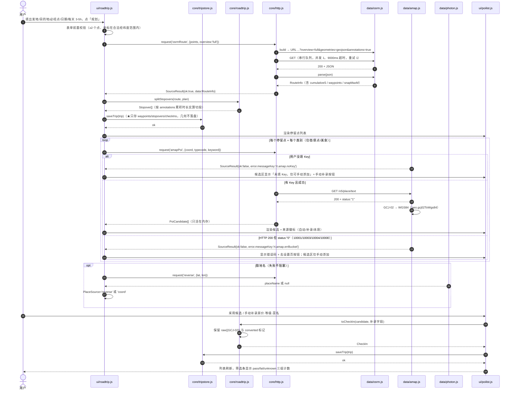
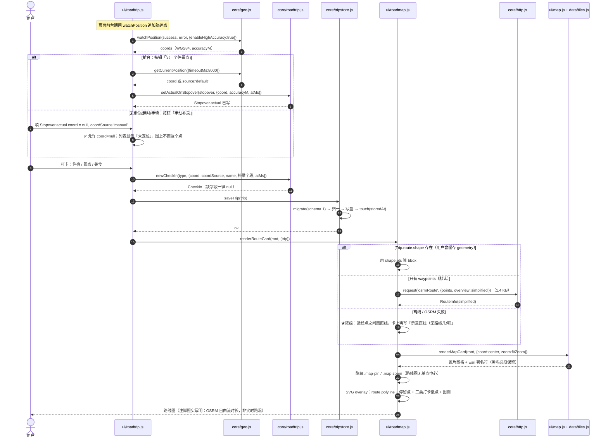
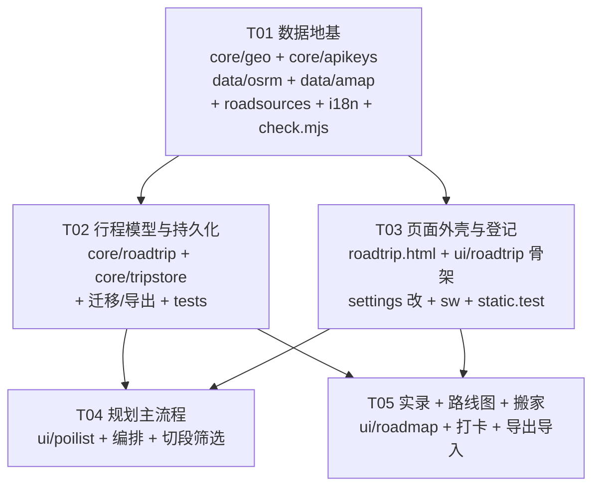

# 地候 GeoScope · 自驾模块增量架构设计（第 4/5/6 项）

> 作者：高见远（架构师） · 状态：**待 team-lead 拍板 §10 待确认事项**
> 本文档只做增量设计，**未改动任何代码文件**。
> 所有「可达性 / 时延 / 体积」结论均为本次在沙箱环境实测所得，未经实测的一律标注 **【待实测】**。

### ⚠️ 时延口径声明（项目铁律，任何引用本文档数字的地方都必须带着这句话）

**本文档所有时延 / 体积数字均为「沙箱 / 本机代理口径」，不是真机口径。** 本项目时延口径有四档，且**不可混比**：

```
应用内真机（预热后）　＜　线上冷启动首屏（约为前者的 2–3 倍）　＜　本机代理 ≈ 沙箱直连
```

因此本文档里写的一律是「**沙箱口径下可用**」，**不得**写成「已验证可用 / 实测 X ms」。**真机复测**已作为必做项登记在 §12，每个涉及网络的模块都必须复测后再声称成绩。

另一个必须守住的外延纪律：**项目里 `tile.openstreetmap.org` 与 `nominatim` 实测不可达（team-lead 真机口径 0/10），但那是 OSM 的**瓦片/地名**服务，与 OSRM 路由服务是**两回事、两个域名**。本次 OSRM（`router.project-osrm.org`）沙箱实测多次全通。**严禁**把「OSM 不可达」外推成「OSRM 不可达」。

### ⚠️ 章节号的稳定性约定（跨组契约）

`src/**` 的代码注释里已引用本文档的章节号（§0 / §0.1 / §2.2 / §3.1 / §3.2 / §4.1 / §4.2 / §4.3 / §4.4.1 / §4.6 / §4.8 / §6 / §8 / §10 / §12）。因此**本文档的章节编号是跨组契约，不只是排版**：

1. **只追加，不重排**：新增内容一律放在已有章节末尾、或新增叶子小节（如 §4.3.1 / §4.3.2），或文档末尾新增大节（§12、§13 …）。**绝不插队重编号，绝不整体重排。**
2. **确需重排时提前打招呼**：若将来必须合并或重排章节，动手前先通知 software-engineer-2，由其同步更新 `src/**` 里的引用（几分钟工作量），避免 check 突然变红却无人知道原因。
3. **新注释的写法建议**：写成「见文档『几何体积实测表』一节 (§0.1)」—— 标题给人读（抗编号变动），编号给机器校验。
4. **后备方案（未启用）**：若将来「只认编号」不够用（例如需要连主题一起校验），由架构师为被引用小节添加稳定锚点（形如 `<!-- A:geo-vol -->`），断言改为校验锚点。此路径**当前不启用**，记录在此只为后人遇到问题时不必重新讨论。

---

## 0. 本次实测结论（先看这里，有两条会改变设计）

> 表中「沙箱」= 本机代理 / 沙箱直连口径；标注「team-lead」的行是 team-lead 独立复跑的数据，已与我自己的样本交叉校验。

| # | 结论 | 实测口径 | 影响 |
|---|---|---|---|
| E1 | OSRM `overview=full&geometries=geojson` **可用** | 京郊 25.7 km → HTTP 200 / 0.80 s / 7.6 KB（沙箱） | 决策 B 成立（沙箱口径） |
| E2 | 该实例**同坐标系**：返回 `[lon,lat]`，WGS84 | 与 Esri 底图（wkid 102100/3857，即 Web Mercator-WGS84）一致，无需纠偏（沙箱口径复现 + team-lead 独立确认） | 与既有判断一致 |
| E3 | **`overview=full` 体积随里程线性放大**，长途会到几百 KB | 见 §0.1 完整表；最坏样本：哈尔滨→三亚 **4043 km / 537 KB / 24133 点 / 1.84 s** | **禁止**把 full 几何落 localStorage |
| E4 | `overview=simplified` 与里程**弱相关**，几乎恒定在 1 KB 级 | 726 km → 31 点 / 1.3 KB；2144 km → 19 点 / 1.1 KB；4043 km → 23 点 / 1.2 KB | 路线图默认用 simplified（与 full 相差 **300–400 倍**） |
| E5 | `annotations=true` 给出**逐边时长**，是切段的唯一依据 | `legs[].annotation.duration[]` 长 = 该 leg 几何边数；求和与 `legs.duration` 有系统性小差异：**726 km 差 38 s（0.13 %）／336 km 三点路线差 95 s（0.66 %）**，且恒为「annotation 和 ≤ legs.duration」 | 切段在 annotations 之上实算；两数差异写进 UI 注脚，不许假装相等 |
| E6 | `steps=true` 太重 | 同 726 km **318 KB / 2.24 s** | **不用** steps 做切段 |
| E7 | 多途经点可用，返回 `legs[]`（**按必经点**切） | 5 点 → 4 legs；12 点 → 11 legs（HTTP 200 / 0.99 s）；team-lead 的 3 点 336 km 路线 → **2 legs = [154.6 km/1.84 h, 181.6 km/2.17 h]**，实测 2313 点 / 53.6 KB，与其独立复跑数字一致 | legs **不等于**开车的一「天」，必须再有一层（见 §4.4.1） |
| E8 | `waypoints[].distance` = 吸附距离 | 任意中间点被吸附到 **1580 m / 3363 m** 外；team-lead 样本 snap 到「天府大道辅道」「凤城八路」「台基厂头条」，距离 25–199 m | 路网精度到街道级，但吸附距离**必须显示**，否则「途经点被挪了」是静默造假 |
| E9 | 单点 / 海上：一个是 HTTP 错，一个是数据层假成功 | 只有 1 个坐标 → **HTTP 400** `{"code":"InvalidOptions"}`；海上两坐标 → HTTP 200 但 `distance` 全 0 | 400 走 http.js 的 `error.HTTP`（不可重试）；0 距离必须在 parse 层判成失败 |
| E10 | **高德 Web 服务 REST 支持浏览器直连** | `restapi.amap.com` v3/v5 均返回 **`Access-Control-Allow-Origin: *`**、`Allow-Methods: *`（沙箱口径） | 决策 A 成立（关键前提，之前未被验证） |
| E11 | 高德业务失败是 **HTTP 200 + status:"0"** | `{"status":"0","info":"INVALID_USER_KEY","infocode":"10001"}` | `parse()` 必须显式判 `status`，否则 http.js 会当成成功 |
| E12 | GCJ-02 ↔ WGS84 算法可自实现、精度够 | 天安门偏移 **+156 m 纬 / +531 m 经**；迭代 5 次反演**往返残差 0.000 m**（6 个点全测）；境外（东京）原样返回 | 见 §2.2 决策：**转换，不隔离** |
| E13 | POI 大类码 | 餐饮 `050000` / 住宿 `100000` / 风景 `110000`（多源一致） | 直接用于 `types` 参数，**细节待真 key 验证** |
| E14 | `sig`（数字签名）在高德 Web 服务 API 是**可选**参数 | 官方文档参数表标「可选」 | 用户在控制台建 key 时**不要开启数字签名**；若开启会回落 `10008` |
| E15 | 若真要存 full 几何，**polyline6 比 geojson 省 6 倍** | 同一条 4043 km：polyline6 串 **90.1 KB** vs geojson **549 KB**（5 位小数 501 KB / 4 位小数 453 KB） | 即便如此仍**默认不存**；留作将来「离线精细导航」的备选口径 |
| E16 | **simplified 的点密度随里程急剧变稀** | 38.9 km → 16 点（2.4 km/点）；154 km → 26 点（5.9 km/点）；336 km → 57 点（5.9 km/点）；726 km → 31 点（23.4 km/点）；2144 km → 19 点（**112.8 km/点**） | 整段视图用一次整段 simplified 够看；**放大到某一天必须按该段单独再请求一次**，否则 112 km 一段会明显切过地形 |
| E17 | OSRM 参数顺序是 **lon,lat**（不是 lat,lon） | 与既有 Esri 瓦片 `{z}/{y}/{x}` 同类坑：写反不报错，只静默拉到地球另一侧 | URL 拼装必须有单测钉死 |

### 0.1 几何体积实测表（回答「长途会不会撑爆存储」）

| 路线 | 里程 | `overview=full` 点数 | full 响应 | `overview=simplified` 点数 | simplified 响应 |
|---|---|---|---|---|---|
| 京郊两点 | 25.7 km | — | 7.6 KB | — | — |
| 3 点两腿（team-lead 样本） | 336 km | **2313** | **53.6 KB** | 57 | 2.2 KB |
| 成都 → 西安 | 726 km | 5987 | 134 KB | 31 | 1.3 KB |
| 北京 → 深圳 | 2144 km | **13517** | **299 KB** | 19 | 1.1 KB |
| 哈尔滨 → 三亚 | **4043 km** | **24133** | **537 KB** | 23 | 1.2 KB |

> 全部为**沙箱口径**；`steps=false`（默认）条件下测得。
> **结论：不要默认存原始几何。** team-lead 担心的那条已被量化 —— 2000 km 量级就到 300 KB，4000 km 到 537 KB，而 localStorage 全局预算只有 4.5 MB（含天气/空气/地名/海拔缓存），SW 也有自己的壳预算。

> E3 + E6 + §0.1 共同决定：**Full 几何只在内存里活一次**（见 §4.3 存储纪律）。
> E11 决定：两路新源的 `parse()` 都必须做业务态 → SourceError 的翻译（见 §4.2）。
> E7 + E5 共同决定：**legs 只在必经点切，「按 3–5 h 分天」必须在 legs 之上再加一层**（见 §4.4.1）。

---

## 1. 范围与不做的事

**本期做**：第 4 项（路线规划 + 停留点 + 住宿/景点/美食推荐与筛选）、第 5 项（路线实录 = 停留点 + 三类打卡）、第 6 项（路线图标注）。
**本期不做**：第 7 项 Vlog。

**明确不做（写在文档里的边界，避免实现期自我膨胀）**：

1. 不做**自动**订房 / 比价 / 实时房价：所有免费源拿不到，全部由用户补录。
2. 不做**实时路况**：OSRM 公共实例是自由流时长（E5），界面必须写明「OSRM 自由流估算，非实时路况」。
3. 不做后台定位：iOS PWA 无此能力，主路径是「前台 Watch + 手动打卡」（§2.4）。
4. 不做地图 SDK / 打包器 / 任何 npm 依赖。
5. 不做「推荐算法打分区分高低」：排序只允许用**真实拿到的字段**（距离、高德评分（如有）、用户的补录值），缺字段不参与排序。

---

## 2. 实现方案与取舍

### 2.1 总体切分：三层新增 + 一条既有请求层

```
core（纯逻辑/持久，不许 import data 与 i18n）
  └─ geo.js(改) apikeys.js(新) roadtrip.js(新) tripstore.js(新)
data（构造请求 + 解析响应，可 import core）
  └─ osrm.js(新) amap.js(新) roadsources.js(新) sources.js(改)
ui（DOM 与编排，可 import core/data/i18n）
  └─ roadtrip.js(新) poilist.js(新) roadmap.js(新) settings.js(改)
html
  └─ roadtrip.html(新)
```

**为什么不把 OSRM / 高德塞进 ui 层直接 fetch**：违反「所有请求必须走 `core/http.js`」这条既有纪律（并发 1 / 超时 / 重试 / 离线短路 / 统一 SourceResult）。新源一律注册成 SourceSpec，一行都不自己发请求。

### 2.2 坐标系：**转换，不是隔离**（决策，含理由）

| 方案 | 结论 |
|---|---|
| A. 高德返回的 GCJ-02 转 WGS84 后统一使用 | **选它** |
| B. 高德数据只在自己的列表里用，不上路线图（两套坐标并存） | 否决 |

**选 A 的四条理由**：

1. **需求 6 强制共存**：路线图要把「OSRM 路线 + Esri 底图 + 高德 POI 标记」画在同一张图上。两套坐标不能同框。
2. **方案 B 会自相矛盾**：列表里「在地图上看这家酒店」一旦实现就是错位 531 m（E12）；不做则功能残缺。用户导出含坐标的数据给别人用时会更混乱。
3. **偏移量远超容忍**：天安门实测 +531 m 经度（E12），酒店会落到河对岸，属于「看起来正常但错了」的最坏一类 bug —— 与本仓库「静默错误最可怕」的一贯口径冲突。
4. **代价可测**：约 90 行纯三角函数 + 单测（往返残差、境外不纠偏两类断言）。风险封闭在 `core/geo.js` 一处。

**配套三条「不许编造」护栏**：

- 每条 POI 同时存**三份**：`coord`（转换后的 WGS84，用于画图和算距离）、`raw`（高德原文 `{lat,lon}`，原样留着）、`origCoordSys:'GCJ-02'`、`converted:boolean`。任何时候都能重算，且有据可查。
- 中国境外（或境外偏移区）由 `isInOffsetZone()` 判定后**原样返回**并置 `converted:false`（实测东京返回原值，见 E12）。
- `src/core/geo.js` 现有 `wgs84ToGcj02()` **方向反了，不要复用 git 里那行恒等占位以外的语义**；本次把它实现为真算法（已有注释就写着「阶段二实现」，是占位），并**新增**真正需要的 `gcj02ToWgs84()`（迭代 5 次反演）。

**遗留未确认项（不阻塞开发，但要在 §10 拍验证方法）**：Esri 中国底图自身是否按 GCJ-02 生产。若真机发现整体偏移，翻转开关在 `core/geo.js` 一处（渲染层加一步 `wgs84ToGcj02`），调用方一个都不用改。

### 2.3 「住宿 / 景点 / 美食」的数据来源纪律

| 字段 | 来源 | 是否自动可得 |
|---|---|---|
| 店名 / 坐标 / 类别 / 地址 | 高德 POI | ✅ 自动（需 key） |
| 高德评分 `rating` | 高德 `extensions=all` 的 `biz_ext.rating` | ⚠️ **覆盖率未知，【待实测】**；拿不到显示「未填」 |
| 人均消费 `cost` | 高德 `biz_ext.cost`（餐饮偶有） | ⚠️ **覆盖率未知，【待实测】**；不得当作「房价」用 |
| 房价（标准间/大床房，≤150 元，特殊 ≤200） | 用户手动补录 | ❌ 自动源一律拿不到 |
| 景区等级（4A/5A） | 用户手动补录 | ❌ 无公开免费 API |
| 菜名 | 用户手动补录 + 候选显示品类名 | ❌ 属点评内容数据 |

**执行口径（三条产品边界之一：不许编造）**：

- 筛选器同时对「自动字段」和「补录字段」生效；**缺字段不参与比较**，而是被分到列表底部一个显式分组「未填：房价」，并计数。绝不因为缺就默认通过，也绝不填补默认值。
- 每个字段在 UI 上带来源徽标：`自动` / `补录` / `未填`（文字色只用文字层级色，不用状态色做文字 —— 遵守配色红线）。

### 2.4 实录主路径：前台 + 手动

- 页面前台：用 `navigator.geolocation.watchPosition` 追加轨迹点；**页面一旦不可见就停**（`visibilitychange`），并在 UI 上明写「切后台/锁屏不记录，iOS PWA 无后台定位能力」。
- 「记一个停留点」按钮 = 取当前 GPS（超时沿用 `GEO_TIMEOUT_MS=8000`，失败降级到**手动补录**，不允许静默跳过）。
- 手动打卡允许 `coord:null`（`coordSource:'manual'`）：列表显示「未定位」，路线图上**不画这个点**，而不是给一个假坐标。

### 2.5 高德 Key 为什么不进 `core/store.js`

高德 key **不进** `store.js` 的 prefs。理由：prefs 是 `exportBackup()` 的原料，导出 JSON 是要搬家/可能被分享的文件，**明文 key 不该进备份**；而一旦加进 prefs，`replaceState()` / `applyBackup()` 与既有的 prefs 五字段契约全部要跟着改（`themeMode` / `fontScale` / `locale` 那套「本机属性不进备份」的处理会被复制一份）。
改为独立微型模块 `src/core/apikeys.js`（单一职责：读/写/掩码一个字符串），对既有 store/backup 零改动、零回归面。

### 2.6 高德 Key 的三条硬规矩，落成什么形态

| 规矩 | 落成形态 | 怎么保证不被破坏 |
|---|---|---|
| **严禁硬编码** | Key 只存在运行时的一处：`core/apikeys.js` 经 `core/cache.js` 写入 localStorage 键 **`gs:v1:amapkey:v1`**（以实现为准）。源码里**没有任何一行**含 key 字面量 | `tools/check.mjs` 第 7 节已扫全域 host 白名单；另在 §9 约定里补一条：新增 row 不得出现「疑似密钥常量」（32 位字母数字） |
| **严禁进 git** | 它落在 localStorage，从来不在仓库里；导出文件也刻意不含它（见上条：不进 backup payload） | 结构上不可能：没有任何源码承载它 |
| **没填 key 必须优雅降级** | `amapPoi.build(ctx)` 在 `getAmapKey()` 为空时不返回 URL，而是抛带 `messageKey:'rt.amap.noKey'` 的 SourceError → UI 显示说明条 + 「手动添加」可用，**其余功能（求路/切段/路线图/打卡/导出）全部照常** | 降级矩阵 §8 第一行 + 单测断言「无 key 时 build 抛错且 UI 状态为 manual-only」 |

**方向 reminder（防止再搞反）**：`core/geo.js` 里现有占位是 `wgs84ToGcj02()`（WGS84→GCJ-02），本项目需要的是反向 **`gcj02ToWgs84()`**。两者都会实现（正向用于将来「Esri 底图确认是 GCJ-02」时的翻转），但**业务调用只用反向**，并且必须有单测区分二者（天安门样本：正变换 +156 m/+531 m，反变换回原点残差 0 m）。

---

## 3. 文件清单（新增 / 修改）

行数预估按本仓库现有文风（含 JSDoc 与注释，注释密度与现有模块同档）。

### 3.1 新增文件

| 层 | 路径 | 预估行数 | 一句话职责 |
|---|---|---|---|
| core | `src/core/apikeys.js` | ~90 | 高德 Key 的本机读写与掩码，**不入备份**；空值即「未配置」 |
| core | `src/core/roadtrip.js` | ~430 | 行程领域模型：常量、类型、`migrate*()`、三类筛选、**纯**、无 DOM、无网络 |
| core | `src/core/tripstore.js` | ~240 | 行程的本机持久化：索引 / 单条读写 / 删除 / **schema 版本 + 迁移** / 触摸时间戳 |
| data | `src/data/osrm.js` | ~210 | OSRM 适配器：`buildRouteRequest` / `parseRoute`（含 annotations 累积曲线、吸附距离、件裁 lut/降级标记） |
| data | `src/data/amap.js` | ~190 | 高德 POI 适配器：`buildPoiRequest` / `parsePoi`（含 `status:"0"` 业务错 → i18n key 桶、GCJ-02 转换） |
| data | `src/data/roadsources.js` | ~130 | 新增两路源的 SourceSpec（`osrmRoute` / `amapPoi`）+ 宿主常量 + 契约数值 |
| ui | `src/ui/roadtrip.js` | ~820 | 自驾页入口与编排：表单 / 规划 / 切段呈现 / 打卡 / 导出导入按钮 / 降级横幅 |
| ui | `src/ui/poilist.js` | ~360 | 三类候选列表卡：筛选条、来源徽标、「未填」分组、手动补录表单、**缺 key 时的手动兜底 UI** |
| ui | `src/ui/roadmap.js` | ~320 | 路线图卡：算 fitBounds → 复用 `map.js` 铺瓦片 → SVG 叠加路线/停留点/打卡/图例 |
| html | `roadtrip.html` | ~55 | 抄 `compare.html` 骨架，**不带 tabbar**（理由见 §6） |
| test | `tests/roadtrip-sources.test.mjs` | ~180 | 两路新源契约 + URL 构造 + 坐标算法往返/境外断言 |
| test | `tests/roadtrip-model.test.mjs` | ~220 | 迁移 / 体积上限 / 触摸 / 导出导入 round-trip / 非法拒绝 |
| test | `tests/roadtrip-plan.test.mjs` | ~200 | 切段算法（边界：不足一天、必经点邻近、吸附过大）+ 三类筛选语义（含「未填」分组） |
| test | `tests/roadtrip-map.test.mjs` | ~140 | fitBounds 层级选择 + 投影正确性 + 无几何时的降级渲染 |

### 3.2 修改文件

| 层 | 路径 | 改动量 | 改什么 | 为什么必须改 |
|---|---|---|---|---|
| core | `src/core/geo.js` | +100 | 实现 `wgs84ToGcj02` 真算法 + **新增** `gcj02ToWgs84`（迭代 5 次）+ `isInOffsetZone` | §2.2；也是该文件原有注释「阶段二实现」的兑现 |
| data | `src/data/sources.js` | +18 | 引入 `ROAD_SOURCES` 合成 `SOURCE_TABLE`；**`SOURCE_LIST` 保持恰好六路**（显式数组），`getSource()` 查合并表 | 让 `tests/sources.test.mjs:57` 与 `tools/verify-standalone.mjs:106` 的「六路」断言原地保持绿色，**一条测试都不用改** |
| ui | `src/ui/settings.js` | +140 | 新增「高德 Web 服务 Key」卡（输入/掩码显示/清空/校验）与「自驾」入口卡（照既有 `_renderCompareCard()` 同款写法） | 入口（§6）+ key 只能用户自填（决策 C） |
| styles | `styles/app.css` | +160 | 新增（表单 / 列表 / 筛选条 / 路线图叠加层）的类，颜色一律引用 `tokens.css` 变量 | 样式只有 2 个文件的约束 |
| i18n | `src/i18n/zh.js`<br>`src/i18n/en.js` | 各 +80 key | 全部新增文案**双语同增**；含新增源名与署名(`source.osrmRoute`/`attr.osrm`、`source.amapPoi`/`attr.amap`) | 双表对拍护栏；`check.mjs` 第 9 节与 sources 测试会扫 `t('…')` 的存在性 |
| i18n | `src/i18n/zh.js`（`about.privacy`）+ `en.js` 同键 | 改 2 行 | 原文「除**六路**数据源之外…」不再准确 | 诚实原则：加了新源就得改说法 |
| sw | `sw.js` | +8 行 + 版本号 | `SHELL_ASSETS` 追加 `./roadtrip.html` 与新增 src 文件；`tools/bump-shell.mjs` 升 `geoscope-shell-v18 → v19` | check.mjs 第 6 节反向断言（srcFiles 全扫描） |
| tools | `tools/check.mjs` | +3 行 | `ENTRY_OF_PAGE['roadtrip.html']`；`ALLOWED_HOSTS` 追加 `router.project-osrm.org`、`restapi.amap.com` | 漏第二条会以「白名单外外链」报红，极易被忽略 |
| tools | `tests/static.test.mjs` | +2 行 | `runtimeFiles` 追加 `roadtrip.html` 与新 src 文件 | 与 SHELL_ASSETS 双向一致性 |
| docs | `README.md` | +3 行 | 「除六路数据源之外不发任何请求」→ 改为「除已声明的数据源（现为八路）之外…」 | 同上诚实原则 |

### 3.3 分层合规证明（`core/` 不得 import `data/`、不得 import `src/i18n/`）

| 新/改的 core 文件 | import 了什么 | 是否合规 |
|---|---|---|
| `core/geo.js`（改） | 无 import | ✅ |
| `core/apikeys.js`（新） | `./cache.js` | ✅ 同层 |
| `core/roadtrip.js`（新） | `./cache.js`、`./format.js`、`./geo.js` | ✅ 同层 |
| `core/tripstore.js`（新） | `./cache.js`、`./roadtrip.js`、`./store.js`(log) | ✅ 同层 |
| `data/osrm.js`（新） | `../core/geo.js`、`../core/format.js` | ✅ data→core 允许 |
| `data/amap.js`（新） | `../core/geo.js`（GCJ 转换）、`../core/apikeys.js`（读 key） | ✅ data→core 允许 |
| `data/roadsources.js`（新） | `../core/cache.js`、`../core/http.js`、`./osrm.js`、`./amap.js` | ✅ data 层内部 + data→core |
| `ui/*.js`（新/改） | core / data / i18n 全是向下依赖 | ✅ |

**core 层的错误文案**继续沿用既有做法：只输出 `{ reasonKey, reasonParams }`（如 `trip.err.newerSchema`、`rt.err.needMorePoints`），**绝不拼中文句子**，翻译留给 UI 层 `tr()`。core 里出现任何中文字面量的可能性为零。

**没有新增第三条依赖方向的例外。** `SOURCE_LIST`（六路自检源）与 `SOURCE_TABLE`（全量源表）的拆分见 §3.2 说明，不改变既有单向依赖。

---

## 4. 数据结构与接口契约

字段名全部具体列出，不写「等等」。缺失一律 `null`（不是 `0`、不是 `''`），延续 `core/format.js` 的 `_num()` 口径。

### 4.1 行程（Trip）— 本机持久化的顶层对象

```js
/** @typedef {Object} Trip
 *  schema: 1                        // ★ schema 版本号，迁移的唯一依据
 *  id: 'trip-lz4j8k'                // 生成规则：'trip-' + Date.now().toString(36)
 *  name: '成都 → 西安'               // 用户可改，≤40 字符
 *  createdAt: 1760000000000         // ms epoch
 *  updatedAt: 1760000000000
 *  plan: PlanInput                  // 见 4.2
 *  route: RouteInfo                 // 见 4.3
 *  stopovers: Stopover[]            // 见 4.4（计划里的每晚落脚点）
 *  checkIns: CheckIn[]              // 见 4.5（实际打卡，三类）
 *  lastErrorKey: string | null      // 最近一次失败的 i18n key（便于重进页面时如实重显）
 */
```

### 4.2 PlanInput — 规划输入（用户填的部分）

```js
/** @typedef {Object} PlanInput
 *  origin:      PlaceRef              // 出发地
 *  destination: PlaceRef              // 目的地
 *  via:         PlaceRef[]            // 必经点，UI 限 ≤6（OSRM 实测 12 点可用，保守留余量）
 *  startDate:   '2026-10-20' | null   // 出发日期（需求里「含日期」）
 *  days:        3 | null              // 计划天数；null = 由引擎按驾驶时长推算
 *  dailyTargetSec: 14400              // 每天驾驶目标秒数：10800(3h) / 14400(4h，默认) / 18000(5h)
 *  minGapSec: 1800                    // 末段不足该值就不再切新停留点（避免「最后只开 22 分钟」）
 *  filters: { stay: StayFilter, sight: SightFilter, food: FoodFilter }  // 见 4.7
 */

/** @typedef {Object} PlaceRef
 *  lat: 39.9087
 *  lon: 116.3975
 *  name: '天安门'                      // 用户视角的显示名
 *  source: 'search' | 'gps' | 'manual' // search=地理编码/Photon，gps=定位，manual=手填坐标
 *  amapId: 'B0FFH...' | null           // 只有经高德搜索确认过的点才有；用于复读与去重
 */
```

### 4.3 RouteInfo — OSRM 结果（**几何不入持久化**，见下方存储纪律）

```js
/** @typedef {Object} RouteInfo
 *  ok: boolean
 *  errorKey: string | null        // 'error.TIMEOUT' / 'error.HTTP' / 'rt.err.noRoute' / 'rt.err.zeroDistance'
 *  fetchedAt: 1760000000000 | null
 *  distanceM: 726004.8 | null
 *  durationS: 29898.1 | null
 *  durationKind: 'osrm-freeflow' | null   // ★界面必须照此标注「非实时路况」
 *  waypoints: WaypointSnap[]              // 每个输入点被吸附到哪、挪了多远
 *  snapMaxM: 3363.0 | null                // 最大吸附距离；> 2000 触发「请核对途经点」警示
 *  legs: [{ fromIndex:0, toIndex:1, distanceM:25705.4, durationS:1374 }]
 *  cumulativeS: [0, 8.9, 22.0, …]         // 长 = geometry 点数（边累积），切段的唯一依据
 *  geometry: [[116.396984, 39.908685], …] // [lon,lat]，WGS84；★只在内存中存活
 *  geometryPoints: 5987                   // 原始点数（即使不留存几何也要记住，便于提示）
 *  shape: ShapeCache | null               // 用户主动点了「缓存几何以便离线查看」才有
 */

/** @typedef {Object} WaypointSnap
 *  inputIndex: 2
 *  snapped: { lat: 40.285925, lon: 116.502698 }
 *  name: '' | '京加路'                     // OSRM 给的吸附道路名，可能为空串
 *  snapDistanceM: 1580.0                  // ★必须显示
 */

/** @typedef {Object} ShapeCache       // 唯一允许落盘的几何
 *  source: 'osrm-simplified' | 'decimated'
 *  pts: [[lon,lat], …]                // source='osrm-simplified' 时存 OSRM 简化几何原样（726km→1.4KB）
 *  rawCount: 5987                     // 原始点数（诚实标注曾经被抽稀）
 */
```

**★存储纪律（针对 E3 / E6 / §0.1）**：`overview=full` 单次响应在 726 km 就到 134 KB（+annotations 362 KB），4043 km 到 **537 KB**。若把 full 几何写进 localStorage：① 4.5 MB 预算（含天气/空气/地名/海拔六路缓存）几趟长行程就见底；② `core/cache.js` 的 `evictOldest(0.5)` / `prune()` 会在配额满时按 `storedAt` 淘汰最旧条目 —— **行程是用户数据，被当成缓存淘汰是不可接受的灾难**。因此：

- `osrmRoute` 源设为 `cacheable:false`（不进 http.js 的缓存层），几何**只在当次规划的内存里活一次**；
- 持久化只留 `waypoints + stopovers + checkIns + plan`，单条行程目标 **< 20 KB**；
- 需要离线看图时，由用户显式点「缓存此行程的路线几何」，此时**单发一次** `overview=simplified`（4043 km 也只要 **1.2 KB**，实测 E4/§0.1）存进 `Trip.route.shape`；
- 没有 `shape` 又要画图时，降级为**途经点之间的直线**，并在卡上明写「示意直线（无路线几何）」—— 绝不用直线冒充真实路线。

#### 4.3.1 几何体积：四种存法的实测对比（同一条 哈尔滨→三亚 4043 km）

| 存法 | 体积 | 倍率 | 结论 |
|---|---|---|---|
| geojson 原始坐标（OSRM 给的 6 位小数） | **549 KB** | 1×（基准） | ❌ 绝不可存 |
| geojson 保留 5 位小数（≈1.1 m） | 501 KB | 0.91× | ❌ 省钱有限，得不偿失 |
| geojson 保留 4 位小数（≈11 m） | 453 KB | 0.83× | ❌ 同上 |
| **polyline6 字符串**（OSRM 默认编码） | **90.1 KB** | **0.16×** | ⚠️ 唯一「勉强能存 full」的口径，但要自写解码器，换来 90 KB/行程仍然不划算 |
| **`overview=simplified` geojson** | **1.2 KB** | **0.0022×** | ✅ **本期采用** |

> 全部为沙箱口径。取舍：**默认是「不存几何」**（需要看图时重新拉 simplified，1.2 KB / 约 1 s，比本地解析 90 KB 更省）；polyline6 只作为「将来真要做离线精细导航时可以启用的备选」记录在案，本期不引入解码器（见 Q9）。

#### 4.3.2 分视图的几何策略（回答「简化之后放大能不能看」）

实测 E16：`simplified` 的点密度随里程急剧变稀 —— 2144 km 只有 19 个点（**112.8 km/点**）。整段挤在 350×260 的卡里每段约 10–18 px，**看着还行**；但当用户切到「只看第 3 天」时，这条粗糙折线会明显切过地形（一段直线跨上百公里）。

**策略（两级，都用 simplified，从不落 full）**：

| 视图 | 请求方式 | 点数参考（实测） | 成本 |
|---|---|---|---|
| 整段概览（默认） | 全程一次 `overview=simplified` | 19–31 点 | 1 次请求 / ~1.2 KB |
| 某一天 / 某一段 | 用**该段起终点**再请求一次 `overview=simplified` | 154 km → 26 点（5.9 km/点）；336 km → 57 点 | 每次 1 次请求 / ~1.3 KB，切换时才发 |

⇒ 落到 UI 上就是「整段 / 按天」两个 chip；切到某天才发第二次请求，并在状态行上写明几何来源（复用 `map.js` 的 `_statusText()` 那种写法）。**全程不存在 full 几何的传输与存储。**

### 4.4 Stopover — 停留点（行程计划里的落脚点）

```js
/** @typedef {Object} Stopover
 *  id: 'so-3'
 *  day: 1                                // 第几天（1 基）
 *  seq: 1                                // 行程内的顺序
 *  coord: { lat: 32.774556, lon: 106.177618 }   // WGS84，切下来的那一点
 *  anchorFrom: 'cumulative-4h' | 'via' | 'manual'
 *  cumSecAtArrival: 14404                // 从头累计到此的驾驶秒数（annotations 实算）
 *  driveFromPrevS: 14404 | null          // 距上一停留点驾驶时长
 *  driveFromPrevM: 331120 | null         // 距上一停留点驾驶里程
 *  placeName: '陕西 · 汉中' | null         // Photon reverse 实得，可为 null（境外/海上无结果）
 *  placeSource: 'reverse' | 'coord' | 'user'   // coord = 只能用 fmt.coord() 显示
 *  note: ''
 *  actual: { coord, coordSource, accuracyM, atMs } | null   // ★第 5 项「实录」落到哪：实际停下的位置与时间
 */
```

> **★三个溯源字段必须留**：无论是 POI 坐标（`raw` / `converted`）还是停留点锚点（`anchorFrom`），都要让用户和后来的人一眼看出「这个值是拿什么办法算出来的」。**显式标注过的派生值不是伪造** —— 伪造是拿推算值冒充实测值，而我们是把换算过程原样写在记录里。（`CheckIn.raw`/`converted` 见 §4.5，`Stopover.anchorFrom` 见上。）

### 4.4.1 ★ legs 之上那一层：为什么多必经点不够用，以及按时长重切怎么做

**先把 team-lead 那条疑问答实**：多必经点请求确实天然返回 `legs[]`，每段带 `distance`/`duration` —— 但 `legs` 是**按必经点**切的，**不等于按天**。用 team-lead 那条 336 km 三点路线的实测量就能看出裂缝：

```
legs[0] = 154.6 km / 1.84 h        ← 不足「一天」（小于 3 h 下限）
legs[1] = 181.6 km / 2.17 h        ← 也不足一天
总 = 336.2 km / 4.01 h              ← 而「一天」应该按 3–5 h 算
```

⇒ 若把 legs 当天，这条路线会被排成「两天、每天不到 2.2 h」，而实际需求是「每天 3–5 h」。反过来，成都→西安只有 1 条 leg（8.31 h），远超 5 h 上限，又必须切开。**所以 legs 只是「必经点之间的自然分段」，之上必然还要一层按时长的重切**。

**Stage 1（数据层 `data/osrm.js`）**：把 `[origin, ...via, destination]` 一次请求出去，取回 `legs[]` + `waypoints[]` + `overview=full` 几何 + `annotations.duration[]`。

**Stage 2（模型层 `core/roadtrip.js::splitStopovers(route, plan)`，纯函数）**：

1. **串接累积曲线**：把每条 leg 的 `annotation.duration[]` 首尾相接，得到全局 `cum[k]` = 从起点开到第 k 条边末端的秒数（`cum.length === geometry.length`）。多条 leg 时在 leg 边界处自然对齐。
2. **锚点 = 第一条跨过门槛的边**：指针 `t` 从 0 起，`want = t + dailyTargetSec`（默认 14400 = 4 h），找到最小的 `k` 使 `cum[k] >= want`，取 `geometry[k]` 作为这天落脚点；然后 `t = cum[k]` 继续找下一个。
3. **收尾规则（避免荒谬的一天）**：若切完之后剩余 `total - cum[k] < minGapSec`（默认 1800 = 30 min），**不再切**这一刀，把余量并入最后一天，并在界面写「末段 X 分钟并入第 N 天」。
4. **必经点优先（避免更荒谬的安排）**：若第 2 步找到的 `k` 正好落在某条 leg 的**末端**（即那个必经点）附近，则把锚点**吸附到该必经点**，`anchorFrom:'via'`，并把 `t` 推进到该 leg 结束。否则会出现「用户说要经停保定，结果系统把住宿安排到保定市区前 30 km 的国道边」这种结果。
5. **去重**：新锚点与任一必经点直线距离 < 2 km（`core/geo.js::distanceKm`）则丢弃这一刀（不算独立停留点）。
6. **起点 / 终点永不成为 Stopover**，它们分别属于 `plan.origin` 与 `plan.destination`。
7. **不估算**：每个 Stopover 的 `driveFromPrevS` / `driveFromPrevM` 都是 `cum[]` / 边距离在对应区间上的**求和**（实测真值），不是直线距离 ÷ 假想速度。
8. **诚实声明累计口径**：`Σ annotation.duration` 与 `Σ legs[].duration` 实测存在系统性小差异（726 km 差 38 s / 336 km 三点差 95 s，恒为 annotation 略小）。**做法**：停靠位置、每日时长一律出自 annotation 累积；行程总时长展示值用 `Σ legs[].duration`；两者差异写进结构里的 `Stopover.cumSecAtArrival` 精度说明，UI 注脚标明「两者相差 <1 %」。

**算法已在真实响应上跑过验证（不是纸面推演）**，三个样本如下：

| 样本 | 总里程 / 总时长 | `dailyTargetSec` | 结果 |
|---|---|---|---|
| team-lead 三点路线 | 336 km / 4.01 h | 4 h | **0 个停留点、1 天**（4.01 h 扣掉 4 h 只剩 1 min < minGap 30 min → 并入同一天） |
| 成都 → 西安 | 726 km / 8.31 h | 4 h | **1 个停留点、2 天**；锚点落在 `[106.17855, 32.77479]`（汉中以南） |
| 成都 → 西安 | 726 km / 8.31 h | 3 h | **2 个停留点、3 天**；锚点分别落在 `[105.566, 32.30835]`、`[107.77626, 33.26337]` |

> 三条都符合直觉，且第二条验证了「同一个 `legs` 输入、不同的每日目标，产出不同天数」—— 正是 legs 之上这一层存在的意义。这段会原样搬进 `tests/roadtrip-plan.test.mjs` 当单测夹具（用真实响应切片，不用 mock 想象值）。

> 已知精度项（必须写进 UI 注脚，不许藏着）：`Σ annotation.duration` 与 `legs[].duration` 实测差 **0.13 %**（726 km 上 38 s），属 OSRM 内部取整，界面注脚如实写明来源与量级。

### 4.5 CheckIn — 打卡记录（住宿 / 景点 / 美食 共用一张表）

```js
/** @typedef {Object} CheckIn
 *  id: 'ck-9a2'
 *  type: 'stay' | 'sight' | 'food'
 *  tripId: 'trip-lz4j8k'
 *  stopoverId: 'so-3' | null           // 挂在哪个停留点下
 *  // —— 定位 ——
 *  coord: { lat, lon } | null           // WGS84；允许用户完全没有坐标
 *  coordSource: 'gps' | 'amap' | 'map-tap' | 'manual' | null
 *  accuracyM: 35 | null
 *  atMs: 1760000000000                  // 打卡时刻（用户可改，默认取点击按钮那一刻）
 *  // —— 身份 ——
 *  name: '汉中院子民宿'                   // 店名 / 景点名；food 可为菜名+店名，用户自决
 *  address: '陕西省汉中市…' | null
 *  category: '宾馆酒店' | null           // 高德 type 原文串；null 即「未填」
 *  amapId: 'B0FFH9XJ2L' | null          // source==='amap' 时才有
 *  source: 'amap' | 'manual'
 *  // —— 原始凭证（★不许丢，随时可换个算法重算）——
 *  raw: { lat: 33.1234, lon: 106.2345, coordSys: 'GCJ-02' } | null
 *  converted: boolean                    // true = coord 由 raw 经 gcj02ToWgs84 得来
 *  // —— 三类各自的业务字段（★缺即 null，绝不填默认值）——
 *  stay:  { pricePerNight: 148|null, roomType:'standard'|'king'|null, nights:1|null } | null
 *  sight: { level: '4A'|'5A'|null, levelRaw: 'AAAA'|null, rating: 4.7|null, ticketCny: 90|null } | null
 *  food:  { dishes: Dish[], localSpecial: true|false|null, perHeadCny: 68|null } | null
 *  common:{ rating: 4.6|null, note: '', tags: ['停车方便'] }
 */

/** @typedef {Object} Dish
 *  name: '菜豆腐'          // 菜名（用户补录）
 *  priceCny: 12 | null
 *  note: ''
 */
```

> `common.rating`：**仅当高德真的返回了评分**才有值（`source==='amap'` 且 `biz_ext.rating` 存在）。其它任何情况为 `null`，界面显示「未填」，**不允许**用 4.0 / 5.0 之类的默认值占位。

### 4.6 POI 候选（**不落盘**）

```js
/** @typedef {Object} PoiCandidate      // 运行时对象，从不进 localStorage
 *  id: 'B0FFH9XJ2L'                  // 高德 POI id（用户「采用」后写入 CheckIn.amapId）
 *  name: '如家酒店·汉中中心广场店'
 *  type: '住宿服务;宾馆酒店'            // 高德 type 原文
 *  typecode: '100100'
 *  address: '…'
 *  rating: 4.3 | null                 // 高德评分，【待实测】覆盖率
 *  cost: null                         // biz_ext.cost，【待实测】；不用它冒充房价
 *  coord: { lat, lon }                // WGS84（已转换）
 *  raw: { lat, lon, coordSys:'GCJ-02' }
 *  converted: true
 *  distanceM: 820                     // 距锚点的直线距离（core/geo.distanceKm 实算）
 *  distanceKind: 'straight'           // ★标明是直线距离，不是路网距离
 */
```

**为什么不缓存候选**：POI 数据有配额成本、会过期、且容易把 4.5 MB 预算吃光。用户点「采用」才落成 CheckIn；刷新候选要重新请求（1 次 / 锚点 / 类别，UI 上明示会消耗几次配额）。

### 4.7 筛选条件（默认取用户原始需求）

```js
StayFilter  = { enabled:{price:true}, maxPriceCny:150, flexMaxPriceCny:200,
                roomTypes:['standard','king'], minRating:null, unknown:'分组到底部「未填」' }
SightFilter = { enabled:{level:true, rating:true}, minLevel:'4A', minRating:4.6,
                levels:['3A','4A','5A'], levelRank:{ '3A':3, '4A':4, '5A':5 } }
FoodFilter  = { enabled:{local:true}, requireLocalSpecial:true,
                keywords:['当地特色','名菜'] }   // 与用户补录的 tags 匹配
```

**统一筛选语义（`core/roadtrip.js` 的 `partitionByFilter(list, filter)`）**：返回三元组 `{ pass, fail, unknown }`。

- `pass`：条件成立；
- `fail`：有值但不达标（例如房价 260 > 150，即使 < 200 也进 `fail`，界面标注「超出上限」）；
- `unknown`：**该字段为 null** —— 单独成组，标题「未填：房价（3）」，永不被 `pass` 吞掉，也永不被静默删除。

这是「不许编造」在算法层的落地：看不清就是看不清，但要让用户看见「有多少条看不清」。

### 4.8 新增两路源契约（`src/data/roadsources.js`）

| id | `osrmRoute` | `amapPoi` |
|---|---|---|
| host | `https://router.project-osrm.org` | `https://restapi.amap.com` |
| 端点 | `/route/v1/driving/{lon},{lat};…` | `/v5/place/text`（**待真 key 实测**，见 §10 Q3） |
| timeoutMs | **9000**（E6/ E3 显示：full+annotations 362 KB，电话网络可能到数秒；6000 偏紧）【待真机复测】 | 6000 |
| retry | 1（仅 TIMEOUT/NETWORK/5xx/429 会重试，由 http.js 判定） | 1 |
| cacheable | **false**（§4.3 存储纪律） | true |
| ttlMs | 0 | 21600000（6 小时，省 5000 次/月配额） |
| cacheKey | `gs:v1:osrmRoute:<pointsHash>:<overview>` | `gs:v1:amapPoi:<typecode>:<kw>:<lat4>:<lon4>:<radius>` |
| 备注 | 请求顺序是 **lon,lat**（实测，写反会绕地球另一侧） | **业务失败是 HTTP 200 + status:"0"**，必须 parse 内翻译 |

**关于业务失败与 key 缺失**（实现已在 `core/http.js` 落地了更好的做法，本文据此订正）：

- **不新增错误码体系，只复用既有 `SourceError` 形状**，新增 `core/http.js::makeErrorWithKey(code, sourceId, messageKey, extra)`，并把 `request()` 里 parse 异常的兜底分支分成两类：① 普通 JSON 解析异常 → 老口径压成 `error.PARSE`；② data 层**主动抛出**的、带 `messageKey` 的业务态失败 → **原样提升**，保住具体那个桶。
  ⇒ 没有这个分支的话，高德「配额用尽」会被压成一句「解析失败」—— 失败倒是看得见了，却看错了位置（正好是「假成功源」的反面，一样糟糕）。这类错误 `retriable` 恒为 **false**：配额用尽 / Key 无效 / 限频，重试只会再烧一次配额，让用户处境更糟。
- **HTTP 200 + `status:"0"`**：由 `data/amap.js::parsePoi()` 抛 `makeErrorWithKey('BUSINESS','amapPoi','rt.amap.<桶>')`，走上面第 ② 条路径上屏。
- **没填 Key**：**不发请求**（一次都不该消耗），由 `amapPoi.build()` 前置门禁抛同形状的 `rt.amap.noKey`；UI 显示说明条 + 「手动添加」可用。
- **禁止**用 `opts.onXxx || (() => {})` 这类「取不到就退化成空函数」的写法 —— 那正是历史踩过的静默断线模式，这里取不到必须是**看得见的失败**。

> 实现侧已落地 `src/core/apikeys.js`（孤儿存储键为 **`gs:v1:amapkey:v1`**，与 store 的 prefs 平级）与 `src/core/geo.js` 的 `isInOffsetZone()` / `GCJ_INVERSE_ITERATIONS = 5`。本文此前的键名 `gs:v1:amap:key` 作废，**以实现为准**。

---

## 5. 时序图

### 5.1 时序图一：路线规划（需求 4）



### 5.2 时序图二：路线实录 + 路线图渲染（需求 5 / 6）



### 5.3 类图

```mermaid
classDiagram
    class Apikeys {
        +getAmapKey() string
        +setAmapKey(key) void
        +clearAmapKey() void
        +maskKey(key) string
        +hasAmapKey() boolean
        +KEY_MAX_LEN number
    }
    note for Apikeys "core 层。孤儿存储：绝不进 backup.json —— 明文密钥不能被导出搬家"

    class GeoUtil {
        +isInOffsetZone(lat, lon) boolean
        +wgs84ToGcj02(lat, lon) Coord
        +gcj02ToWgs84(lat, lon) Coord
        +distanceKm(a, b) number
        +roundCoord(c) Coord
        +getCurrentPosition(opts) Promise
    }
    note for GeoUtil "改造点：把两个恒等占位实现成真算法。境外原样返回；反演迭代 5 次，实测往返残差 0.000 m"

    class RoadtripModel {
        +SCHEMA_VERSION number
        +DAILY_PRESETS array
        +MAX_VIA number
        +newTrip(plan) Trip
        +splitStopovers(route, plan) Stopover[]
        +partitionByFilter(list, filter) Result3
        +newCheckIn(type, patch) CheckIn
        +adoptCandidate(candidate, patch) CheckIn
        +migrateTrip(raw) Trip
        +exportTrips(trips) Payload
        +inspectTripFile(input) Result
        +applyTripFile(plan) Result
    }
    note for RoadtripModel "core 层纯函数：无 DOM、无网络、无 i18n。失败只给 reasonKey"

    class TripStore {
        +listTrips() Trip[]
        +readTrip(id) Trip
        +saveTrip(trip) boolean
        +deleteTrip(id) boolean
        +setActiveTrip(id) void
        +getActiveTripId() string
        +touch(id) void
    }
    note for TripStore "每次读都 touch 刷新 storedAt，降低被 cache.prune() 当作旧缓存淘汰的概率"

    class Trip {
        +schema number
        +id string
        +name string
        +createdAt number
        +updatedAt number
        +plan PlanInput
        +route RouteInfo
        +stopovers Stopover[]
        +checkIns CheckIn[]
    }
    class PlanInput {
        +origin PlaceRef
        +destination PlaceRef
        +via PlaceRef[]
        +startDate string
        +days number
        +dailyTargetSec number
        +minGapSec number
        +filters object
    }
    class RouteInfo {
        +ok boolean
        +errorKey string
        +distanceM number
        +durationS number
        +durationKind string
        +waypoints WaypointSnap[]
        +snapMaxM number
        +legs array
        +cumulativeS number[]
        +geometry array
        +shape ShapeCache
    }
    class Stopover {
        +id string
        +day number
        +seq number
        +coord Coord
        +anchorFrom string
        +cumSecAtArrival number
        +driveFromPrevS number
        +driveFromPrevM number
        +placeName string
        +actual object
    }
    class CheckIn {
        +id string
        +type string
        +coord Coord
        +coordSource string
        +atMs number
        +name string
        +source string
        +raw Coord
        +converted boolean
        +stay object
        +sight object
        +food object
    }
    class PoiCandidate {
        +id string
        +name string
        +typecode string
        +rating number
        +coord Coord
        +raw Coord
        +distanceM number
        +distanceKind string
    }
    note for PoiCandidate "★从不落盘：只在内存与当次结果里活，避免配额与陈旧数据污染"

    class OsrmAdapter {
        +OSRM_HOST string
        +buildRouteRequest(ctx) RequestSpec
        +parseRoute(json, ctx) RouteInfo
        +pointsUrl(points) string
        +NO_KEY_REASON string
    }
    class AmapAdapter {
        +AMAP_HOST string
        +AMAP_TYPES object
        +buildPoiRequest(ctx) RequestSpec
        +parsePoi(json, ctx) PoiResult
        +bucketOf(infocode) string
    }
    note for AmapAdapter "★status:\"0\" 是 HTTP 200：parse 内必须翻译成 SourceError，不能当成功"

    class RoadtripUI {
        +boot() void
        +renderForm() void
        +runPlan() Promise
        +renderStopoverList() void
        +runCheckIn(type) void
        +exportTripJson() void
        +importTripJson(file) Promise
    }
    class PoiListUI {
        +renderFilterBar(type) Node
        +renderCandidateList(type, items) Node
        +renderManualForm(type) Node
        +renderMissingGroup(count) Node
    }
    class RoadMapUI {
        +renderRouteCard(root, trip) Node
        +fitBoundsZoom(bbox) number
        +project(lon, lat, view) Point
        +drawOverlay(trip, view) SVGElement
        +renderLegend() Node
    }

    Trip "1" *-- "1" PlanInput
    Trip "1" *-- "1" RouteInfo
    Trip "1" *-- "n" Stopover
    Trip "1" *-- "n" CheckIn
    Stopover "1" <.. "n" CheckIn : stopoverId
    TripStore ..> Trip : 读写+迁移
    TripStore ..> RoadtripModel : migrate/归一
    RoadtripModel ..> GeoUtil : distanceKm / roundCoord
    AmapAdapter ..> GeoUtil : gcj02ToWgs84
    AmapAdapter ..> Apikeys : getAmapKey
    AmapAdapter ..> PoiCandidate : 产出
    OsrmAdapter ..> RouteInfo : 产出
    RoadtripUI ..> OsrmAdapter : request('osrmRoute')
    RoadtripUI ..> AmapAdapter : request('amapPoi')
    RoadtripUI ..> TripStore : saveTrip
    RoadtripUI ..> PoiListUI : 渲染
    RoadtripUI ..> RoadMapUI : 渲染
```

---

## 6. 新增页面的登记清单（逐条）+ 一处「不适用」

对照 `compare.html`（同为「不进 tabbar 的手写页」）的现状，逐条给出：

| # | 位置 | 动作 | 漏了会怎样 |
|---|---|---|---|
| ① | `roadtrip.html`（新建） | 抄 `compare.html` 骨架：同一套 `<head>` 元信息（`data-i18n` 系列 + 内联 SVG icon + 两行 preload 无关）；同一段**无障碍字号预置脚本**（键 `gs:v1:store:prefs`，被 check.mjs 第 13 节断言）；`<body data-page="roadtrip">`；`<main id="app" class="app">` + 骨架文案；**不带 `<nav class="tabbar">`**；`<script type="module" src="src/ui/roadtrip.js">`；自带无 JS 兜底可见文本 | 白屏 / 首帧字号跳档 |
| ② | **四个 tabbar 各加 `<a class="tab">`** | ❌ **不适用**。加第 5 项：①320 px 屏必断行（历史真机 bug）；②check.mjs 第 12 节空间预算会算出来超标并报红；③第 10 节要求四页 href 列表逐项相等，四页一起改也会红 | 见下「替代动作」 |
| ②′ | 替代动作：`src/ui/settings.js` 新增「自驾」入口卡 | 照既有 `_renderCompareCard()` 同款写法：`<a href="roadtrip.html">` 的入口卡，放在「多地点对比」卡下方。**具体位置待 team-lead 拍板**（§10 Q1，可能还要在「此刻」页加一张） | 用户找不到入口 |
| ③ | `sw.js` 的 `SHELL_ASSETS` | 追加 `'./roadtrip.html'` 与全部新增 src 文件；并用 `node tools/bump-shell.mjs` 把 `geoscope-shell-v18` 升到 **v19** | check.mjs 第 6 节「SW 覆盖 xxx」报红（srcFiles 是全目录扫描，新文件自动被要求入清单） |
| ④ | `tests/static.test.mjs` 的 `runtimeFiles` | 追加 `roadtrip.html` 与新增 src 文件 | 与 ③ 的双向一致性断言报红 |
| ⑤a | `tools/check.mjs` 的 `ENTRY_OF_PAGE` | `'roadtrip.html': 'src/ui/roadtrip.js'` | 第 5 节「未登记的页面」报红 |
| ⑤b | `tools/check.mjs` 的 **`ALLOWED_HOSTS`** | 追加 `'router.project-osrm.org'` 与 `'restapi.amap.com'` | 第 7 节「白名单外外链」报红。**这条最容易被忘** |
| ⑥ | `tools/build-standalone.mjs` 第 3 步 nav 替换正则 `(?:index\|compass\|settings)` | **无需改动**（单文件版以 `selfcheck.html` 为模板，自驾页不参与） | 无。将来若要把自驾页做成单文件版，需在此加 `roadtrip` |

**额外三条（不是第 6 项，但同批必须做）**：

| 位置 | 动作 | 理由 |
|---|---|---|
| `tools/check.mjs` 的 `PAGES` 常量 | **不要**加 `roadtrip.html` | `PAGES` 的语义是「有 tabbar 的手写页」，被第 10/11/13 节消费；参照先例：`compare.html` 也不在其中。加进去会立刻触发「缺 tabbar 容器」报红 |
| `tests/sources.test.mjs:57` 与 `tools/verify-standalone.mjs:106` 的「六路」断言 | **不要改**（保持 `SOURCE_LIST` 恰好六路） | 本次设计靠「SOURCE_LIST（自检六路）≠ SOURCE_TABLE（全量表）」的拆分让这两条断言原地保持绿色，§3.2 |
| `src/i18n/zh.js` 的 `about.privacy` + README 「不发任何请求」那句 | 文案从「六路」改为实际值 | 诚实原则；改一处必须改双语 + README |

---

## 7. 任务列表（5 个，有序）

每个任务都能**独立验证**（有单测或工具门禁），且 ≥3 个文件。

### T01 · 数据地基（请求层 + 坐标 + 密钥 + i18n 骨架） — P0

- **依赖**：无
- **文件**：`src/core/geo.js`(改)、`src/core/apikeys.js`(新)、`src/data/osrm.js`(新)、`src/data/amap.js`(新)、`src/data/roadsources.js`(新)、`src/data/sources.js`(改)、`tools/check.mjs`(改)、`src/i18n/zh.js`+`en.js`(改)、`tests/roadtrip-sources.test.mjs`(新)
- **实现要点**：GCJ 双向算法（含境外不纠偏）；`SOURCE_LIST` 保持六路 + 新增 `SOURCE_TABLE`；两路源的 build/parse（含 E11 的 `status:"0"` 翻译、`distance` 全 0 的业务失败判定）；`ALLOWED_HOSTS` 两条；URL 必须用 **lon,lat** 顺序（E17，写反不报错，必须有断言钉死）
- **验收**：
  - `node --test tests/*.test.mjs` → 现有 **439** 项不退化 + 新增用例全绿
  - `node tools/check.mjs` → exit 0（**新域名白名单已生效**）
  - 坐标断言：6 个样本往返残差 < 1 m；东京 = 原值；正反两个方向分别断言（防搞反）
  - URL 断言：把三个样本的整串 URL 写成期望值（含 `overview=full&geometries=geojson&annotations=true`），而不是只断言前缀
  - **真机复测 V1 / V2 / V9**（见 §12）：OSRM 时延定标、蜂窝网络可用性、demo 实例限流边界 —— 三项出数之前，`timeoutMs=9000` 只是**建议值**，不许写进 UI 文案当承诺

### T02 · 行程模型与本机持久化 — P0

- **依赖**：T01（`core/geo.js` 的坐标能力）
- **文件**：`src/core/roadtrip.js`(新)、`src/core/tripstore.js`(新)、`tests/roadtrip-model.test.mjs`(新)、`src/i18n/zh.js`+`en.js`(改)
- **实现要点**：`SCHEMA_VERSION=1` + `migrateTrip()` + 「更高版本 → 拒绝并给 reasonKey」；三类筛选的 `pass/fail/unknown` 三分组；导出载荷/导入的**先 inspect 后 apply** 两步法（照 `core/backup.js`）；`readTrip()` 自动 touch
- **验收**：迁移用例（旧结构 → v1 字段补齐且不动已有值）、未知更高版本被拒、导出→导入 round-trip 等价、单条行程 JSON 体积 < 20 KB 的护栏用例（**V4 真机复测后回填真实数字**）

### T03 · 页面外壳与 6 处登记 — P0

- **依赖**：T01
- **文件**：`roadtrip.html`(新)、`src/ui/roadtrip.js`(新，先做成空态骨架)、`src/ui/settings.js`(改，「高德 Key」卡 +「自驾」入口卡)、`sw.js`(改 + bump)、`tests/static.test.mjs`(改)、`styles/app.css`(改少量)、`src/i18n/zh.js`+`en.js`(改)
- **实现要点**：入口模块**顶层**三件套 `applyThemeMode(getThemeMode())` / `applyFontScale(getFontScale())` / `applyLocale(getLocale())`（照 `compare.js` 第 52–56 行）；Key 卡的「校验」按钮明写「会消耗 1 次配额」
- **验收**：`node tools/check.mjs` @ 0、`node tools/smoke.mjs` @ 188、`node --test tests/static.test.mjs` 绿、`node tools/build-standalone.mjs` + `verify-standalone.mjs` @ 18 不退步、无 JS 打开 roadtrip.html 不是白屏

### T04 · 规划主流程（求路 → 切段 → 候选 → 补录 → 筛选 → 存盘） — P1

- **依赖**：T02、T03
- **文件**：`src/ui/roadtrip.js`(扩：编排)、`src/ui/poilist.js`(新)、`src/core/roadtrip.js`(扩：切段与筛选)、`tests/roadtrip-plan.test.mjs`(新)、`src/i18n/zh.js`+`en.js`(改)
- **实现要点**：严格照 §4.4.1 的 Stage 2 实现（累积曲线 → 跨门槛取锚点 → 收尾 minGap → 必经点优先吸附 → 去重）；候选**不落盘**；三类字段徽标；每次 POI 请求在 UI 上明写消耗配额次数（并发 1 意味着 N 个锚点 × M 个类别是 N×M 次串行请求，必须让用户知情，并提供「只搜住宿」这类开关）
- **验收**：**先用 §4.4.1 那三条真实样本（336 km/0 停留、726 km@4h/1 停留、726 km@3h/2 停留，含精确锚点坐标）当单测夹具**，再补边界用例（总时长不足一天、锚点贴着必经点、annotations 求与 legs.duration 不一致时的一致性降级）；缺 key / `status:"0"` / 超时三种路径的 UI 状态用例；`node tools/smoke.mjs` 与 `node tools/contrast-audit.mjs` exit 0；**真机复测 V1（时延）与 V8（QPS=3 体感）**

### T05 · 实录 + 路线图 + 导出导入 — P1

- **依赖**：T02、T03
- **文件**：`src/ui/roadmap.js`(新)、`src/ui/roadtrip.js`(扩：实录段 + 搬家按钮)、`src/core/roadtrip.js`(扩：export/inspect/apply)、`tests/roadtrip-map.test.mjs`(新)、`src/i18n/zh.js`+`en.js`(改)
- **实现要点**：fitBounds 用 `tiles.js` 的 `lonLatToTile` 反算 zoom（不改 `map.js`，零回归面）；隐藏 `.map-pin` / `.map-zoom` 并说明为什么；保留 Esri 署名行；`coord:null` 的打卡**不上图**（列表里写「未定位」）；几何走 §4.3.2 的两级策略（整段一次 / 按天再请求一次），**任何时候都不请求 full**
- **验收**：fitBounds 层级选择 + 投影正确性用例；无几何时降级为「示意直线」并带标注；导出文件能在新机器上导入出等价行程；**真机复测 V3（simplified 按天观感）与 V5（Esri 是否 GCJ-02）**

### 依赖图



> T04 与 T05 **可并行**（都只依赖 T02+T03，互不共用文件除 `core/roadtrip.js` 的扩 —— 约定：T04 写「切段/筛选」段、T05 写「导出/导入」段，分处文件尾部不同小节，冲突面小）。

---

## 8. 降级矩阵

| 情况 | 界面显示什么 | 谁来决定 |
|---|---|---|
| **高德没填 Key** | 候选区顶部说明条：「未填高德 Key：住宿/景点/美食候选不可用，可手动添加」+「去设置页填 Key」按钮；**只有**「手动添加」可用；**除此外全功能正常**（求路/切段/路线图照跑） | `amapPoi.build()` 前置门禁抛 `rt.amap.noKey`（**一次请求都不发**），走 `makeErrorWithKey` 上屏 |
| **Key 无效/过期**（10001） | 「高德 Key 无效或已过期（错误码 10001）」+ 去设置页 | `parsePoi` 判 `status:"0"` → 桶 `rt.amap.invalidKey` |
| **日配额用尽**（10003） | 「今日配额已用尽（错误码 10003）」+ 不再自动重试 | 同上，桶 `rt.amap.quota` |
| **调用过于频繁**（10004） | 「调用过于频繁（错误码 10004），请稍后再试」 | 桶 `rt.amap.busy` |
| **数字签名未关闭**（10008） | 「请在控制台关闭数字签名后重试（错误码 10008）」 | 桶 `rt.amap.sig` |
| **其它 infocode** | 「高德返回错误（错误码 XXXXX）」——数字语言无关，双语都成立 | 桶 `rt.amap.other` |
| **OSRM 超时 / 网络失败** | 顶部降级横幅（复用 `now.js` 的 `renderBanner`）+ 规划区：「无法计算路线（error.TIMEOUT）。可继续手动添加停留点」 | `SourceResult.error.messageKey` 直出，UI 只 `tr()` |
| **OSRM HTTP 400**（坐标 < 2） | 不该发生（表单前置校验禁用按钮）；真发生则显示 `error.HTTP status 400` | http.js 已有 `error.HTTP` |
| **吸附距离过大**（`snapMaxM > 2000`） | 列表上方警示：「有途经点被吸附到 3.4 km 外的道路，请核对」；每个途经点旁显示「吸附 1.6 km」 | E8 实测证据 |
| **断网** | `http.js` 的离线短路生效 → `OFFLINE`；规划按钮置灰并说明；**路线图仍可画**（有 shape 画真实、没 shape 画「示意直线」并标注） | 既有机制 |
| **iOS 切后台 / 锁屏** | 页上常驻一行：「切后台或锁屏时本页不记录位置（iOS PWA 无后台定位能力），请保持在前台」；回到前台继续，`Stopover.actual` 缺失的条目显示「未记录」 | 设计约束 7 |
| **用户没填房价 / 景区等级 / 菜名** | 卡片内该字段显示「未填」；筛选时进底部独立分组「未填：房价（3）」并计数；永不用均值/默认值填充 | 产品边界 1 |
| **高德没返回评分 / 人均** | 显示「未填」；**不得**用菜品均价、同类均值或 4.0 兜底 | 同上 |
| **「路况」** | 全程明写注脚：「驾驶时长为 OSRM 自由流估算，非实时路况」 | E5 + 无付费源 |
| **行程数据来自更高版本** | `readTrip()` 撞到更高 schema → 「这份行程由更新版本创建，请升级后再打开」，**不改写、不猜测** 字段 | `core/roadtrip.js` 的迁移路径 |
| **localStorage 配额即将见底** | 设置页给「清理旧行程」入口；写入失败必须**看得见**（返回 false → UI 提示），不得静默丢弃用户数据 | §4.3 存储纪律 |

---

## 9. 共享约定（给实现同学）

1. 所有新请求一律 `request(sourceId, ctx)`，不得自己 `fetch`。错误一律 `SourceError` 形状，UI 用 `tr({key: err.messageKey, params: err.messageParams})` 翻译。
2. **禁止** `opts.onXxx || (() => {})`：回调取不到必须是看得见的失败（历史真机坑：方位页按钮点了没反应）。
3. 缺失值一律 `null` 并在屏上显示 `—` / 「未填」；数字缺了绝不显示成 `0`（沿用 `core/format.js` 的 `_num()` 口径）。
4. 新增 `--c-*` 一律进 `styles/tokens.css`，`app.css` 不写死颜色；**状态色只做填充与徽点，绝不作为文字色**。
5. 新增译文必须 **zh/en 同时加**，由 `node --test tests/i18n.test.mjs` 守双表 key 集合完全相等。
6. 禁止直接 `console.log`，一律 `core/store.js` 的 `log()`。
7. 新增模块中不要写用不上的导出符号，宁缺勿滥（照本仓库一贯口径）。
8. 所有「可达性 / 时延 / 体积」结论必须实测或标注【待实测】，不许假定。
9. **时延口径不许混比**：沙箱 ≠ 本机代理 ≈ ≠ 真机冷启动 ≠ 应用内预热。写进注释 / UI / 提交信息时一律带上口径；**真机没跑过的，就是「待实测」，不是「已验证」**（见 §12）。
10. **OSM ≠ OSRM**：`tile.openstreetmap.org` / `nominatim` 实测不可用，但那是 OSM 的瓦片与地名服务；`router.project-osrm.org` 是另一个服务、另一个域名，实测可用。**不许**把前者的结论外推到后者。
11. URL 拼装的顺序坑（OSRM 是 **lon,lat**、Esri 瓦片是 **{z}/{y}/{x}**）必须有单测钉死 —— 写反不报错，只静默拉到地球另一侧。

---

## 10. 待 team-lead 拍板（我列了 8 条，不自己决定）

| # | 问题 | 我的倾向 | 影响面 |
|---|---|---|---|
| Q1 | **自驾页入口放哪？**（a）「我的/设置」页加入口卡（照对比页做法）；（b）「此刻」页顶部加一张卡；（c）两处都要 | 先做 (a)；若产品上要高频入口再加 (c) | T03 |
| Q2 | **是否接受高德 key 下发到前端的配额盗刷风险？**（任何能查看页面源码的人都能抄走 key；若对外分发即等于公开） | 接受，但页面明写风险 + 只在不对外分发的前提下使用。若将来要分发，必须改回「用户自填」（也就是本方案） | 决策 C |
| Q3 | **高德用 v5 还是 v3 的 POI 搜索？** 官方文档两者并存，v5 参数名不同（`page_size`/`page_num`/`region` vs `offset`/`page`/`city`）。**我没 key，无法实测哪个配额/字段更好** | 先用 v5（新接口）；同时在设置页写明 **sig 必须关闭** | T01 |
| Q4 | **每天 3–5h 的默认目标值**：三档 3/4/5h 让用户选，还是默认 4h + 允许微调？ | 默认 4h（14400 s）+ 三档预设；末段不足 30 min 不再切点 | T02/T04 |
| Q5 | **路线图要不要能缩放/拖拽？** 现有 `map.js` 是固定 3×3 瓦片 **无平移**；做整段概览 + 分天切换即可，还是要能拖？ | 本期只做「整段概览 + 按天切换」，不碰 `map.js`（零回归面）；拖拽留到下一期 | T05 |
| Q6 | **行程是否并入 `core/backup.js` 的那份备份？** 我倾向**独立的行程导出/导入**（不动 `SCHEMA_VERSION=1` 的备份契约） | 独立导出文件 `geoscope-roadtrip-*.json`；备份仍只装 prefs+收藏+快照 | T02/T05 |
| Q7 | **Esri 中国底图是否 GCJ-02 —— 真机验证方法要不要排进本期？** 建议方法：在 z16 底图上显示天安门旗杆（WGS84 39.908722,116.397499）对比建筑轮廓 | 排一次真机/沙箱目视 + 截图留档；若有整体偏移，翻转开关在 `core/geo.js` 一处 | T05 |
| Q8 | **要不要允许把 POI 候选缓存到本地（哪怕只最近 20 条）以便断网查看？** | 默认不存（见 §4.6）；若你要，我改成「最多缓存 3 个最近锚点的候选，带 TTL 6h」 | T02 |
| Q9 | **几何策略要不要给「存 polyline6 全量」留接口？** 实测 full geojson 4043 km 是 537 KB、polyline6 只要 90 KB（E15），但落盘仍会挤垮 4.5 MB 预算 | 本期不实现，只在 `ShapeCache.source` 里预留 `'osrm-polyline6'` 枚举 + 一条 TODO；真要精细离线导航时再补解码器 | T05 |

---

## 11. 一句话总结

三件事：**①** 高德 POI 与 OSRM 都实测可行（含 CORS），高德坐标必须先转成 WGS84 才能和 OSRM/Esri 同框（实测偏移 531 m）；**②** 价格/等级/菜名三项诚实承认拿不到，做成「补录 + 未填分组」而不是假装能筛；**③** 几何不落盘、行程带 schema 版本与迁移 —— 直接避开 `store.js` 那次「新增字段在 TTL 内不自愈」的历史坑。

---

## 12. ★ 待真机 / 待实测清单（本项目纪律：不许假定，不许把沙箱口径当成绩）

**口径纪律复述**：应用内真机（预热后）＜ 线上冷启动首屏（约前者 2–3 倍）＜ 本机代理 ≈ 沙箱直连。本文档所有时延都是**最后一档**。以下每一项在真机上跑出来之前，**不得**在文档 / UI / 提交信息里写成「已验证」。

| # | 待办 | 怎么验 | 归属任务 | 不做的后果 |
|---|---|---|---|---|
| V1 | **OSRM 路线请求时延**（含 full+annotations 这种大响应） | 同一条成都→西安，分别在①应用内预热后 ②冷启动首屏 两种真机条件下各跑 3 次，记录 p50/max；据此决定是否要把 `timeoutMs` 从建议的 9000 上调 | T01（定标）、T04（复验） | 超时阈值拍脑袋，弱网上规划必失败 |
| V2 | **OSRM 在中国大陆蜂窝网络下的可用性** | 蜂窝网络下重复沙箱那 5 组样本 | T01 | 沙箱走代理可能掩盖了运营商层面的限制 |
| V3 | **`overview=simplified` 在「按天视图」下的观感** | 真机目视：154 km / 336 km 两段分别按 26 / 57 点绘制，看是否明显切过地形 | T05 | 路线图「看起来像直线」会被当成 bug |
| V4 | **单条行程的 localStorage 体积实测**（N 个停留点 + M 条打卡） | 构造 10 天行程真机导出一次，量 JSON 大小；确认 < 20 KB 目标成立 | T02 | 目标值是估算，没验过 |
| V5 | **Esri 中国底图是否 GCJ-02**（= Q7） | z16 底图上对天安门旗杆目视 + 截图留档 | T05 | 若成立而没验，路线图整体偏 ~500 m |
| V6 | **高德 POI：v5 vs v3 的字段与配额差异** | 同一个 key、同一组关键词各跑一次，比对「有无 `biz_ext.rating` / `biz_ext.cost`」与响应体积 | T01 + 用户配合（需真 key） | 我只能按 v5 写，验收时要返工 |
| V7 | **高德 `biz_ext.rating` / `biz_ext.cost` 的覆盖率** | 连跑 30 个不同类型的 POI，统计这两个字段的返回率 | T01 | 若覆盖率极低，「评分」筛选就是空的，UI 必须如实告诉用户 |
| V8 | **高德「POI 搜索 5000 次/月、QPS=3」额度的实际体感** | 一次规划（3 天 × 3 类 = 9 次请求）在真机上计时，看 QPS 限制是否触发 `10004` | T04 | 连续请求会被限流，UI 却以为成功了 |
| V9 | **OSRM 公共实例的限流 / 礼貌使用边界** | 连续 20 次请求，观察是否出现 429 / 变慢；据此决定是否要「两次请求之间强制间隔」 | T01 | demo 实例被打到限流会牵连整站 |
| V10 | **`tile.openstreetmap.org` / `nominatim` 不等于 OSRM** | 无需复验，纪律项：任何文档引用都要写清「OSRM（`router.project-osrm.org`）可用；OSM 瓦片 / nominatim 地名不可用」 | 全团队 | 把不可达结论外推到 OSRM，会误杀本期方案 |
