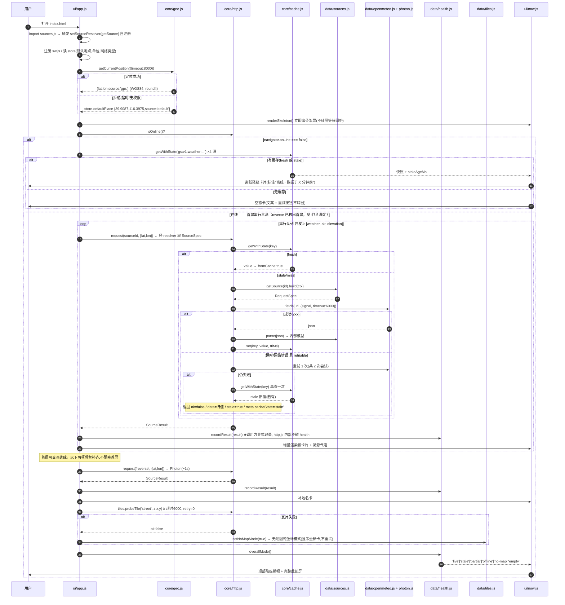
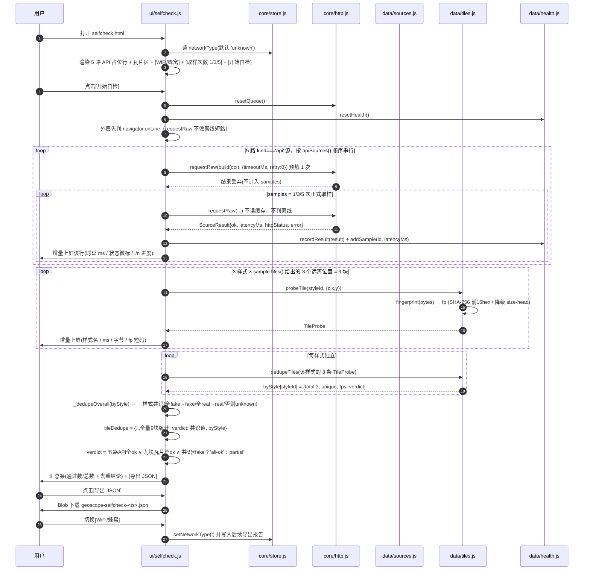

# 地候 GeoScope · 阶段一系统架构设计

> 版本：v2（已与阶段一实现代码对齐）· 阶段一（数据源接入层 + 此刻屏 + 数据源自检页）
> 技术栈：零构建原生 PWA（HTML + CSS + 原生 ES Module，零第三方依赖）
> 坐标基准：内部一律 WGS84；显示层 GCJ-02 纠偏本阶段仅占位，不实现。
> **v2 变更**：按工程师实现过程中产生的 10 条出入（主理人逐条裁定采纳）回写，详见文末 §9 变更记录。

---

## 0. 阶段一验收结论

| 项 | 结论 |
|---|---|
| 交付规模 | **35 个主文件 + 18 个测试文件**（另含测试装置 `tests/harness.mjs` 与本文档），约 15,300 行；全部为零依赖原生 ESM，无任何 npm 运行时包 |
| 单元测试 | `node --test "tests/*.test.mjs"` → **240/240 通过**（18 个用例文件；此前文档记的 182 只统计了已登记的 15 个文件，漏了 `sw-offline.test.mjs` 的 18 条，已补登记） |
| 冒烟脚本 | `node tools/smoke.mjs` → **188/188 通过** |
| 静态检查 | `node tools/check.mjs` → **597/597 通过**（含六路源契约硬断言与隐私红线扫描） |
| 配色审计 | `node tools/contrast-audit.mjs` → **59 条全覆盖、全部达标（≥ 4.5:1）、退出码 0**（`app.css` 全部 `color:` 声明；v13 起改为数据驱动扫描，v12 及以前只硬编码 9 个选择器，故当年「18 项全达标」只在自己那 9 个里成立）。门槛一律 4.5:1，只有 ≥18pt(24px) 才适用 WCAG 大字 3:1；全清单最低一项 4.57:1（浅色次要文字压屏渐变暗端） |
| 单文件版 | `node tools/build-standalone.mjs` + `node tools/verify-standalone.mjs` → **17/17 通过**（199.3 KB，内联 15 个模块） |
| 契约校验 | 六路源的 URL / 参数 / 超时 / 重试 / TTL 全部按本文档 §3.1 表固化值硬断言；隐私红线（除六源外无任何第三方请求、无统计、无字体外链、无坐标上传）通过静态扫描断言 |
| **真机实测** | **已完成四轮**（2 WiFi + 2 蜂窝，Android 16 / Chrome 150 / 微信 XWEB 内核），结论见 `docs/bench/2026-10-11-summary.md`：五路 API 四轮全通；瓦片中位 693 ms、峰值 3198 ms；同一 z/x/y 字节与指纹跨四轮完全一致 |
| **未验项** | 换设备 / 换地区 / 换运营商后仍需重跑一次 `selfcheck.html`（bench 结论只对当时那台机器与网络负责）；方位屏为**本机计算**，不受网络影响，但真机只验过「算得出数」，未与实地标定值比对（也**不该**去比：见 §3.10 的诚实红线） |
| **分层红灯（已关闭）** | ~~`src/core/mag.js` import `../data/wmm2025.js` 破坏 core←data 单向~~ —— **v11 期间该线已自行修正为「core 只放通用算法、系数与装配放 data」，红灯消失**，见下面的裁决说明 |

**★WMM 两个文件的落位裁决（不再挪动）**：`src/core/mag.js` 放**通用球谐算法**（不持有任何具体模型系数，靠 `createMagneticModel()` 注入），`src/data/wmm2025.js` 放**WMM2025 这一特定版本模型的系数与装配**。这样切分后依赖方向天然是 `data → core`（唯一合法方向），且**换 WMM2030 只需换 `data/` 层一个文件、`core/` 一行不动**；若反过来把系数并进 `core/`，换模型就要动算法层。此前文档里「整体挪进 `core/`」的建议**作废**，理由是它把「会变的模型数据」和「不该变的算法」捆在了一起。

本地运行：`node tools/serve.mjs`（ES Module 需 http 协议，`file://` 不可用）→ `http://127.0.0.1:8080/`。

---

## 1. 实现方案概述

1. **四层单向依赖**：`core`（无业务）← `data`（源适配器）← `ui`（渲染）← `html`（装配）。`core` 不 import `data`，`data` 不 import `ui`。**该约束在阶段一以两条强制手段落地**：① 健康记录由调用方（`app.js` / `selfcheck.js`）显式调 `health.recordResult()`，`http.js` 内部不碰 health；② 源注册表通过 `http.setSourceResolver(getSource)` 注入，`sources.js` 加载时自注册，而非 `http.js` import `sources.js`（详见 §6.14）。
2. **单一出口请求**：所有网络请求必须经 `src/core/http.js` 的 `request()`，内置一个**全局串行队列（并发 1）** + `AbortController` 超时 + 固定重试次数，源只声明「超时/重试」，不自己 fetch。
3. **源注册表驱动**：`src/data/sources.js` 是唯一真相源（URL/参数/超时/重试/TTL/署名/`kind`/`critical`），适配器（openmeteo/photon/tiles）只负责「构造请求 + 解析响应」，新增源不改 UI。注册表按 `kind: 'api' | 'tile'` 分组导出 `apiSources()` / `tileSources()`。
4. **缓存即降级底座**：`core/cache.js` 统一 localStorage 读写，返回 `fresh / stale / miss` 三态；有 `stale` 数据绝不显示空白，走陈旧降级并标注陈旧时长。**注意 `ok === false` 时 `data` 仍可能是陈旧兜底值**，调用方看 `stale` 字段而非 `data` 是否非空（详见 §3.2）。
5. **降级先于请求**：`navigator.onLine === false` 或缓存命中时**不发请求**；瓦片**不再**「失败一次即切无地图」——真机实测瓦片时延波动 13 倍（247–3198 ms），一次慢请求就把整张地图打没代价太大。改为**整批探测结束后三态裁决**：全成 `map` / 部分失败 `grid`（仅网格+坐标）/ 全败 `no-map`；单块成败不决定全局。瓦片另有**内存 LRU 缓存**（96 条 / 7 天），但**只有该样式经自检判为 real 授信后才允许写缓存**（详见 §3.7）。
6. **健康模型横切**：每次请求结束后由**调用方**调用 `data/health.js` 的 `recordResult(result)` 落一条 `SourceHealth`（内部按 `ok` 分流到 `recordSuccess` / `recordFailure`），此刻屏与自检页读同一份内存态，保证两页口径一致。
7. **渲染纯函数化**：`ui/*.js` 只做「数据 → DOM 字符串/节点」，网络与判定全在上游完成，便于 `node --test` + mock fetch 冒烟。
8. **离线壳**：`sw.js` 只预缓存静态资源（cache-first），**不缓存任何 API 响应**；业务数据由 `core/cache.js` 走 localStorage 快照。离线导航兜底按 URL 回对应页面（`index.html` ↔ `selfcheck.html`）。
9. **零依赖副作用**：无 CDN、无字体外链（字体走系统栈 fallback）、无任何统计/广告/账号；`crypto.subtle` 用于瓦片指纹，安全上下文缺失时自动降级为「字节长度 + 首 64 字节」指纹（用 SHA-256 前 16 hex 替代 MD5，见 §3.7）。

**数据流**：`用户/定位 → geo.js(WGS84) → http.js(队列) → sources.js(经 resolver 注入) → adapters(构造/解析) → cache.js(TTL) → health.js(recordResult，调用方显式调) → ui(now|selfcheck).js(渲染/降级)`

---

## 2. 文件清单（磁盘实际文件，阶段一已交付）

**主文件 28 个**（行数 = 交付时实际行数；其中 1 个为生成产物，已标注）：

| # | 路径 | 职责一句话 | 行数 |
|---|---|---|---|
| 1 | `index.html` | 此刻屏外壳：viewport/meta/主题色、挂载点 `#app`、以 `type="module"` 引入 `src/ui/app.js`；tabbar 三页（此刻/自检/方位） | 51 |
| 2 | `selfcheck.html` | 自检页外壳：源列表容器、网络类型切换、取样次数选择、导出按钮，引入 `src/ui/selfcheck.js`；tabbar 三页（此刻/自检/方位） | 81 |
| 3 | `manifest.webmanifest` | PWA 清单：name/短名/start_url(index.html)/standalone/主题色 `#1E9C8C`/图标（内联 SVG data URI，避免外链） | 27 |
| 4 | `package.json` | **零依赖**，仅 14 行：`"type":"module"` 让 Node 以 ESM 方式加载浏览器 `.js`（使 `tools/` 与 `tests/` 可 import `src/`）；浏览器完全忽略此文件，**不构成构建步骤** | 14 |
| 5 | `sw.js` | Service Worker：`install` 预缓存静态壳；`fetch` 对同源静态资源 cache-first，对跨域 API/瓦片**直接放行不拦截**；离线导航按 URL 兜底回对应页面（三个页面各自回自己的壳） | 108 |
| 6 | `styles/tokens.css` | 设计令牌：CSS 变量定义品牌色/渐变/字号/间距(8pt)/圆角(卡 18–20、胶囊 36)/阴影/文本层级；`--c-brand-solid` 是「实心填充+白字」专用（白字压 `--c-brand` 只有 3.39:1，压 `--c-brand-solid` 4.94:1）；`--c-state-offline/idle` 为**字面色值**（v14 起不再复用 `--c-text-3`，浅色值须在两个浅色块里各写一遍） | 145 |
| 7 | `styles/app.css` | 全局与组件样式：深浅双主题、玻璃卡、胶囊、状态徽标、溯源气泡、降级横幅（`stale`/`partial`/`grid`/`empty`/`offline`/`no-map` 六个变体，色阶按严重度递进：琥珀 7% → 琥珀 14% → 告警红 20%；变体名由 `renderBanner` 直接拼出；告警红不作文字色，只作底纹）、自检页表格、方位屏罗盘与换算输入、≥44×44 触达区。颜色纪律：状态色与数据色只作填充/边框/徽点，**不作文字色**（文字一律 `--c-text-*`）；「实心填充 + 白字」一律用 `--c-brand-solid` 而非 `--c-brand` | 769 |
| 8 | `src/i18n/zh.js` | 中文文案集中表（叶子模块，允许被 core 依赖）：源名、状态词、WMO/AQI/UV 健康建议、降级提示（含 grid 态专属 `mode.grid`）、自检页标签、底图三态文案、**方位屏 `compass.*` 段**、导出文件名模板 | 288 |
| 9 | `src/core/format.js` | 纯格式化：温度/风速/气压/能见度/降水/海拔/坐标 DMS-4位小数/时延/相对时间（"3 分钟前"） | 245 |
| 10 | `src/core/cache.js` | localStorage 封装：命名空间 `gs:v1:`、TTL、三态返回、陈旧标记、按前缀清理、容量超限 LRU 淘汰 | 280 |
| 11 | `src/core/http.js` | 请求内核：全局串行队列（并发 1）、AbortController 超时、重试、统一 `SourceResult`（含 `stale`）、离线短路、`setSourceResolver` 注入、调试日志 | 528 |
| 12 | `src/core/store.js` | 本机状态：默认地点（北京天安门 `39.9087,116.3975`）、单位制、网络类型、最近快照、`debug` 开关与 `log()`、收藏增删改查（`getFavorites`/`addFavorite`，阶段二接 UI） | 230 |
| 13 | `src/core/geo.js` | 定位封装：`getCurrentPosition` 转 WGS84、超时 8s、权限拒绝/超时降级为默认地点（**顺带回 `altitudeM`，椭球高、米，缺失为 null**）；`round4()`；GCJ-02 占位函数 | 174 |
| 14 | `src/core/sun.js` | NOAA 日出日落纯函数（离线可用）：无网络时兜底算 sunrise/sunset/正午/昼长，极昼极夜返回 `polar-day/night` | 176 |
| 15 | `src/core/wmo.js` | 映射表：WMO 天气码→中文/图标/昼夜、欧洲 AQI 分级（含 `adviceKey`）、UV 分级、风向 16 方位、蒲福风级 | 195 |
| 15b | `src/core/mag.js` | 地磁**通用算法**（不持任何具体模型系数）：大地→地心换算、Schmidt 半归一化缔合勒让德递推、双系数综合得场值与年变率、七要素与七年变率；`createMagneticModel()` 装配入口；`decimalYearFromDate()`；`trueBearingFromMagnetic()` / `magneticBearingFromTrue()`（东偏为正、归一到 [0,360)）；`normalizeSignedAngle()` / `normalizeBearing()`。**纯计算，不 import 任何层** | 635 |
| 16 | `src/data/sources.js` | **源注册表**：6 条 `SourceSpec`（含 `kind`/`critical`）、加载时 `setSourceResolver(getSource)` 自注册、导出 `SOURCE_LIST`/`apiSources()`/`tileSources()`/`criticalIds()` | 232 |
| 17 | `src/data/openmeteo.js` | 四路适配器：forecast / air-quality / geocoding / elevation 的参数拼装与响应→内部模型解析（`parseWeather` 额外输出 `tzOffsetSec` 等 5 个展示字段） | 272 |
| 18 | `src/data/photon.js` | Photon 逆地理反查适配器（`lang=default`），解析出「区/街道/名称」层级文本 | 86 |
| 19 | `src/data/tiles.js` | Esri 三种样式 URL 构造、可用性探测（**单块超时可被调用方收紧，只能更短不能更长**，整批时间预算靠它落地）、瓦片指纹、**同一样式内**去重判定 `dedupeTiles()`、**内存 LRU 瓦片缓存（须授信才写）**、**授信持久化（30 天）**、**地图三态（map/grid/no-map）与整批裁决** | 620 |
| 20 | `src/data/health.js` | 源健康记录：状态机、时延样本 `addSample()`、最后成功时间、陈旧判定、`recordResult()` 统一入口、聚合为「整体降级态」`overallMode()`（含 **grid → partial** 分支） | 248 |
| 20b | `src/data/wmm2025.js` | **WMM2025 这一版模型的系数与装配**（`G/H/DG/DH` 四张表 + `WMM_MODEL` 元信息 + `computeGeomagnetic()`），离线内嵌、不发请求；**换 WMM2030 只改这一个文件，`core/mag.js` 不动**。有效期 2025.0–2030.0，超期返回 `level:'error'` 但**照常返回数值** | 168 |
| 21 | `src/ui/now.js` | 此刻屏渲染：天气/空气/海拔/地名卡片、溯源气泡雏形、五种降级态 + `grid` 变体分支渲染 | 454 |
| 22 | `src/ui/selfcheck.js` | 自检页：预热→取样（瓦片强制 `useCache:false`）→实时上屏→**分样式去重 + 三样式共识**→**样式授信（持久化）**→整批裁决地图模式→三条件合取汇总→网络类型标记→导出 JSON（含 `mapMode`） | 789 |
| 23b | `src/ui/compass.js` | ★新增：方位屏渲染与装配 —— 磁偏角卡（D/I/F/H + 年变率，超期挂告警态但数值不隐藏）、模型卡（版本/历元/有效期/来源 + 到期提示）、真↔磁方位手动双向换算、**罗盘（有传感器才画指针，无/未授权/桌面一律降级不白屏）**；`computeAt()` 收口米→千米与 `decimalYear` 两处易错点；异常降级为「暂不可用」 | 777 |
| 23 | `src/ui/app.js` | 入口装配：注册 SW、初始化 store/health、绑定定位与刷新、首屏串行三源 + reverse/瓦片后台补齐（`probeTileBatch()` 探 `TILE_PROBE_COUNT=3` 块、**整批 8 s 时间预算**内逐块收紧超时，≥2 块才整批裁决，grid 才可达）、`_bannerMode()` 决定横幅态（grid 换如文案，offline/empty/stale 让位）、挂载 `now.js` | 574 |
| 24 | `tools/serve.mjs` | 零依赖静态服务器（ES Module 需 http 协议，`file://` 不可用），默认 `127.0.0.1:8080`，含 MIME 与目录穿越防护 | 248 |
| 25 | `tools/smoke.mjs` | 冒烟脚本：mock fetch，188 条断言，离线验证队列/超时/重试/TTL/降级/URL 拼装/隐私红线/瓦片缓存与三态 | 738 |
| 26 | `tools/check.mjs` | 静态检查脚本：597 条断言，覆盖源契约固化值、分层依赖方向（core 不得 import data/ui）、隐私红线扫描、禁止 CDN/打包器关键字、**每页必须引自己的入口模块**（`ENTRY_OF_PAGE` 登记） | 415 |
| 27 | `README.md` | 本地运行、命令一览（含单文件版重建）、Cloudflare Pages 部署（免备案）说明、隐私边界声明 | 236 |
| 27b | `compass.html` | ★新增：方位屏外壳 —— `body[data-page]` / `#banner` / `#app` / `#about` / 三页 tabbar，以 `type="module"` 引入 `src/ui/compass.js` | 51 |
| 28 | `selfcheck-standalone.html` | ★**生成产物，不是手写源文件**：由 `tools/build-standalone.mjs` 生成，内联 `styles/tokens.css` + `styles/app.css` + 15 个 ES Module 源码，用于发到手机上直接跑自检。**改到 `styles/` 或 `src/` 后必须重新生成**（`node tools/build-standalone.mjs` + `node tools/verify-standalone.mjs`），否则它是源码的旧快照，现象与仓库对不上 | 1078 |
| 29 | `tools/build-standalone.mjs` | 单文件版生成器：把 `styles/*.css` 内联进 `<style>`、把 15 个 ES Module 源码内联进一个 `<script type="module">`（按依赖拓扑排序），产出 `selfcheck-standalone.html` | 174 |
| 30 | `tools/verify-standalone.mjs` | 单文件版校验器：17 条断言，确认产物里 CSS 与每个模块源码**与磁盘当前内容逐字一致**，防止产物悄悄变旧 | 82 |
| 31 | `tools/contrast-audit.mjs` | **改完配色必跑**：**数据驱动**解析 `app.css`，凡声明 `color:` 的规则全部纳入（59 条；v12 及以前只硬编码 9 个选择器，故当年「18 项全达标」只在自己那 9 个里成立）。基底按「屏渐变（两端取较差者）→ 容器填色 → 自身填色」合成，含 `color-mix` 预乘语义；门槛一律 4.5:1，只有 ≥18pt(24px) 才适用 WCAG 大字 3:1（14pt-bold 那条因 bold 无明确阈值定义不采用）。手工维护的只剩两张**结构表**（不在卡片内的区域 / 父容器自带填色的少数处）。有项 < 4.5:1 则退出码 1 | 430 |

**测试文件 18 个**（`node --test "tests/*.test.mjs"`，240 条断言）：

| # | 路径 | 覆盖对象 | 行数 |
|---|---|---|---|
| 1 | `tests/harness.mjs` | 测试公共装置：mock fetch / mock localStorage / 时钟桩 / 断言辅助，**不是用例文件**（不参与 `*.test.mjs` 匹配） | 577 |
| 2 | `tests/http.test.mjs` | `core/http.js`：串行队列、超时、重试、离线短路、`stale` 字段 | 254 |
| 3 | `tests/cache.test.mjs` | `core/cache.js`：TTL 三态、陈旧标记、LRU 淘汰、键规则 | 227 |
| 4 | `tests/format.test.mjs` | `core/format.js`：单位换算、坐标格式、相对时间 | 138 |
| 5 | `tests/sun.test.mjs` | `core/sun.js`：NOAA 算法、极昼极夜 | 167 |
| 6 | `tests/wmo.test.mjs` | `core/wmo.js`：WMO/AQI/UV/风向/风级映射 | 157 |
| 7 | `tests/sources.test.mjs` | `data/sources.js`：注册表结构、`kind` 分组、固化值、i18n 字面量与模板键（`mode.` 枚举含 `grid`）全覆盖 | 213 |
| 8 | `tests/tiles.test.mjs` | `data/tiles.js`：URL 构造、探测、指纹去重单样式判定 | 235 |
| 9 | `tests/health.test.mjs` | `data/health.js`：状态机、`recordResult` 分流、`overallMode` | 171 |
| 10 | `tests/ui.test.mjs` | `ui/now.js` + `ui/selfcheck.js`：渲染分支、降级态、去重共识、三条件合取 verdict | 536 |
| 11 | `tests/static.test.mjs` | 静态与红线：六源契约固化值、分层依赖方向、隐私红线、PWA 壳完整性 | 281 |
| 12 | `tests/tiles-cache.test.mjs` | ★新增：`data/tiles.js` 瓦片缓存（未授信不写 / 命中零请求 / LRU 96 / TTL 7 天 / 撤销授信清缓存）、**授信持久化与 30 天过期**、地图三态降级 | 355 |
| 13 | `tests/mapmode.test.mjs` | ★新增：底图三态在**主页面**真的落地（`probeTileBatch` 探 3 块 → grid 可达）、`overallMode()` 对 grid 给 `partial`、`sc.mapMode.*` 仅自检页消费 | 118 |
| 14 | `tests/trust-chain.test.mjs` | ★新增：「自检判 real → 授信 → 日常命中缓存」端到端链路；3 块坏 1 块时主页面真进 grid | 231 |
| 17 | `tests/tile-budget.test.mjs` | ★新增：瓦片整批探测的**时间预算** —— 全慢时整批被压到预算量级（远小于 3×6 s）、全快时不误杀（3 块全探且仍判 map）、默认预算生效、`shouldStop()` 仍在循环内（epoch 竞态守卫不许回退）、单块抛异常只记该块失败、预算 < 块数×单块超时的契约、**队列让步点已在 app 层免费实现（`http.js` 无需改动的结论被源码级锁死）** | 193 |
| 18 | `tests/sw-offline.test.mjs` | Service Worker 离线行为：预缓存清单、cache-first 命中、跨域 API/瓦片不拦截、离线导航按 URL 兜底回对应页面 | 540 |
| 19 | `tests/compass.test.mjs` | ★新增：方位屏 —— 北京 2025 官方值（D −7.49°/I 59.31°/F 54895 nT）、**超期仍返回数值**且 level='error'/overshoot≈5、真↔磁换算严格互逆、换算卡手动输入双向、有传感器才画盘、无传感器降级不白屏（含端到端 `boot()`）、米→千米换算、**诚实红线（文案不得出现精度/误差、不得直出 warning 原文）** | 297 |
| 16 | `tests/contrast.test.mjs` | ★新增：配色红线 —— 扫描 `app.css`，告警红（`--c-alert` / `--c-state-failed`）不得作为文字色（放行红底纹与红边框）；横幅三档色阶递进 partial 7% < grid 14% < empty 20%；chip 状态色不作文字色 | 116 |
| 15 | `tests/grid-banner.test.mjs` | ★新增：grid 态横幅文案如实（`mode.grid`，不复用 `partial` 那句「其余数据正常」）、`.banner--grid` / `.banner--partial` / `.banner--empty` 样式钩真实存在且色阶递进、端到端 `boot()` 后横幅真挂 `banner--grid` 与 `banner--empty` | 344 |

**阶段二/三预留（本阶段不建文件，已留扩展点）**：`src/data/overpass.js`(POI)、`src/ui/compare.js`(多地点对比)、`src/core/compass.js`(二十四山；磁偏角与罗盘指针已于阶段二落地，见 §3.10)、`src/core/share.js`(海报/CSV)、`src/i18n/en.js`(英文)。已就位的扩展点：`sources.js` 注册表追加条目即可（新源须声明 `kind`）；`health.js` 的降级态枚举预留 `no-poi`；`store.js` 已含 `favorites: []` 与 `unitSystem`（阶段一仅 `metric` 生效）；`wmo.js` 已输出 `adviceKey` 供英文字包按 key 取值。

---

## 3. 接口契约（工程师照此实现）

### 3.1 源注册表 `src/data/sources.js`

```js
/**
 * @typedef {Object} SourceSpec
 * @property {string} id                // 'weather'|'air'|'geocode'|'elevation'|'reverse'|'tile'
 * @property {string} label             // 中文名，取自 i18n/zh.js
 * @property {string} host              // 'https://api.open-meteo.com'，仅用于自检页展示与分组
 * @property {'api'|'tile'} kind        // ★阶段一新增：源类别。api=五路 JSON 接口；tile=底图瓦片。
 *                                      //   自检 results[] 只遍历 kind==='api'（5 条）；瓦片走独立 tiles[] 段（9 条 TileProbe）。
 *                                      //   阶段二新增 POI 源必须显式声明 kind，否则会被两组过滤器同时漏掉。
 * @property {boolean} critical         // ★阶段一新增：是否关键源。critical 全灭且无缓存 → overallMode()='empty'。
 *                                      //   当前 critical=true：weather、air；其余为 false。
 * @property {number} timeoutMs         // 超时毫秒
 * @property {number} retry             // 失败重试次数（0=不重试）
 * @property {number} ttlMs             // 缓存 TTL 毫秒
 * @property {boolean} cacheable        // 瓦片=false（不缓存二进制）
 * @property {(ctx)=>string} cacheKey   // 缓存键构造器
 * @property {(ctx)=>RequestSpec} build // 请求构造器
 * @property {(json,ctx)=>*} parse      // 响应解析器
 * @property {(bytes,headers)=>string} [fingerprint] // 仅瓦片：字节指纹
 * @property {string} attribution       // 许可署名文本
 * @property {number} priority          // 1 最高，串行队列内排序用
 */
export const SOURCES = { weather: {...}, air: {...}, geocode: {...}, elevation: {...}, reverse: {...}, tile: {...} };
export const SOURCE_LIST = Object.values(SOURCES);   // 长度 6，自检页遍历顺序 = 数组顺序
export function getSource(id): SourceSpec;
export function apiSources(): SourceSpec[];   // ★新增：kind === 'api'，长度 5
export function tileSources(): SourceSpec[];  // ★新增：kind === 'tile'，长度 1（tile 源内部再按 TILE_STYLES 展开 3 样式）
export function criticalIds(): string[];      // critical === true 的源 id 列表

// ★依赖注入：core 层不得 import data 层，故由 sources.js 在模块加载末尾自注册 resolver(setSourceResolver/5)
import { setSourceResolver } from '../core/http.js';
setSourceResolver(getSource);
```

实测契约固化值（**不得改动**）：

| id | kind | critical | host/路径 | timeoutMs | retry | ttlMs |
|---|---|---|---|---|---|---|
| `weather` | api | ✔ | `https://api.open-meteo.com/v1/forecast` | 6000 | 1 | 600000 |
| `air` | api | ✔ | `https://air-quality-api.open-meteo.com/v1/air-quality` | 6000 | 1 | 600000 |
| `geocode` | api | — | `https://geocoding-api.open-meteo.com/v1/search` | 6000 | 1 | 86400000 |
| `elevation` | api | — | `https://api.open-meteo.com/v1/elevation` | 6000 | 1 | 604800000 |
| `reverse` | api | — | `https://photon.komoot.io/reverse` | 6000 | 1 | 604800000 |
| `tile` | tile | — | `https://server.arcgisonline.com/ArcGIS/rest/services/...` | 6000 | 0 | **内存 LRU 96 条 + TTL 7 天**（`TILE_CACHE_MAX` / `TILE_CACHE_TTL_MS`），**须该样式授信后才可写缓存** |

> `tile` 的 `ttlMs: 0` / `cacheable: false` 两个注册表字段**对瓦片不生效**，仅为保持 `SourceSpec` 形状一致：瓦片不走 `http.js` 的 localStorage 缓存层（`probeTile()` 用 `requestRaw` 直接取字节），它的缓存实现在 `data/tiles.js`，是**纯内存**（瓦片平均 20 KB，落 localStorage 会迅速撑爆配额，而收益主要在页面内的缩放平移）。

### 3.2 请求内核 `src/core/http.js`

```js
/** @typedef {Object} RequestSpec  由 SourceSpec.build(ctx) 返回
 *  @property {string} url
 *  @property {Record<string,string|number>} [params]  // 由内核拼 query（已带值的 url 不再拼）
 *  @property {'json'|'bytes'} [responseType]          // 默认 'json'
 */

/** @typedef {Object} SourceResult  唯一返回形状
 *  @property {boolean} ok
 *  @property {string}  sourceId
 *  @property {*}       data
 *      // ★阶段一变更：ok=true → 解析器输出；
 *      //   ok=false → **可能是陈旧兜底值**（上游彻底失败但 localStorage 里有过期旧数据），不是恒为 null。
 *      //   这是「有 stale 绝不显示空白」的实现基础，与 §4.1 时序图口径一致。
 *  @property {?SourceError} error  // ok=false 时非空
 *  @property {ResultMeta} meta
 *  @property {boolean} stale
 *      // ★阶段一新增的显式字段，等价推导式：stale === (meta.cacheState === 'stale')
 *      //   判据顺序（调用方必须遵守）：
 *      //     1) 能不能当成功数据用 → 看 ok，不看 data 是否非空；
 *      //     2) 是不是旧数据       → 看 stale（或 meta.cacheState），不要靠 data 是否非空猜；
 *      //   典型组合：{ok:true,  stale:false} 新鲜成功 / {ok:true, stale:true} 命中未过期→不会 stale，仅理论存在
 *      //            {ok:false, stale:true}  请求失败但用了旧缓存（走陈旧降级，须显示「陈旧 X 分钟前」）
 *      //            {ok:false, stale:false} 彻底失败且无旧值（走空态/失败卡）
 */
/** @typedef {Object} ResultMeta
 *  @property {number}  attempts    // 实际尝试次数（1..retry+1）
 *  @property {number}  latencyMs   // 最后一次尝试的耗时（不含排队等待）
 *  @property {number}  queuedMs    // 在串行队列中的等待时长
 *  @property {number}  startedAt   // ms epoch
 *  @property {number}  finishedAt  // ms epoch
 *  @property {boolean} fromCache   // true 表示未发网络请求
 *  @property {'fresh'|'stale'|'miss'|'n/a'} cacheState
 *  @property {number}  staleAgeMs  // cacheState='stale' 时的数据年龄
 *  @property {string}  requestUrl  // 最终 URL（已拼参），用于溯源气泡与自检导出
 *  @property {number|null} httpStatus
 *  @property {number|null} bytes   // 响应字节数（瓦片必填）
 */
/** @typedef {Object} SourceError
 *  @property {'OFFLINE'|'TIMEOUT'|'HTTP'|'NETWORK'|'PARSE'|'ABORT'|'EMPTY'|'UNSUPPORTED'} code
 *  @property {string} message      // 中文，可直接上屏
 *  @property {?number} httpStatus
 *  @property {string} sourceId
 *  @property {boolean} retriable   // TIMEOUT/NETWORK/HTTP(5xx,429)=true；PARSE/EMPTY/HTTP 4xx=false
 */

export function request(sourceId, ctx, opts = {}): Promise<SourceResult>;
  // opts: { force?: boolean }  force=true 跳过缓存与离线短路（自检页取样用）
export function requestRaw(spec, { timeoutMs, retry, responseType }): Promise<SourceResult>; // 自检页直连用
export function enqueue(fn, { name }): Promise; // 串行队列；并发恒为 1
export function queueLength(): number;
export function resetQueue(): void;
export function setSourceResolver(fn): void;   // ★新增：注入 getSource，见下方「依赖方向」说明
```

**依赖方向（强制，由 `tools/check.mjs` 静态断言）**：`src/core/*` **不得 import** `src/data/*`。为守住这条线，阶段一落地了两处设计：

1. **源查询用注入**：`http.js` 不认识 `sources.js`，只持有一个 resolver 槽位；`sources.js` 在自身模块末尾调用 `http.setSourceResolver(getSource)` 完成自注册。`request(sourceId, ...)` 内部经 resolver 取 `SourceSpec`，取不到时返回 `code:'UNSUPPORTED'`。
   → 后果：任何直接 `import` 了 `http.js` 却**没有**先加载 `sources.js` 的入口（如某些测试），必须自己 `setSourceResolver()`，否则 `request()` 一律返回 UNSUPPORTED。阶段二写测试时注意。
2. **健康记录外移**：`http.js` 内部**不调用** `health.js`；由调用方（`app.js` / `selfcheck.js`）在拿到 `SourceResult` 后显式调 `health.recordResult(result)`。代价是每个调用点都要记得调（漏掉则该源在健康面板里永远 `idle`），换来的是 core 层对 data 层的零依赖。

行为约束（硬）：
- `navigator.onLine === false` 且 `!opts.force` → 立即返回 `ok:false, error.code:'OFFLINE'`，**不进入队列、不发请求**。
- 重试仅在 `error.retriable === true` 时发生；重试前不额外退避（重试是应对偶发丢包，避免拖长真机时延），两次尝试合计不超过 `timeoutMs*(retry+1) + 100ms`。
- 超时用 `AbortController`，超时后 `code:'TIMEOUT'`；用户主动取消为 `'ABORT'`。
- 命中 `fresh` 缓存 → `fromCache:true, attempts:0, latencyMs:0`，**不发请求**。
- `stale` 兜底的写入时机：`request()` 在重试耗尽仍失败后，再查一次 `cache.getWithState(key)`；命中 `stale` 则把旧值放进 `data`、并把 `meta.cacheState='stale'` 与 `meta.staleAgeMs` 一并改写后才返回（`stale` 字段由二者推导）。
- **`requestRaw()` 不过 `isOnline()` 检查**（已知契约缝隙，见 §8）：只有 `request()` 有离线短路。自检页走 `requestRaw` 时若设备离线，会真实发出请求并失败，不会提前返回 `OFFLINE`。调用方（`selfcheck.js`）自行在外层判 `navigator.onLine` 决定整轮 verdict。

### 3.3 缓存 `src/core/cache.js`

```js
export const NS = 'gs:v1:';
export function makeKey(sourceId, ...parts): string; // NS + sourceId + ':' + parts.join(':')
export function get(key): { value:*, storedAt:number, ttlMs:number } | null;
export function set(key, value, ttlMs): boolean;     // 失败(配额满)先淘汰最旧再试一次，仍失败返回 false 且不抛
export function getWithState(key): { state:'fresh'|'stale'|'miss', value:*, ageMs:number, staleForMs:number };
export function markStale(key): void;                 // 上游失败但存在旧数据时，保留值只改标记
export function clearPrefix(prefix): number;          // 返回清除条数
export function evictOldest(ratio = 0.25): number;    // 按 storedAt 升序淘汰最旧的一批（set 失败时的自救路径）
export function byteSize(value): number;
export function prune(maxBytes = DEFAULT_MAX_BYTES): void;  // 超限（默认 4.5MB）时按 storedAt 升序淘汰
export function clearAll(): void;
export function __useMemory(): void;                  // ★仅测试用：把后端切成内存实现，避免 Node 环境无 localStorage
export const DEFAULT_MAX_BYTES = 4_500_000;
export function get(key): { value:*, storedAt:number, ttlMs:number } | null;
export function set(key, value, ttlMs = 0): boolean;  // 失败(配额满)先淘汰最旧再试一次，仍失败返回 false 且不抛
export function getWithState(key): { state:'fresh'|'stale'|'miss', value:*, ageMs:number, staleForMs:number };
export function markStale(key): void;                 // 上游失败但存在旧数据时，保留值只改标记
```

缓存键与 TTL 表：

| 源 | 键 | TTL |
|---|---|---|
| weather | `gs:v1:weather:{lat4}:{lon4}` | 600000（10 min） |
| air | `gs:v1:air:{lat4}:{lon4}` | 600000（10 min） |
| geocode | `gs:v1:geocode:{encodeURIComponent(q)}:{lang}` | 86400000（24 h） |
| reverse | `gs:v1:reverse:{lat4}:{lon4}` | 604800000（7 d） |
| elevation | `gs:v1:elevation:{lat4}:{lon4}` | 604800000（7 d） |
| tile | **不走本表（localStorage）**；字节缓存为 `data/tiles.js` 内的纯内存 LRU（96 条 / 7 天），键 = 瓦片 URL，**仅该样式被授信后写入** | 604800000（内存，非本层） |

`{lat4}/{lon4}` = 坐标 `toFixed(4)`（≈11 m）。阶段二新增源沿用 `NS + sourceId + 参数` 规则。

### 3.4 健康模型 `src/data/health.js`

```js
/** @typedef {Object} SourceHealth
 *  @property {string} sourceId
 *  @property {string} label
 *  @property {'idle'|'ok'|'stale'|'degraded'|'failed'|'offline'} status
 *      // idle 未请求；ok 新鲜成功；stale 用旧数据；degraded 失败但有缓存旧值/非关键源失败；
 *      // failed 关键源彻底失败且无旧值；offline navigator.onLine=false
 *  @property {number|null} latencyMs      // 最近一次成功时延
 *  @property {number|null} lastSuccessAt  // ms epoch
 *  @property {number|null} lastAttemptAt
 *  @property {?SourceError} lastError
 *  @property {number} attempts
 *  @property {number[]} samples           // 自检页取样时延，毫秒
 *  @property {boolean} isStale
 *  @property {number} staleAgeMs
 *  @property {string} attribution
 */
export function getHealth(sourceId): SourceHealth;
export function allHealth(): SourceHealth[];
export function recordSuccess(sourceId, meta): void;          // 内部用，调用方一般不直接调
export function recordFailure(sourceId, meta, error): void;   // 内部用，调用方一般不直接调
/** ★阶段一统一入口：按 SourceResult 分流到 success/failure。所有调用方（app.js / selfcheck.js）一律走这里 */
export function recordResult(result: SourceResult): void;
export function addSample(sourceId, ms): void;                // 追加自检取样时延；日常请求不写 samples
export function resetHealth(): void;                          // 自检页开始新一轮前调用

/** 整体降级态：供此刻屏顶部横幅使用 */
export function overallMode(): 'live'|'stale'|'partial'|'offline'|'no-map'|'empty';
export function isMapDisabled(): boolean;                     // 瓦片探测失败 → true（注意：函数名是 isMapDisabled）
export function criticalIds(): string[];                      // 转出 sources.js 的 critical 源 id
```

`overallMode()` 判定顺序：`offline` > `empty`（`criticalIds()` 全失败且无缓存）> `stale`（任一关键源 stale）> `partial`（非关键源失败）> `no-map`（仅瓦片失败）> `live`。

**记录时机（强制）**：`http.js` 内部不碰 health。每个拿到 `SourceResult` 的调用点都必须紧跟一次 `health.recordResult(result)`，否则该源永远是 `idle`、横幅不会亮。此刻屏在四路 `_pull()` 后逐个 record；自检页在每源每次取样后 record、并在取样前 `addSample()` 之外的场景不污染 samples。

### 3.5 映射表 `src/core/wmo.js`

```js
export function wmo(code, isDay = true): { code:number, zh:string, short:string, icon:string, day:boolean };
/** ★adviceKey / displayValue 为阶段一新增的向后兼容字段：契约要求的 level/zh/advice 未减，只是额外给出 */
export function aqi(europeanAqi): {
  value:number,          // 原始测量值四舍五入，**保留负值**，便于排查上游异常
  displayValue:number,   // 钳制到 [0,+∞) 的展示值 —— ★界面一律用这个，避免出现「优 · AQI -10」的自相矛盾文案
  level:'good'|'fair'|'moderate'|'poor'|'very-poor'|'extreme',
  zh:string, colorToken:'--c-ok'|'--c-warn'|'--c-alert',
  advice:string, adviceKey:'aqi.<level>.advice'   // adviceKey 供阶段二英文包按 key 取文案
};
export function uv(index): {
  value:number, displayValue:number,
  level:'low'|'moderate'|'high'|'very-high'|'extreme',
  zh:string, colorToken:string, advice:string, adviceKey:'uv.<level>.advice'
};
export function windDir16(deg): { deg:number, zh:string };      // '北风'…'西北偏北风'
export function beaufort(ms): { level:number, zh:string };
```

> **字段名是 `colorToken`（不是 `token`）** —— `token` 只是内部档位表 `AQI_LEVELS`/`UV_LEVELS` 里的临时键名，对外返回值已改名。取值直接对应 `styles/tokens.css` 的变量名（`--c-ok` / `--c-warn` / `--c-alert`）。
> 非有限入参（`undefined`/`null`/`'x'`/`NaN`/`{}`）一律兜底为 `value:0, level:'good'`，不抛异常。
> `wmo.js` 是本阶段唯一允许被 core 依赖的 i18n 消费者（依赖方向 `core/wmo.js` → `i18n/zh.js`，叶子无环）。

欧洲 AQI 分档（Open-Meteo 口径）：0–20 优 / 21–40 良 / 41–60 中 / 61–80 差 / 81–100 很差 / >100 极差。UV：0–2 低 / 3–5 中 / 6–7 高 / 8–10 很高 / 11+ 极高。

### 3.6 日出日落 `src/core/sun.js`（纯函数、无网络依赖）

```js
export function sunriseSunset({ lat, lon, dateUTC, zenith = 90.833 }):
  { sunriseAt:number|null, sunsetAt:number|null, solarNoonAt:number, dayLengthMs:number|null,
    polar:'none'|'polar-day'|'polar-night' };
   // 入参 dateUTC = ms epoch；返回均为 ms epoch（UTC 语义），显示层按 timeZoneOffsetMinutes 转本地
export function isDaylight(atMs, { lat, lon }): boolean;
export function solarNoon({ lat, lon, dateUTC }): number;
```

Open-Meteo daily 已提供 `sunrise/sunset`，**优先用上游值**；`sun.js` 仅在离线或上游缺失 `daily` 时兜底。

### 3.7 瓦片 `src/data/tiles.js`

```js
export const TILE_STYLES = {
  street:  { id:'street',  label:'街道图', path:'World_Street_Map/MapServer/tile/{z}/{y}/{x}',       fmt:'jpeg' },
  imagery: { id:'imagery', label:'影像图', path:'World_Imagery/MapServer/tile/{z}/{y}/{x}',           fmt:'jpeg' },
  dark:    { id:'dark',    label:'暗色图', path:'Canvas/World_Dark_Gray_Base/MapServer/tile/{z}/{y}/{x}', fmt:'png' },
};
// 基址统一：https://server.arcgisonline.com/ArcGIS/rest/services/{path}
export function tileUrl(styleId, z, x, y): string;
/** @typedef {Object} TileProbe
 *  @property {string} styleId @property {string} label @property {string} url
 *  @property {number} z @property {number} x @property {number} y
 *  @property {boolean} ok @property {number|null} httpStatus @property {number} latencyMs
 *  @property {number|null} bytes @property {string|null} contentType
 *  @property {string|null} fp        // 指纹，十六进制字符串
 *  @property {'sha256-16'|'size-head'|null} fpAlgo
 *  @property {?SourceError} error
 *  @property {boolean} fromCache     // ★新增：true = 本次命中内存缓存（零网络请求、latencyMs 恒为 0）
 *  @property {number|null} cachedAt  // ★新增：命中缓存时给出该条目的写入时刻（ms epoch），否则 null
 */
export async function probeTile(styleId, { z, x, y }, opts?): Promise<TileProbe>;  // 经 http.requestRaw，不重试
   // ★opts.timeoutMs 可**收紧**单块超时（整批时间预算靠它落地）；会被 Math.min(timeoutMs, TILE_TIMEOUT_MS)
   //   钳住，只能更短不能更长 —— 源超时是契约上限，调用方无权加长。
export async function probeTileBatch(styleId, tiles, opts?): Promise<TileProbe[]>;  // ★整批探测（ui/app.js）
   // opts = { count = TILE_PROBE_COUNT, budgetMs = TILE_PROBE_BUDGET_MS, shouldStop }
   // 逐块串行，每块超时 = min(TILE_TIMEOUT_MS, budgetMs − 已耗时)；预算耗尽不再发起新块；
   // shouldStop() 在每块之后检查（epoch 竞态守卫留在循环内）。返回可能少于 count 条。
   // ★坐标非法时 TileProbe.url 恒为 null：拼出来的会是 `.../tile/NaN/NaN/NaN`，
   //   它不对应任何真实请求，却会写进自检导出的 JSON（用户会以为真请求过；将来若有人拿它去发请求就是事故）。
   //   非法信息已由 error.code='PARSE' 与 message 完整表达，故 URL 直接给 null，信息不丢。
   // opts.useCache !== false 时读缓存（默认读）；自检页必须传 { useCache: false }，
   // 否则测的是缓存而不是链路质量。该开关只管「读」，写仍受样式授信约束。
export async function fingerprint(bytes): Promise<{ fp:string, algo:'sha256-16'|'size-head' }>;
   // crypto.subtle.digest('SHA-256', bytes) 取前 16 hex；subtle 不可用(非安全上下文)时
   // 退化为 `${bytes.byteLength}:${首64字节hex}`。说明：Web Crypto 不提供 MD5，故用 SHA-256 截短等价替代，去重语义不变。
/** @typedef {Object} DedupeVerdict
 *  @property {number} total    // 参与判定的瓦片数
 *  @property {number} unique   // 不同指纹数
 *  @property {string[]} fps
 *  @property {'real'|'fake'|'unknown'} verdict   // 见下方「判定语义」
 */
export function dedupeTiles(probes: TileProbe[]): DedupeVerdict;
   // ★前置约束：传入的 probes 必须是「同一样式、不同位置」，见下方「判定语义」。
   //   跨样式混传得到的 unique/total 没有判定价值，不要拿它的 verdict 当整轮结论用。
export function setNoMapMode(on: boolean): void;   // ★兼容两态接口：on → 'no-map'，off → 'map'（不会停在 'grid'）
export function isNoMapMode(): boolean;            // ★兼容两态接口：等价于 mapMode() === 'no-map'（'grid' 时返回 false）
export function sampleTiles(coord?): Array<{z:number,x:number,y:number}>;  // 同一缩放层级下 3 个彼此远离的位置，用于识破假成功源
export function styleLabel(styleId): string;
export const TILE_BASE = 'https://server.arcgisonline.com/ArcGIS/rest/services/';
export const TILE_TIMEOUT_MS = 6000;
export const TILE_ATTRIBUTION = 'Esri ArcGIS Online World Tile Service';

// ---- 2026-10-11 真机实测后新增：缓存 + 三态降级 ----
export const TILE_CACHE_TTL_MS = 604800000;   // 瓦片缓存 TTL：7 天
export const TILE_CACHE_MAX = 96;             // 瓦片缓存 LRU 上限：96 条（96 × 约 20 KB ≈ 2 MB）
export const TILE_TRUST_TTL_MS = 2592000000;  // 样式授信有效期：30 天（过期回到未授信，逼下一次自检重验）
export const MAP_MODE = { MAP:'map', GRID:'grid', NO_MAP:'no-map' };
export function mapMode(): 'map'|'grid'|'no-map';      // ★三态的唯一状态源在 tiles.js
export function setMapMode(mode): void;                // 非法值忽略（全局状态不得被脏入参打歪）
export function degradeMapMode(probes): 'map'|'grid'|'no-map';  // 整批裁决：全成→map 全败→no-map 部分→grid 空批→不动
export function markStyleTrusted(styleId, trusted): void;  // 授信后才允许写缓存；撤销授信会清空该样式缓存
export function isStyleTrusted(styleId): boolean;          // 默认 false：未经真机自检，一律不缓存
export function clearTileCache(): void;                    // 清空（自检页「强制刷新」与测试用）
export function tileCacheSize(): number;                   // 当前条目数（调试/测试用）
// health.js 的 isMapDisabled() 只是向 tiles.js 的转发（保证单一状态源），业务代码请用哪个都行，不要各自再存一份布尔值。
```

**瓦片缓存（新增）**：

- 键 = 瓦片 URL；值是 `{ styleId, bytes, length, fp, fpAlgo, contentType, httpStatus, latencyMs, storedAt, lastUsed }`。
- **纯内存**：不落 localStorage。瓦片平均 20 KB，持久化会迅速撑爆配额，而收益主要在页面内的缩放平移。
- LRU 上限 96 条，超限淘汰 `lastUsed` 最久的；TTL 7 天，过期条目在读取时删除。命中刷新 `lastUsed`。
- **写缓存的唯一前提是该样式已授信**（`isStyleTrusted(styleId) === true`，默认全部 `false`）。理由：单块瓦片的指纹**无法自证真假**（占位图同样有指纹），必须「同一样式 + 多个位置」比对判为 `real` 之后才可信。这正是当初选择不缓存所防的「占位图被缓存下来永久中毒」，加缓存必须守住这道门。
- 授信入口只有自检页：每轮跑完拿到 `tileDedupe.byStyle` 后，`real` → `markStyleTrusted(id, true)`；`fake`（确诊占位图）→ `markStyleTrusted(id, false)` 并连带清空该样式缓存；`unknown` 只是样本不足，不足以推翻既有结论，故不动。
- **授信要持久化**：键 `gs:v1:tile-trust:<styleId>`，值 `{ trusted, at }`，TTL `TILE_TRUST_TTL_MS`（30 天）。否则用户关掉 App 再打开就不授信了，而没人会每次开 App 先跑一遍自检 —— 缓存会永远不生效，这层改动等于白做。
  - 读侧：先查内存镜像，没有记录再查 localStorage（冷启动路径）；两处都没有 → 未授信（**默认仍是不授信**，保持「不假设、只信实测」）。
  - localStorage 不可用（隐私模式 / 配额满 / 抛异常）时**静默降级为纯内存**：`markStyleTrusted()` 不抛异常，本次会话照常授信与缓存，绝不能因为授信存不下就影响瓦片请求本身。
  - 过期即视为未授信并清掉那条记录；撤销授信同样连记录一起抹掉。
- `probeTile()` 命中缓存时**不发网络请求**，返回 `latencyMs: 0`、`fromCache: true`、`cachedAt: 写入时刻`，其余字段（`fp` / `bytes` / `httpStatus` / `contentType`）照实回填。

**降级梯度（三态，新增）**：

| 整批探测结果 | 模式 | 界面含义 |
|---|---|---|
| 全部 ok | `map` | 底图可用 |
| 部分失败（如 3 块坏 1~2 块） | `grid` | 仅网格 + 坐标，**先不宣布无地图**，给后续静默重试留余地；健康层表现为 `overallMode() === 'partial'` |
| 全部失败 | `no-map` | 纯坐标模式；健康层表现为 `overallMode() === 'no-map'` |
| 空批（没有任何探测结果） | **保持当前模式** | 没有证据时不猜 |

**★调用方必须喂 ≥ 2 块**：`degradeMapMode()` 的 grid 条件是 `0 < 成功数 < 总数`，只喂一块时该区间是空集 → **grid 永远不可达**，「一次慢请求就把整张地图打没」这个要消除的行为会原封不动留着，而三态契约、i18n 文案、裁决函数又都写齐 —— 形成「已修复」的假象。`app.js` 因此探 `TILE_PROBE_COUNT = 3` 块（与 `sampleTiles()` 取样数一致）。

**多探几块的成本（实测口径，别写成 3 块串行）**：探测循环是「逐块 `await` 完才入队下一块」，所以同一时刻队列里最多只有 **1 块**瓦片（`queueLength()` 实测为 1）。中途刷新时，新一轮的 API 请求最多只等**当前在飞的那一块的剩余时间** —— 真机中位 **693 ms**、峰值 **3198 ms**，而不是 3 块串行的 ~2 s。第二轮起命中缓存（样式已授信）则接近零成本。

**★整批时间预算（最坏占用 18 s → 8 s）**：虽然同一时刻只占 1 块，但三块串行、每块超时 6 s，**最坏情况仍会连续占住队列 3 × 6 s = 18 s**（瓦片源半死不活时真会发生）。所以 `app.js` 给整批一个总预算 `TILE_PROBE_BUDGET_MS = 8000`：

- **每一块的超时按剩余预算收紧**：`timeout_i = min(TILE_TIMEOUT_MS, 预算 − 已耗时)`。`probeTile()` 还会用 `Math.min(timeoutMs, TILE_TIMEOUT_MS)` 再钳一次 —— **只能收紧、不能放松**，注册表里声明的源超时是契约上限，调用方无权加长。
- 预算耗尽后**不再发起新块**（剩余不足 `TILE_PROBE_MIN_SLOT_MS = 300` ms 就停：瓦片中位 693 ms，这点时间注定超时，发起只会白占队列并多喂一条必然失败的样本）。
- 已拿到的结果照常喂给 `degradeMapMode()`；但**不足 2 块时不裁决**（单块区分不了「一块慢」和「源挂了」，那是 grid 区间为空集的同一个坑）。
- 8000 的来由：真机峰值 3198 ms，8 s 足够三块在正常情况跑完（3 × 693 ≈ 2.1 s），同时把最坏占用砍到 8 s。
- **不做**旁路队列：那等于拆掉「全局并发 1」这条当初为弱网稳定刻意定的约束，收益不抵风险。
- **不做**队列让步点（**已评估：app 层已经有了，`http.js` 不用改，做了是重复建设**）：让 `http.js` 支持「作废排队中任务」，得给 `enqueue()` 加 tag/跳过判定，还要新增一种「任务没跑」的结果类型，**请求内核（唯一网络出口、最不能出错的文件）为一个后台探测让路，不划算**。更关键的是——这件事本来就不需要它：① 探测是**逐块入队**的（等上一块返回才入下一块），同一时刻队列里最多只有 1 个瓦片任务；② `refresh()` → `boot()` 在**第一个 `await` 之前**同步自增 `_epoch`；③ 循环每块之后检查 `shouldStop()`（即 `epoch !== _epoch`），于是刷新一发生，第 2/3 块**根本不会入队**，刷新请求排在唯一那块在飞任务后面即可（FIFO 本来就保证它插在第 2 块之前）。剩下唯一「抢不掉」的是**已在飞**的那块：它已经在 fetch 中，强杀它要么丢一条样本（可能跌破「≥2 块才裁决」的门槛、本轮白跑），要么得伪造一个 `ok:false` 填进去 —— 那是谎报一次没发生过的请求，撞红线。结论：**不划算，且已有更便宜的等价物**（由 `tests/tile-budget.test.mjs` 第 7 条源码级锁定）。

**★健康层必须接住 grid**：`overallMode()` 在 `isNoMapMode()` 判断前加了 grid 分支返回 `'partial'`（复用现成状态与文案，不新增枚举）。否则 grid 时 `isNoMapMode()` 为 false 会一路落到 `'live'`，出现「9 块坏 8 块，用户却看到『一切正常』」的静默降级。

**★横幅这一层必须再分支一次（grid 不能沿用 partial 的文案）**：`overallMode()` 对 grid 返回 `'partial'` 是**对的**——健康层其它消费者要的正是「部分不可用」，不需要知道坏的是 API 还是瓦片。但 `mode.partial` 的文案是「部分数据源不可用，其余数据正常」，grid 场景下五个 API 全都正常、坏的只是瓦片，这句话是**假话**，用户读完会以为天气/空气也坏了。所以 `app.js` 用 `_bannerMode()` 在**展示层**单独接住 grid：

```js
const gridWins = mode === 'partial' || mode === 'no-map' || mode === 'live';
if (mapMode() === MAP_MODE.GRID && gridWins) return 'grid';
return mode;
```

- `grid` 走 `mode.grid`（「部分瓦片未取到 · 已降为网格」）+ `.banner--grid`（琥珀 `--c-warn`，填充 14%）。
- `.banner--partial` 同时补齐：它原先是**死样式钩** —— `renderBanner` 一直在拼 `banner--partial` 这个 class，而 CSS 里只有 `stale / offline / failed / no-map` 四条，于是静默退回基础 `.banner`，用户只看到一个琥珀小圆点。
- `.banner--empty` 同一个病，一并补齐：关键源全败且无缓存时 `overallMode()` 返回 `'empty'`（可达，`tests/ui.test.mjs` 已真跑 `boot()` 断言过该文案），但 CSS 里同样没有对应规则。它是**最重的一档**（一个数据都没有），用红系 `--c-alert`：

  | 变体 | 语义 | 色 | 填充 |
  |---|---|---|---|
  | `banner--partial` | 部分 API 不可用 | `--c-warn` 琥珀 | 7% |
  | `banner--grid` | 部分瓦片未取到 | `--c-warn` 琥珀 | 14% |
  | `banner--empty` | 关键源全败，无数据 | `--c-alert` 告警红 | 20% |

  文字色一律 `--c-text-1`（随主题翻转：深色 `#fff` / 浅色 `#0f181d`），**告警色只做低透明度底纹，绝不拿去当文字色** —— 红字压深底在深色屏下会掉到 4.5:1 以下。按此取值实测对比度：深色屏最差 **10.76:1**（屏渐变两端各算一次取较差者）、浅色屏 **13.93:1**，无需按主题分别取值。

**★配色红线：告警红不作文字色（全站适用，不止横幅）**

`--c-alert`（`#c9584b`）只允许出现在 `background` / `border-color` / `background-color` 上，**不允许出现在 `color` 上**。已修的两处反例与其前后实测值（口径同上：填充与卡片底色预乘混合后叠到屏渐变两端取较差者）：

| 规则 | 旧（红字） | 新（`--c-text-1`） | 告警语义靠什么承载 |
|---|---|---|---|
| `.chip--failed` | 深色 **2.50:1** / 浅色 3.18:1 | 深色 **10.55:1** / 浅色 **13.57:1** | 22% 红填充 + 红色徽点 `.badge--failed` |
| `.kv-v--alert` | 深色 **3.04:1** / 浅色 4.22:1 | 深色 **12.80:1** / 浅色 **17.97:1** | 无（本条当前无调用方，见下） |

- 规矩的由来：越需要被看见的告警色，当文字色时反而越看不清（2.50:1 已经是「几乎读不出来」），传达效果是负的；而文字改用随主题翻转的 `--c-text-1` 后，深浅两态都必然达标，且**不引入任何新 token、不需要按主题分别取值**（`--c-alert` 本身深浅同值）。
- `.kv-v--alert` 目前**没有调用方**：`now.js` 的 `_kv(key, value, mod)` 支持 `'hot' | 'cold' | 'alert'` 修饰类，但全站没有一处传入第三参 —— 这条（连同 `.kv-v--hot` / `.kv-v--cold`）是死样式，改它不影响任何画面。将来若接上，告警语义请用红色底纹承载，**不要改回红字**。
- 该红线由 `tests/contrast.test.mjs` 扫描 `styles/app.css` 强制执行（凡 `color:` 取值为 `--c-alert` / `--c-state-failed` 即失败，同时放行 `border-color` / `background` 里的红）。

**★同一条规矩推广到 chip：状态色只做填充与徽点，不做文字色**

红只是最严重的一个，其余 chip 变体同病。全部改为中性字色 `--c-text-1`（填充与徽点一字不动），实测值（**基底口径：chip 坐在卡片表面上，不是直接叠在屏渐变上**）：

| 变体 | 旧（状态色当文字色） | 新（`--c-text-1`） |
|---|---|---|
| `.chip--ok` | 深色 2.82:1 / 浅色 2.65:1 | 深色 **9.55:1** / 浅色 **14.06:1** |
| `.chip--stale` | 深色 3.86:1 / 浅色 **1.90:1** | 深色 **8.69:1** / 浅色 **15.19:1** |
| `.chip--degraded` | 深色 3.86:1 / 浅色 **1.90:1** | 深色 **8.69:1** / 浅色 **15.19:1** |
| `.chip--offline` | 深色 3.14:1 / 浅色 2.79:1 | 深色 **9.11:1** / 浅色 **14.25:1** |
| `.chip--failed` | 深色 2.50:1 / 浅色 3.18:1 | 深色 **10.55:1** / 浅色 **13.57:1** |
| `.chip--idle` | 深色 3.23:1 / 浅色 2.92:1 | 深色 **7.06:1** / 浅色 **11.88:1**（先补信号再改文字，见下） |

- **`.chip--idle` 走的是「先补信号，再改文字色」，顺序不能反**：它原本的填充是中性 `--c-card-stroke`，与基础 `.chip` 的底色**完全同色**（实测两底只差 **1.03:1**、通道差 3，肉眼分不开）；没有专属的 `.badge--idle` 规则；而**自检页渲染 chip 时根本不插徽点**（`selfcheck.js` 四处 `chip chip--${x}` 只有文字）。三条合起来意味着文字色是它唯一的语义信号 —— 那时直接改文字色等于抹掉 idle。
  - 第一步补信号：填充换成 **38% 的 `--c-state-idle`**（＝ `--c-text-3`，**已有中性 token，未新增**）。与基础 chip 底拉开到 **1.33:1**（通道差 19，浅色 Δ28），视觉上分得开。
  - 第二步才改文字：`--c-text-1`，深色 **7.06:1** / 浅色 **11.88:1**。
  - **不补** `.badge--idle`：自检页那四处根本不插徽点，补了是死规则。基础 `.chip` 本身没有 `border`，所以也不涉及「边框同步加深」。
  - 填充比例是权衡出来的：越实越容易与基础 chip 区分，但文字对比度随之下降（30% → 8.02:1、38% → 7.06:1、45% → 6.33:1）。38% 是「区分度够用 + 文字对比度仍与同族变体同档」的平衡点。

**不可达样式登记（不改不删，避免后人误当活代码维护）**

| 规则 | 状态 | 说明 |
|---|---|---|
| `.kv-v--alert` / `.kv-v--hot` / `.kv-v--cold` | 不可达 | `now.js` 的 `_kv(key, value, mod)` 支持这三个修饰类，但全站 20 处调用**没有一处传第三参**。文字色已按红线统一改 `--c-text-1`，将来若接上，告警语义请用底纹承载 |
| `.banner--failed` | 不可达 | `overallMode()` 只返回 `offline/empty/stale/partial/no-map/live`，`'failed'` 是**源级**状态不是整体态。CSS 里有规则但永远不会命中 |
- `offline` / `empty` / `stale` 比「底图少几块瓦片」严重得多，grid **压不过**它们，横幅让位。
- 徽点只有 offline / stale 两色，grid 与 partial 都复用琥珀点 `--c-state-stale`；区分三者靠底色与文案，不新增色值。
- 硬约束：`overallMode()` 的返回值**一个字都不改**（只在横幅展示层分支）；主页面也不消费 `sc.mapMode.*`（那是自检页术语）。

- **为什么不让单块成败决定全局**：真机实测瓦片时延波动 13 倍（247–3198 ms，已占 6 s 超时的 53%），一次慢/失败就把整张地图打没，代价比任何 API 失败都大。故 `probeTile()` 的失败分支**刻意不置位**，模式一律由调用方在整批探测结束后调 `degradeMapMode(probes)` 裁决。
- `probeTile()` 的成功分支仍会置 `map`（含缓存命中），保证网络恢复后能退出降级、不可 sticky。
- `isNoMapMode()` / `setNoMapMode()` 保留为兼容两态接口，语义等价于 `mapMode() === 'no-map'`；`grid` 状态下 `isNoMapMode()` 返回 `false`（网格仍算有底图）。

**判定语义（重要，阶段一实现后修正）**：

- `dedupeTiles()` 的 `verdict` **只在「同一样式、≥3 个远离位置」这一组内才有意义**：`unique === total && total >= 3 → 'real'`；`unique === 1 && total >= 3 → 'fake'`；其余（`total < 3`、部分重复、含失败探测）→ `'unknown'`。
- **为什么不能拿 9 块瓦片一起比**：不同样式本来就是不同底图，跨样式比指纹没有意义 —— 全相异只能证明「街道图和影像图不是同一张图」，证明不了「这是真瓦片」；反过来，若取样位置在三种样式下重合，跨样式的 `unique` 还会被人为压低。
- **识破占位图**必须靠「同一样式内多个位置比对」：Carto 那种返回 200 但多瓦片字节全同的假成功源，只有 `byStyle` 能看出来。
- 因此**整轮结论 = 三样式共识**（由 `selfcheck.js` 的 `_dedupeOverall(byStyle)` 计算，详见 §3.9）：全 `fake` → `fake`；全 `real` → `real`；有 `unknown` 或结论打架 → `unknown`（保守）。整轮结果对象里的 `unique/total` 仍按 9 块统计并展示，**但不参与判定**。

### 3.8 此刻屏数据模型（解析产物，供 `ui/now.js` 消费）

```js
/** @typedef {Object} NowSnapshot
 *  @property {number} atMs             // 观测时刻 ms
 *  @property {{lat:number, lon:number, source:'gps'|'default'|'search'}} coord  // WGS84
 *  @property {?string} placeName        // 来自 reverse 或 geocode
 *  @property {?number} elevationM
 *  @property {?WeatherNow} weather
 *  @property {?AirNow} air
 *  @property {Provenance[]} provenance  // 溯源气泡雏形：每条一个来源
 */
/** @typedef {Object} WeatherNow
 *  @property {number} tempC @property {number} feelsC @property {number} humidityPct
 *  @property {number} precipMm @property {number} windMs @property {number} windDeg
 *  @property {?number} pressureHpa @property {?number} visibilityM @property {number} wmoCode
 *  @property {number} sunriseAt @property {number} sunsetAt @property {?number} uvMax
 *  @property {number[]} hourlyTempC @property {number[]} hourlyPopPct  // 今日 24h，图表阶段二再用
 *  // ★阶段一 parseWeather() 额外输出的 5 个展示字段（向后兼容，不影响契约要求的字段）：
 *  @property {number} tzOffsetSec   // Open-Meteo 返回的 utc_offset_seconds
 *      // 必需原因：sunriseAt/sunsetAt 是「目标地点的本地墙钟时间以 UTC ms 表示」，
 *      //          展示层必须靠 tzOffsetSec 才能正确还原成当地 HH:MM，绝不能直接用浏览器本地时区。
 *  @property {?number} todayMaxC    // daily.temperature_2m_max 今日值
 *  @property {?number} todayMinC    // daily.temperature_2m_min 今日值
 *  @property {?number} precipSumMm  // daily.precipitation_sum 今日值
 *  @property {?number} dailyWmoCode // daily.weather_code 今日值（今日概览图标用）
 */
/** @typedef {Object} AirNow
 *  @property {?number} europeanAqi @property {?number} pm10 @property {?number} pm25
 *  @property {?number} ozone @property {?number} no2   // 单位 µg/m³
 */
/** @typedef {Object} Provenance
 *  @property {string} sourceId @property {string} label @property {string} url
 *  @property {number} latencyMs @property {number} fetchedAt @property {'fresh'|'stale'} state
 *  @property {string} attribution
 */
```

### 3.9 自检页 `src/ui/selfcheck.js`

```js
export const DEFAULT_SAMPLES = 3;    // 每源正式取样次数（预热 1 次不计入）
export const SAMPLE_OPTIONS = [1, 3, 5];  // ★阶段一定案：页面可调，取值走白名单，非法值回落 DEFAULT_SAMPLES
export const NETWORK_OPTIONS = ['wifi', 'cellular', 'unknown'];
export const PROBE_COORD = { lat: 39.9087, lon: 116.3975 };  // 自检取样用的固定探针坐标（北京天安门）
export const PROBE_KEYWORD = '北京';                          // geocode 源的取样关键词
export async function runSelfCheck(opts = {}): Promise<SelfCheckReport>;
/** @typedef {Object} SelfCheckReport
 *  @property {string} app 'GeoScope' @property {string} version
 *  @property {number} generatedAt @property {string} networkType 'wifi'|'cellular'|'unknown'
 *  @property {string} effectiveType       // navigator.connection.effectiveType，可能为 'unknown'
 *  @property {boolean} online @property {number} samples @property {boolean} warmup true
 *  @property {string} userAgent
 *  @property {SelfCheckItem[]} results    // ★仅 5 路 kind==='api' 的源，不含瓦片
 *  @property {TileProbe[]} tiles          // ★独立段：3 样式 × 3 位置 = 9 条 TileProbe
 *  @property {DedupeVerdict & {byStyle:Object<string,DedupeVerdict>}} tileDedupe
 *      // total/unique/fps 统计 9 块（展示用，不参与判定）；
 *      // verdict 由 _dedupeOverall(byStyle) 三样式共识得出，覆盖掉全量 verdict（见 §3.7）；
 *      // byStyle[styleId] = dedupeTiles(该样式的 3 条 TileProbe)，逐样式 {'real'|'fake'|'unknown'}。
 *  @property {'all-ok'|'partial'|'offline'} verdict   // ★语义变更，见下方
 */
/** @typedef {Object} SelfCheckItem
 *  @property {string} sourceId @property {string} label @property {string} url
 *  @property {'ok'|'failed'|'offline'} status
 *  @property {number|null} latencyMin @property {number|null} latencyMax
 *  @property {number|null} latencyP50  @property {number|null} latencyAvg
 *  @property {number[]} samplesMs @property {number} successCount @property {number} attemptCount
 *  @property {number|null} httpStatus @property {?SourceError} error
 */
export function exportReport(report): void;  // Blob → a[download] = `geoscope-selfcheck-${YYYYMMDD-HHmm}.json`
export function setNetworkType(type: 'wifi'|'cellular'|'unknown'): void;  // 手动标记，写入 store
export function setSamples(n: number): void;   // 白名单外的值静默回落 DEFAULT_SAMPLES
export function init(): void;                  // 页面装配入口（selfcheck.html 调用）
```

> 注：自检取样使用固定的 `PROBE_COORD` / `PROBE_KEYWORD`，**与用户当前定位无关** —— 这样导出的 JSON 在不同设备/时间之间可比，也不会把用户实时坐标写进可外发的报告（隐私红线）。

**`verdict` 语义（阶段一变更）**：不再是「连通性」单条件，而是**三条件合取**：

```
all-ok  ⟺  ① 五路 API 源全部 status==='ok'
        ∧  ② 九块瓦片全部拿到字节（TileProbe.ok === true）
        ∧  ③ 整轮去重 tileDedupe.verdict !== 'fake'
partial  ⟺ 三者之一不满足，但并非整轮离线/全灭
offline  ⟺ navigator.onLine === false（整轮不发请求）
```

**变更理由**：原语义只表达连通性，一个返回 200 却吐占位图的假成功源（如已剔除的 CartoCDN）会被判 `all-ok`，与同屏瓦片区给出的 `fake` 结论当众打架。加入条件 ③ 后，`all-ok` 已明确排除假成功源，_export 出去的 JSON 才敢当作「六个源都真通」的证据。

**取样规则**：预热 1 次（结果丢弃、不计入统计）→ 正式取样 `samples` 次（`SAMPLE_OPTIONS` 白名单，页面可选 1/3/5）→ 串行执行、每次完成即增量上屏（不等全部结束）。五路 API 走 `SOURCE_LIST.filter(kind==='api')`；瓦片段按 `TILE_STYLES` 三样式 × `sampleTiles()` 给出的 3 个彼此远离的位置，每样式独立 `dedupeTiles()` 后汇总共识。

---

### 3.10 方位屏 `src/ui/compass.js` + `compass.html`（阶段二新增）

**定位**：本机算、不发请求、断网可用。模型算法在 `src/core/mag.js`、系数在 `src/data/wmm2025.js`，
UI 只做「数据 → DOM」，与瓦片/天气那几路完全不走同一条路（`http.js` 全程不参与）。

**调用契约（单位错一个就返工）**：

```js
// 入参：角度**全是度**（不是弧度）；altitudeKm 是**千米且是椭球高**（项目通用海拔是米 → 必须 /1000）
// decimalYear **必须显式传**，不传会按历元 2025.0 算而不是今天 —— 2029 年打开就会拿到 2025 年的值
computeGeomagnetic({ latitude, longitude, altitudeKm, decimalYear });
// 返回：declination(度，东偏为正) / inclination / horizontal / north / east / vertical / total(nT)
//       rates + symbolRates{dD,dI,dH,dX,dY,dZ,dF} / valid / expired / ahead / overshootYears / warning / level
// 调过 computeGeomagnetic 就不必再调 modelValidity（返回里已含同一份有效期结果）
trueBearingFromMagnetic(magDeg, declDeg);   // 度入参，返回已归一到 [0,360)，东偏为正
magneticBearingFromTrue(trueDeg, declDeg);  // 严格互逆
normalizeSignedAngle(diff);                 // (−180,180]，把 D=−7.49 读成「西偏 7.5°」
normalizeBearing(deg);                      // [0,360)
// ★可能抛 RangeError（纬度越界）/ TypeError（NaN/字符串）→ **必须 try/catch 降级为「暂不可用」，不许白屏**
```

**四条硬约束（违反会红 / 会骗人）**：

1. **不许编造精度数字。** COF 里没有误差模型，模块也不导出任何不确定度字段 —— 界面上任何「误差 ±X°」都是假的。
   能诚实展示的只有：模型版本与有效期、`valid/expired/ahead`、`overshootYears`（距失效年数）、
   `symbolRates.dD`（年变率，换算成分/年）。
   `docs/` 里那条「与官方 100 行测试值最大残差 D/I ≤ 5.0e-3°」是**与官方参考实现的吻合度**，
   **不是**相对真实磁场的精度，绝不能写成用户可见的精度指标（`tests/compass.test.mjs` 有断言扫这个）。
2. **不要直接渲染 `warning` 原文** —— 它是非 UI 层返回的中文串，违反 §6.11（上屏文案全取 `src/i18n/zh.js`）。
   读 `level` + `expired/ahead` + `overshootYears`，走 `t()` 自拼。
3. **超期仍显示数值，不隐藏**：照常显示磁偏角数字，只在同一张卡上挂 `.card--alert` + `.chip--failed`。
   用户此时仍需要一个近似值，但不能和有效期内渲染成同一个信任样式。
4. **配色红线**：状态色只做填充与边框，**绝不当文字色**，文字一律 `--c-text-1`（由 `tests/contrast.test.mjs` 断言）。

**传感器降级链**：`sensorSupport()` → `unsupported` / `available` / `needs-permission`（iOS 13+ 需
`DeviceOrientationEvent.requestPermission()`，**必须由用户手势触发**，做成按钮）。挂上监听后若
`SENSOR_WAIT_MS = 2500` ms 内收不到第一条有效数据（桌面内核常见「定义了事件却永不派发」），
判定为无传感器并降级为「本机无方向传感器 · 仅显示计算值与手动换算」，**绝不白屏**。

**海拔**：`getCurrentPosition()` 顺带回 `coords.altitude`（椭球高、米，缺失为 `null`），
方位屏按 0 参与计算 —— 海拔对磁偏角影响很小，但喂 NaN 会让整个结果变 NaN。

---

## 4. 调用时序

### 4.1 此刻屏冷启动



### 4.2 自检页启动



---

## 5. 任务列表（阶段一已全部交付）

| 编号 | 任务名 | 涉及文件 | 依赖前置 | 状态 |
|---|---|---|---|---|
| **T01** | 项目骨架与视觉基线 | `index.html`、`selfcheck.html`、`manifest.webmanifest`、`package.json`、`sw.js`、`styles/tokens.css`、`styles/app.css`、`src/i18n/zh.js`、`README.md` | — | ✅ 完成 |
| **T02** | 核心层（网络/缓存/状态/工具） | `src/core/http.js`、`src/core/cache.js`、`src/core/store.js`、`src/core/geo.js`、`src/core/format.js`、`src/core/sun.js`、`src/core/wmo.js` | T01 | ✅ 完成 |
| **T03** | 数据层（源注册表 + 六路适配器 + 健康） | `src/data/sources.js`、`src/data/openmeteo.js`、`src/data/photon.js`、`src/data/tiles.js`、`src/data/health.js` | T02 | ✅ 完成 |
| **T04** | 此刻屏 UI 与入口装配 | `src/ui/now.js`、`src/ui/app.js` | T01、T03 | ✅ 完成 |
| **T05** | 自检页 + 工具脚本 + 测试收口 | `src/ui/selfcheck.js`、`tools/serve.mjs`、`tools/smoke.mjs`、`tools/check.mjs`、`tests/harness.mjs` + 10 个 `tests/*.test.mjs` | T02、T03 | ✅ 完成 |

**实际完成度比计划多出三件事**（工程师在实现中追加，主理人采纳）：`package.json`（让 Node 以 ESM 加载 `src/*.js`，浏览器忽略）、`tools/check.mjs`（静态契约与红线守卫）、`tests/` 11 个文件（`node --test` 原生跑，138 条断言）。

**验收口径（达成情况）**：
- T02 出口：`tools/smoke.mjs` 跑通「队列串行 / 超时 / 重试 / TTL 三态 / 降级」→ 158/158 ✅
- T03 出口：六源 URL 拼装与解析全部按 §3.1 固化值硬断言 → 含在 check.mjs 427 条中 ✅
- **T05 出口的真机复验未完成**：六个源在真机自检页全绿、瓦片 `tileDedupe.verdict === 'real'` —— 需用户手机打开 `selfcheck.html` 执行（自动化层为零真实网络）

---

## 6. 跨文件约定

1. **命名**：文件与目录小写短横线（无）；JS 导出用 `camelCase`，常量与枚举值 `UPPER_SNAKE`，CSS 变量 `--c-*` / `--sp-*` / `--fs-*` / `--r-*` / `--sh-*`；DOM `id` 用 `kebab-case`，模块内私有函数前缀 `_`。
2. **模块**：全部原生 ES Module，`import` 必须带 `.js` 后缀与相对路径；禁止 `require`、禁止 CDN、禁止打包器。
3. **错误对象**：统一 `{ code, message, httpStatus, sourceId, retriable }`，`code` 取值集合见 3.2；禁止裸抛 `Error` 穿越模块边界。
4. **缓存键**：`gs:v1:<sourceId>:<参数>`，`<参数>` 中坐标一律 `toFixed(4)`，关键词一律 `encodeURIComponent`；所有键读写必须经 `core/cache.js`，禁止直接 `localStorage.setItem`。
5. **时间戳**：一律 **毫秒 epoch（number）**，字段名统一 `At` 后缀（`fetchedAt`、`lastSuccessAt`、`sunriseAt`）；展示层才格式化。
6. **单位**（存储/接口层固定，展示层可换算）：
   温度 `°C`、风速 `m/s`（展示同时给 `km/h`）、风向 `deg`（0=北，顺时针）、气压 `hPa`、能见度 `m`、降水量 `mm`、海拔 `m`、距离 `km`、污染物 `µg/m³`、AQI/UV 无量纲、时延 `ms`、字节 `byte`。
7. **坐标**：内部 WGS84 `{lat, lon}`（数字，非字符串）；传给外部 API 前 `toFixed(4)`；**禁止**在业务层做 GCJ-02 转换（`core/geo.js` 仅导出 `wgs84ToGcj02()` 空实现并注释“阶段二实现”）。
8. **并发**：任何 `fetch` 必须经 `http.js`；全局并发上限 **1**；自检页取样同样串行，避免抢带宽。
9. **网络短路**：`navigator.onLine === false` 时禁止发请求；`opts.force` 仅允许自检页使用。
10. **日志开关**：`core/store.js` 的 `debug`（默认 `false`），开启条件为 `localStorage['gs:v1:debug']='1'` 或 URL `?debug=1`；关闭时所有 `log()` 静默，**禁止** `console.log` 直写。
11. **i18n**：所有上屏文案取自 `src/i18n/zh.js`，UI 层禁止硬编码中文字符串；`t(key, params)` 取值，缺失键返回 key 本身并在 `debug` 下告警。
12. **隐私红线**：除六路数据源外不向任何域名发请求（含字体、图标、统计）；不使用 Google Fonts 外链，字体走系统栈 `'Noto Sans SC', 'Geist', system-ui, sans-serif`，等宽用 `'Geist Mono', ui-monospace, monospace`；不采集、不上传用户坐标。
13. **触达与主题**：交互元素 ≥44×44；深色为默认（`prefers-color-scheme` 跟随，浅色令牌同步定义在 `tokens.css`）。
14. **★分层依赖方向（新增，由 `tools/check.mjs` 静态强制）**：`src/core/**` 不得出现 `import ... from '../data/...'`；`src/data/**` 不得出现 `import ... from '../ui/...'`。
    - 反向依赖一律改成「注入」或「调用方显式调用」：`http.js` 通过 `setSourceResolver(getSource)` 拿源表；`app.js` / `selfcheck.js` 显式调 `health.recordResult(result)`。
    - 唯一例外：`src/core/wmo.js` → `src/i18n/zh.js`（i18n 是叶子模块，无环）。
    - 阶段二加新模块前先确认它落在哪一层；一旦发现需要反向 import，用注入而不是改这条规则。
15. **★单状态源**：同一份布尔/枚举状态只在一处存。「底图模式」（三态 `map`/`grid`/`no-map`）真相在 `tiles.js`（`_mapMode`），`health.isMapDisabled()` 仅为转发；禁止 UI 层再缓存一份。瓦片缓存条目同样只在 `tiles.js` 的 `_tileCache` 里，样式授信表只在 `_trusted` 里。
16. **★向后兼容扩展**：允许「只增字段、不改/删已有字段」的契约扩展。阶段一已落地三例：`SourceResult.stale`、`aqi()/uv()` 的 `adviceKey` 与 `displayValue`、`parseWeather()` 的 `tzOffsetSec` 等 5 字段。契约字段一旦发布不得重命名。

---

## 7. 待明确事项 —— 阶段一裁定结果

v1 提出的 5 条在实现中已全部由主理人拍板，**不再是悬而未决项**，裁定结果即当前代码行为：

| # | 原议题 | 裁定结果（已落地） | 落点 |
|---|---|---|---|
| 1 | 网络类型标记口径 | **接受手动方案**：用户点选 WiFi / 蜂窝 / 未知（默认 `unknown`），同时把 `navigator.connection.effectiveType` 附记进导出 JSON 作参考。不指望 `connection.type`（主流浏览器恒为 `undefined`） | `store.networkType`、`src/ui/selfcheck.js` 的 `NET_OPTIONS` |
| 2 | 自检取样次数 | **做成页面可调**，取值走 `SAMPLE_OPTIONS = [1, 3, 5]` 白名单，默认 3；非法值静默回落 3。真机赶时间可选 1 | `src/ui/selfcheck.js` |
| 3 | 瓦片指纹算法 | **允许不用 MD5**，改用 SHA-256 前 16 hex；UI 与导出 JSON 一律称「指纹 fp」，字段 `fp` + `fpAlgo`，不自称 md5。非安全上下文降级为 `size-head` | `src/data/tiles.js` |
| 4 | 默认地点与定位策略 | **定为北京天安门 `39.9087, 116.3975`**（`store.defaultPlace`，可在设置改）；**允许无定位也渲染此刻屏**，用默认地点并在状态条注明 | `src/core/store.js`、`src/core/geo.js` |
| 5 | 首屏并发顺序 | **改为两段式**：首屏只串行 `[weather → air → elevation]` 逐卡增量渲染；`reverse`（真机约 1 s）与瓦片探测在首屏完成后**后台补齐**，不阻塞可交互时间 | `src/ui/app.js` |

---

## 8. 阶段二待办（已知限制，不按缺陷计）

以下条目由 QA 在实现过程中提出，主理人裁定为「阶段一范围内不修、登记进阶段二」，**不计为缺陷**。阶段二开工时先过一遍这张表：

| # | 位置 | 现象与影响 | 处理建议 |
|---|---|---|---|
| 1 | `src/core/sun.js` | `zenith` 参数用 `\|\|` 取默认，显式传 `0` 会被当成 falsy 回落到 `90.833` | 改用 `??`（或显式 `zenith === undefined` 判空）。当前无调用点传 0，不影响阶段一 |
| 2 | `src/core/format.js:195` | 死代码 `if (diff < 0) diff;`（表达式无副作用） | 删除该行，或补上原本意图的时间戳归一处理；需先确认意图再删 |
| 3 | `src/core/http.js` `requestRaw()` | 不过 `isOnline()` 检查（契约缝隙）——自检页以外的调用方若在离线时用它，会真实发请求再失败，而非即时返回 `OFFLINE` | 要么在 `requestRaw` 内补短路，要么在文档/类型上标明「仅自检页可用」。阶段二若有新调用方务必先确认 |
| 4 | 错误码 `ABORT` | `SourceError.code` 枚举里有 `ABORT`，但当前无任何对外取消入口能触发它（无 AbortSignal 外抛） | 阶段二做「下拉刷新可中断」或「切换地点取消在途请求」时启用；否则视为预留枚举 |
| 5 | `index.html` | 存在一个空的 `<li data-i18n>` 节点 | 已补渲染兜底；阶段二复核是否彻底移除该占位 |
| 6 | `sw.js` | 离线导航兜底已按 URL 回对应页面（`index.html` ↔ `selfcheck.html`） | 逻辑已正确；阶段二新增页面时同步维护这份映射，别漏 |

---

## 9. 变更记录

| 版本 | 变更内容 |
|---|---|
| v15 | **次要色多压一档，把「贴线项」换成有余量的项（配色线收尾）**：浅色 `--c-text-3` `#5e6e77` → `#5d6d76`，其余一字不动（深色侧不动、屏渐变不动）。动因：v14 落地后全清单最低一项是 4.504:1，只高出 4.5 线 **0.004** —— 贴到这个程度等于给下一个人埋雷，将来任何微小调整（哪怕只是有人微调一下屏渐变）都会把它重新挤下线。多压一档换到 **4.573:1**（余量 0.073），代价是浅色 2↔3 梯度 1.653 → **1.628**（少 0.025）。改后全清单最低一项从 4.50 升到 **4.57**，不再有贴线项；纯白卡上 5.29 → **5.36**。六个 chip 数值不动（解耦后已与 `--c-text-3` 无关）。**浅色屏渐变 `#F7FAFA → #E3EFF2` 明确不动**：它是设计系统的基底，动它会影响全部元素，代价远大于收益；浅色正文偏重的问题接受现状，由用户在真机上判断，不在代码里替他预支这个决定。重建 `selfcheck-standalone.html`（199.3 KB，17/17）。四组数字 **240 / 188 / 597 / 17**；配色审计 **59 条全达标、退出码 0**。 |
| v14 | **浅色三档收口（先解耦状态色，再改色）→ 配色审计退出码 0**：① **先解耦（硬要求）**：`--c-state-offline` / `--c-state-idle` 原先是 `var(--c-text-3)` 的别名 —— 状态色复用文字层级色是偷懒，chip 填充会跟着「次要文字」的调整一起动，而两者的诉求完全不同（文字要的是**与底色的对比度**，chip 填充要的是**与基础 chip 底的区分度**）。v14 起写死为字面色值，数值取解耦那一刻的实际取值（深色 `#8a9aa3` / 浅色 `#7c8b94`），画面零变化。**因为是字面色，浅色值必须在 `[data-theme='light']` 与 `prefers-color-scheme` 媒体块里各写一遍**，漏一处只在半条路径上生效。② **解耦验证**：六个 chip 数值与解耦前**逐位一致** —— ok 9.55/14.06、stale 8.69/15.19、failed 10.55/13.57、offline 9.11/14.25、degraded 8.69/15.19、idle 7.06/11.88（其中深色 idle 从 v13 的 6.10 **回到 7.06**、offline 从 8.35 **回到 9.11**，v13 的连带影响被解耦抵消）。③ **再改浅色两档**：`--c-text-2` `#5a6b74 → #3f4d55`、`--c-text-3` `#7c8b94 → #5e6e77`（三档保留，不合并）。浅色实测：屏渐变暗端 `#e3eff2` 上 15.31 / **7.44 / 4.50**，纯白卡上 17.97 / **8.74 / 5.29**；梯度 1↔2 **2.057**、2↔3 **1.653**（改前 3.243 / 1.577，**更均匀**）。④ 深色侧一字未动（v13 已达标）。⑤ `app.css` 两条 chip 注释按解耦后的稳定值回改（idle 区分度 1.33 / 通道差 19，文字 7.06/11.88）。⑥ 重建 `selfcheck-standalone.html`（199.0 KB，17/17）。四组数字 **240 / 188 / 597 / 17**；**配色审计 59 条全达标、退出码 0**。⚠ 已知贴线项：浅色 `--c-text-3` 在屏渐变暗端实测 **4.504:1**，只高出 0.004，是全清单唯一贴线项；若要留余量可再压一档到 `#5d6d76`（4.573:1，梯度降至 1.628）。 |
| v13 | **修配色不达标（audit 覆盖面补齐后第一次看见的洞）**：① 先修工具再修颜色 —— `tools/contrast-audit.mjs` 从「硬编码 9 个选择器」改为**数据驱动**解析 `app.css` 全部 `color:` 声明（59 条），基底按「屏渐变（两端取较差者）→ 容器填色 → 自身填色」合成；门槛一律 4.5:1，只有 ≥18pt(24px) 才用 WCAG 大字 3:1（14pt-bold 不采用）。证伪两例：注入 `.probe-bad` 新选择器被命中并退出 1；把 `.chip--failed` 改回红字后护栏掉到 16/18、实测 2.50/3.18 与 `app.css` 注释里当年手记逐位吻合。② **B 实心青+白字**：新增 `--c-brand-solid: #167e70`（**`--c-brand` 本身不动**，仍承担描边/图标/8% 浅填充），`.tab--active` / `.btn--primary` / `.seg-btn--active` 三处实心底改用它，白字 **3.39:1 → 4.94:1**。③ **C 数据色不当文字**：`.kv-v--hot` / `.kv-v--cold` 文字改 `--c-text-1`（4.80/2.67、3.75/3.41 → 12.80/17.97），冷热语义改由值下方 **2px 色线**承载（区分度不丢）；三条（含 `.kv-v--alert`）经查**当前均无调用方**（`_kv()` 的 `mod` 参数全项目无人传）。④ **D. 方位屏 4 处**：`.compass-mark` 单独升 `--c-text-2`（3.26/3.22 → **7.99/5.08**，它是罗盘唯一方位锚点，压在 8% 品牌色盘面上，是全局最差的一处，不能按装饰处理）；`.card-note` / `.compass-hero-signed` / `.compass-arrow` 随 A 走。⑤ **A 深色 `--c-text-3` `#8a9aa3` → `#a5b3bb`**：卡片表面 4.41→5.95、气泡（双层填色）3.56→**4.80**、屏渐变 5.41→7.30；与 `--c-text-2` 的层级差 2.453→1.816（仍大于既有的 text-1↔text-2 差 1.184）。连锁影响已同步：`.chip--idle` 文字 7.06→**6.10:1**、与基础 chip 底的区分度 1.33→**1.54**（通道差 19→29），`app.css` 两条注释里的旧数字一并改掉。⑥ **A 浅色 `--c-text-3` 按停止条件停手**：浅色屏渐变暗端 `#e3eff2`（lum 0.845）下要 4.5:1，文字 lum 必须 ≤ 0.1488，而 `--c-text-2` `#5a6b74` 就在 0.1395（该处仅 4.72:1）—— 两者会塌到 **1.048:1**（`#5e6e77` vs `#5a6b74`，通道差 4/3/3），**已分不开**。据此不动浅色，22 条留在清单里待拍板（可行解需连带压深浅色 `--c-text-2` 到 lum≈0.07 量级）。⑦ 重建 `selfcheck-standalone.html`（197.6 KB，17/17）。四组数字 **240 / 188 / 597 / 17**；配色审计 59 条中 **22 条待处理、退出码 1**。 |
| v12 | **阶段二·方位屏落地（磁偏角 WMM2025 + 罗盘）**：① 新增 `compass.html` + `src/ui/compass.js`（777 行）—— 磁偏角主卡（D/I/F/H + `symbolRates.dD` 年变率）、模型卡（版本/历元/有效期/来源 + 到期提示）、真↔磁方位**手动双向**换算、罗盘（有传感器才画指针，无/未授权/桌面一律降级不白屏）；渲染照抄 `renderPlaceCard` 的结构（`root` + `snapshot` → `h()` → `_slot()` 整槽替换）。② **收口三处易错点**：`computeAt()` 统一做米→千米（WMM 要千米、项目通用海拔是米）、`decimalYear` 必须显式传（不传会按历元 2025.0 算）、`RangeError`/`TypeError` 一律 try/catch 降级为「暂不可用」。③ **四条硬约束落地**：不许编造精度（文案表与界面均不得出现「误差/精度/±」，由 `tests/compass.test.mjs` 扫描断言；文档那条「残差 ≤ 5.0e-3°」明确为**与官方参考实现的吻合度**，不是真实精度）、不渲染 `warning` 原文（改读 `level`/`expired`/`ahead`/`overshootYears` 走 `t()` 自拼）、超期**照常显示数值**只在同一张卡挂 `.card--alert` + `.chip--failed`、状态色只做填充与边框不作文字色。④ **落位裁决（不再挪）**：`core/mag.js` 放通用算法、`data/wmm2025.js` 放该版系数与装配 —— 依赖方向天然是 `data → core`，**换 WMM2030 只换 data 层一个文件、core 不动**；此前文档「整体挪进 `core/`」的建议**作废**（那会把「会变的模型数据」与「不该变的算法」捆在一起）。§0 那条分层红灯据此**正式关闭**。⑤ 登记 6 处（漏一处就红）：`sw.js` SHELL_ASSETS 加 `./compass.html` + `./src/ui/compass.js`、`tests/static.test.mjs` 的 `runtimeFiles`（并补登此前漏掉的 `mag.js`/`wmm2025.js`）、**两个 tabbar 各加「方位」**、`tools/check.mjs` 新增 `ENTRY_OF_PAGE` 页面→入口登记（顺带修掉 `selfcheck-standalone.html` 被当成未登记页面的旧漏洞）、`tools/build-standalone.mjs` 把 compass 死链也改成不可点（并修掉只换开标签留下的 `<span>…</a>` 错配）、`tools/verify-standalone.mjs` 新增「无 compass.html 死链」（16 → 17 条）。⑥ `geo.js` 的 `getCurrentPosition()` 顺带回 `altitudeM`（椭球高、米，缺失 null）。⑦ 新增 `tests/compass.test.mjs`（12 例）；`README.md` 预留表里写错的 `src/core/magnetic.js` 改为实际的两个文件。四组数字 **240 / 188 / 597 / 17**，配色审计 18 项全达标。 |
| v11 | **给瓦片后台探测加整批时间预算**：① 问题 —— 后台探测 3 块串行、每块超时 6 s、全走 `http.js` 并发 1 的全局队列，最坏**连续**占用 18 s；② 新增 `TILE_PROBE_BUDGET_MS = 8000`（真机峰值 3198 ms，8 s 够三块正常跑完，最坏占用 18 s → 8 s）与 `TILE_PROBE_MIN_SLOT_MS = 300`（剩余预算不够一块就停发，免得白占队列并多喂一条必然失败的样本）；③ 探测循环搬进新的 `probeTileBatch(styleId, tiles, opts)`，逐块按 `timeout_i = min(TILE_TIMEOUT_MS, 预算 − 已耗时)` 收紧超时；④ `probeTile()` 新增 `opts.timeoutMs`，并用 `Math.min(timeoutMs, TILE_TIMEOUT_MS)` 钳住 —— **只能收紧不能放松**，注册表声明的源超时是契约上限，调用方无权加长；⑤ 三条不许回退：`shouldStop()`（epoch 竞态守卫）仍在**每块之后**检查、单块抛异常只记该块失败不中断整批、`TILE_PROBE_COUNT` 仍为 3（2 只是 grid 可达下界，3 才是「区分一块慢与普遍慢」的下界）；⑥ 新增保护：样本 < 2 块时**不裁决**（单块区分不了「一块慢」和「源挂了」，否则预算反而会复活 grid 不可达那个坑）；⑦ 新增 `tests/tile-budget.test.mjs`（7 例：预算生效 / 不误杀 / 默认值 / shouldStop 在循环内 / 单块异常不中断 / 契约 / 队列让步点）；⑧ **`http.js` 队列让步点评估后不做**：探测逐块入队 + `refresh()` 在首个 await 前同步自增 epoch + 循环每块后 `shouldStop()` ⇒ 刷新一发生第 2/3 块就不入队，FIFO 又保证刷新请求插在第 2 块之前；留给 `http.js` 的只剩「强杀已在飞的那块」，代价是丢样本或伪造 `ok:false`（谎报），**不划算** —— 理由写进 §3.7 并由第 7 条源码级锁死；⑨ `tests/mapmode.test.mjs` 第 3 条从锁旧形态（内联 `for` 循环）改为锁新形态（`probeTileBatch` 调用 + `count: TILE_PROBE_COUNT` + `degradeMapMode(probes)`），原意图一条不减；⑩ 顺带补登记四个漏登记文件 —— `tests/sw-offline.test.mjs`(540)、`tools/contrast-audit.mjs`(133)、`tools/build-standalone.mjs`(174)、`tools/verify-standalone.mjs`(82)，**这解释了为什么实测 206 条、文档一直写 182**（后者只统计了已登记的 15 个用例文件）。四组数字 **206 / 188 / 462 / 16**。 |
| v1 | 初版架构设计与任务分解（26 文件、5 任务、13 条约定、5 条待明确） |
| v2 | 按阶段一实现回写 10 条出入（主理人裁定全部采纳）：① 文件清单改为磁盘实际 27 + 11 个文件与真实行数；② `SourceResult.data` 语义 + 新增 `stale` 显式字段；③ 瓦片去重改为「同一样式内比对 + 三样式共识」，新增 `byStyle`；④ 自检 `verdict` 改为三条件合取；⑤ 固化三条分层依赖的强制实现（resolver 注入 / 调用方 recordResult / `kind` 分组）；⑥ 登记三个向后兼容扩展字段（`stale`、`adviceKey`、`parseWeather` 5 字段）；⑦ 新增 §0 验收结论；⑧ §7 改为已裁定结果；⑨ 新增 §8 阶段二待办；⑩ §6 补依赖方向、单状态源、向后兼容三条约定。 |
| v3 | 按 **2026-10-11 四轮真机实测**（`docs/bench/2026-10-11-summary.md`）回写瓦片层：① `tile` 契约从「不缓存」改为「内存 LRU 96 条 + TTL 7 天 + **须样式授信后才写缓存**」（`TILE_CACHE_MAX`/`TILE_CACHE_TTL_MS`/`markStyleTrusted()`/`isStyleTrusted()`/`clearTileCache()`）；② 新增瓦片缓存后 `probeTile()` 增加 `opts.useCache` 与 `TileProbe.fromCache`/`cachedAt`；③ 「失败一次即无地图」退场，改为**三态** `MAP_MODE`（map/grid/no-map）+ 整批裁决 `degradeMapMode()`，`isNoMapMode()`/`setNoMapMode()` 降级为兼容接口；④ 自检页新增两件事：瓦片取样强制 `useCache:false`、跑完按 `byStyle` 给 real 样式**授信**，报告新增 `mapMode` 字段；⑤ 新增 `tests/tiles-cache.test.mjs`（12 例）；⑥ §0 补真机实测结论并将测试数刷新为 150 / 182 / 459。 |
| v5 | **修复 grid 不可达（可达性与健康层同批交）**：① `app.js` 后台瓦片探测从「只探 `tiles[0]` 一块」改为探 `TILE_PROBE_COUNT = 3` 块并把整批结果交给 `degradeMapMode()` —— 单块时 `0 < ok < 1` 是空集，grid 是死代码，「一次慢请求打没整张地图」的行为原封不动；② `health.js` 的 `overallMode()` 新增 grid 分支返回 `'partial'`（复用现成状态，不新增枚举），避免 grid 时落到 `'live'` 造成静默降级；③ `tests/mapmode.test.mjs` 第 3/4/5 条从「缺陷证据」翻转为正向断言（grid 可达 + 源码级确认探多块 + grid → partial）；④ smoke 新增 2 条（grid → partial、单块下 grid 不可达），数字刷新为 161 / 188 / 461。 |
| v10 | **修 `.chip--idle`（按「先补信号，再改文字色」）**：① 填充 `--c-card-stroke` → `color-mix(in srgb, var(--c-state-idle) 38%, transparent)`（**用已有中性 token，未新增**），与基础 `.chip` 底从 1.03:1 / 通道差 3 拉开到 1.33:1 / 通道差 19（浅色 Δ28）；② 文字 `--c-state-idle` → `--c-text-1`，深色 3.23:1→**7.06:1**、浅色 2.92:1→**11.88:1**；③ 不补 `.badge--idle`（自检页渲染 chip 时不插徽点，补了是死规则），基础 `.chip` 无 border 故不涉及边框加深；④ `tests/contrast.test.mjs` 第 4 条变体枚举纳入 `idle`；⑤ 按 README 规矩重建 `selfcheck-standalone.html`（188.6 KB）。四组数字 **182 / 188 / 461 / 16**。 |
| v9 | **① chip 状态色文字对比度（推广第二种方案）**：`--ok` / `--stale` / `--degraded` / `--offline` 文字色统一改 `--c-text-1`，填充与徽点一字不动；实测（基底＝卡片表面）由 2.65~1.90:1 升到 8.69~15.19:1。`.chip--idle` **按停止条件跳过**：填充与基础 chip 同色、无专属徽点、自检页渲染 chip 时不插徽点，文字色是它唯一的语义信号，改了等于抹掉 idle —— 已登记待单独定。② **单文件版定规矩**：`selfcheck-standalone.html` 补进 §2 文件清单并标注为**生成产物**，写明「改到 `styles/` 或 `src/` 后必须 `build-standalone` + `verify-standalone`」；README「命令一览」新增两条命令并新增「⚠ 改完样式或源码，必须重新生成单文件版」小节；本轮重新生成并校验。③ 登记不可达样式（`.kv-v--hot/cold/alert`、`.banner--failed`），不改不删。数字刷新为 **182 / 188 / 461 / 16**。 |
| v8 | **修「告警红当文字色」的对比度缺陷**：① `.chip--failed` 与 `.kv-v--alert` 的文字色 `--c-alert` / `--c-state-failed` → `--c-text-1`，红色只留在填充/边框；深色屏实测 2.50:1→10.55:1、3.04:1→12.80:1（口径：填充与卡片底色预乘混合后叠到屏渐变两端取较差者）；② 新增配色红线「告警红不作文字色」并写进 §3.7，由 `tests/contrast.test.mjs`（4 例）扫描 `app.css` 强制执行；③ 顺带发现并重建 `selfcheck-standalone.html` —— 它内联 `styles/app.css`，但已落后两轮（连 `banner--grid` 都没有），`node tools/build-standalone.mjs` 重新生成、`verify-standalone.mjs` 16/16 通过。数字刷新为 **181 / 188 / 461**。 |
| v7 | **补 `.banner--empty` 死样式钩（与 partial 同病）**：① `styles/app.css` 新增 `.banner--empty`（红系 `--c-alert` 填充 20%，压过 grid 的 14% 与 partial 的 7%），文字色走随主题翻转的 `--c-text-1`，实测深色屏 10.76:1 / 浅色屏 13.93:1；② `_bannerMode()` 的 `gridWins` 加注说明 `'no-map'` 与 `'live'` 当前不可达（与 grid 互斥 / 被 `health.js` 的 grid 分支先拦截），保留属防御性冗余；③ `tests/grid-banner.test.mjs` 变体枚举补 `'empty'`（现 6 个），新增 empty 色阶断言与端到端 `boot()` 断言 `banner--empty`。数字刷新为 **177 / 188 / 461**。`.banner--failed` 经确认**不可达**（`overallMode()` 从不返回 `'failed'`，那是源级状态），性质不同，仅登记不处理。 |
| v6 | **修复 grid 态主页面文案误导与死样式钩**：① `zh.js` 新增 `mode.grid`「部分瓦片未取到 · 已降为网格」——原先 grid 沿用 `mode.partial`「部分数据源不可用，其余数据正常」，五个 API 明明都好，用户读完会以为天气数据也坏了；② `app.js` 新增 `_bannerMode()`，三处 `renderBanner` 全部改走它：先判 `mapMode() === MAP_MODE.GRID` 则用 `mode.grid` + `.banner--grid`，否则回落 `overallMode()`；**`overallMode()` 返回值不动**（健康层其它消费者仍拿 `partial`），只在展示层分支；③ `styles/app.css` 补 `.banner--grid`（琥珀 `--c-warn`，填充 14%）与 `.banner--partial`（7%，原先是死样式钩：class 一直在拼、CSS 里没有规则，静默退回基础横幅）；④ grid 只压过 partial / no-map / live，`offline`/`empty`/`stale` 让位；⑤ 新增 `tests/grid-banner.test.mjs`（10 例，含端到端 `boot()` 后横幅真挂 `banner--grid`），`sources.test.mjs` 的 `mode.` 模板键枚举补 `grid`，`mapmode.test.mjs` 第 6 条失效结论更正。数字刷新为 **175 / 188 / 461**。 |
| v4 | 收尾两条：① **授信持久化**——授信落 localStorage（`gs:v1:tile-trust:<styleId>`，值 `{trusted, at}`），有效期 `TILE_TRUST_TTL_MS = 2592000000`（30 天），过期视为未授信；localStorage 不可用时静默降级为纯内存，**默认仍是不授信**。理由：不持久化的话用户关掉 App 再打开就不授信，而没人会每次开 App 先跑自检 → 缓存永远不生效。② **非法坐标的 `TileProbe.url` 改为 `null`**——`.../tile/NaN/NaN/NaN` 不对应任何真实请求，却会写进导出 JSON 误导用户；信息由 `error.code='PARSE'` 完整表达。同步刷新 §0 数字为 161 / 186 / 461，`tests/tiles-cache.test.mjs` 扩到 17 例。 |
同时校正了若干 v1 里与代码不符的签名（`recordResult`、`isMapDisabled`/`isNoMapMode`、`sampleTiles`、`NETWORK_OPTIONS`、`PROBE_COORD`、`colorToken` 与 `displayValue` 字段名、五路/九块的分组统计口径），避免阶段二照旧文档写错。
